<div align="center">

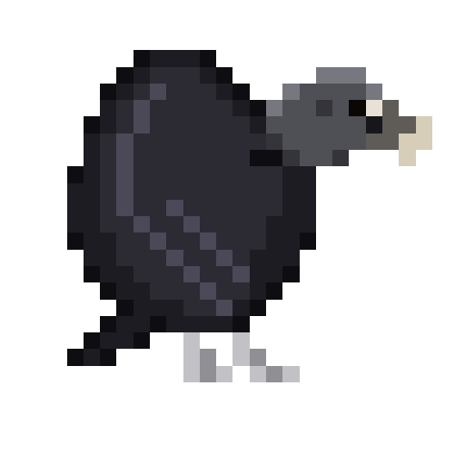

# Vults

**Your coding agents on one wire. Approvals, dictation, chat and GitHub within reach.**

[](https://github.com/rogeriojunior31/Vults/actions/workflows/ci.yml)
[](https://github.com/rogeriojunior31/Vults/releases/latest)
[](LICENSE)

-0078D6?logo=windows)


**English** · [Português (Brasil)](README.pt-br.md) <!-- check-english:allow (language name) -->

[Download](https://github.com/rogeriojunior31/Vults/releases/latest) · [Documentation](https://rogeriojunior31.github.io/en/docs/vults/) · [Changelog](CHANGELOG.md) · [Contributing](CONTRIBUTING.md)

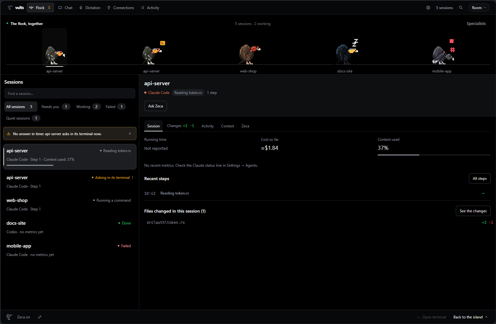

</div>

---

## What is Vults?

Vults is a free, open-source desktop companion for people who run coding agents. It sits at the top
of your screen and does four jobs:

- **It watches your agents.** Each Claude Code, Codex, OpenCode, Qwen Code, Copilot CLI, Cursor,
  Antigravity, Factory Droid, Kimi Code or Hermes session becomes an animated 8-bit vulture. You see
  who is working, who finished, who failed and who needs you, without switching terminals.
- **It brings their questions to you.** A permission card shows exactly what **Allow** authorizes:
  the whole command, the file, the plan. You answer with a click or a key, and every answer is kept
  in an audit trail.
- **It listens.** Hold a key and speak: local speech-to-text types into the app you are in, or copies
  the text. Voice commands, meetings and a voice conversation with Zeca are there when you want them.
- **It talks back.** **Zeca**, the black vulture, is a chat through the Claude Code or Codex login you
  already have, an API key or a local model. He knows your flock, your GitHub work and, if you let
  him, remembers.

> [!IMPORTANT]
> Vults never answers for you. A permission is answered by your click, a signed answer from your
> paired phone, an exact *Always* rule you made, or a policy you wrote and accepted. Destructive
> commands always ask. If anything fails, the agent asks in its own terminal as if Vults were not
> there.

> [!NOTE]
> Vults speaks **English**, **Brazilian Portuguese**, **Spanish** and **Simplified Chinese**. It
> follows your desktop's language; pick one in **Settings → General → Language**.

## Features

| | |
|---|---|
| 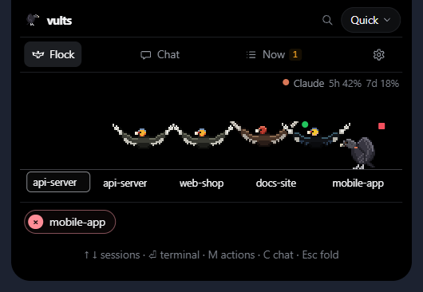 | **The island**<br>Your flock on one wire at the top of the screen: a bird per session, a species per project, a badge for what each one is doing. **Mini** shows only the birds, **Quick** opens the island to see and answer, **Room** and **Full** open the Nest. The Claude and Codex plan meters sit in the corner, and a tag shows any session that needs you or failed. [Guide](docs/guide/island.md) |
| 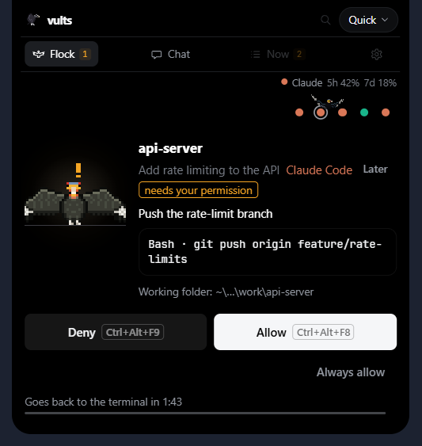 | **Permission cards**<br>When an agent asks to run a tool, the island opens on a card with the agent's own words, the whole command, file or URL, the lines an edit adds and removes, the folder it works in, and how long until it goes back to the terminal. **Deny**, **Allow** or **Always allow** this exact call, with the mouse or with a key. A card ignores clicks in its first moments, so a stray click never lands on Allow. [Guide](docs/guide/approvals.md) |
| 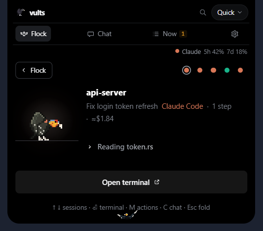 | **A session up close**<br>Pick a bird to see its project, the title Claude Code gave the session (or your `/rename`), its agent, steps and cost, what it is doing now, and **Open terminal** to bring its terminal, pane or editor forward. [Guide](docs/guide/island.md#getting-to-a-session) |
| 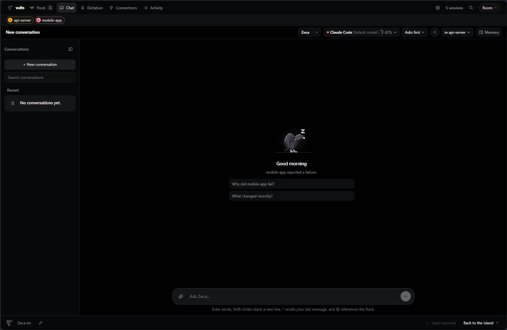 | **Chat with Zeca**<br>A chat through the Claude Code or Codex you already use, an API or a local model. Markdown, files, saved conversations, `@` references to your sessions and an access choice for what Zeca may do on his own. Specialist profiles give Claude Code or Codex a role, a look and pinned skills. [Guide](docs/guide/chat.md) |
| 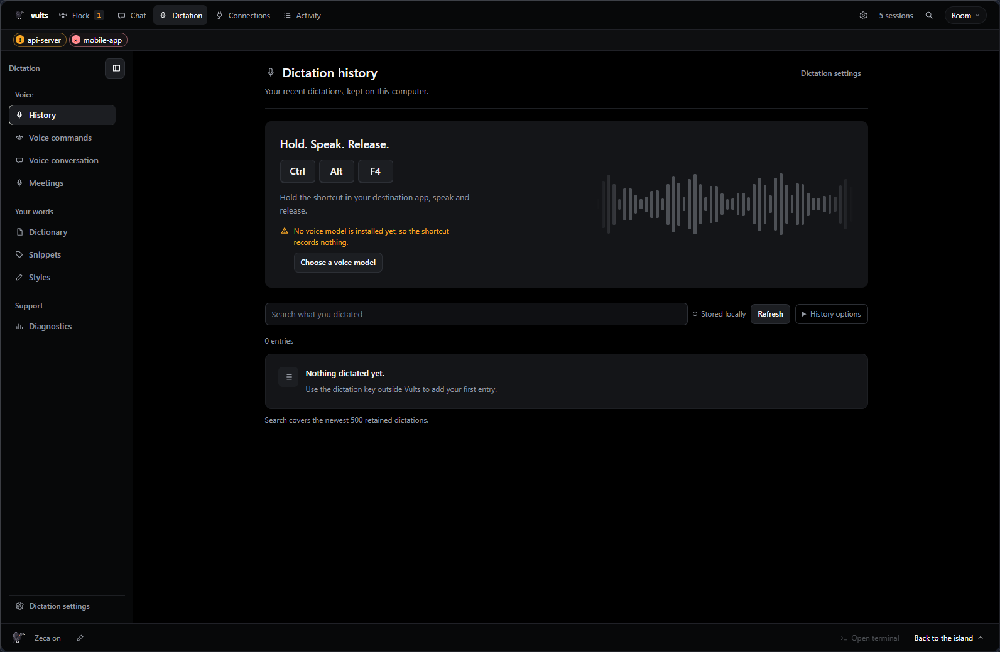 | **Dictation**<br>Hold the key, speak, release: local whisper.cpp transcription goes into the app you are in or onto the clipboard. A dictionary, snippets, spoken code, per-app styles, a searchable history and statistics. Voice commands and meeting notes live here too. [Guide](docs/guide/dictation.md) |
| 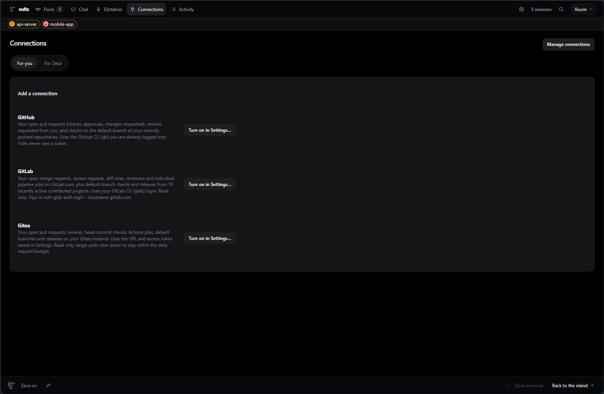 | **Connections**<br>Your GitHub pull requests, reviews and checks through the `gh` you are logged into, plus read-only GitLab and Gitea. News lands on the island; Zeca and specialists can read it when you say so, and any write asks first. [Guide](docs/guide/connectors.md) |
| 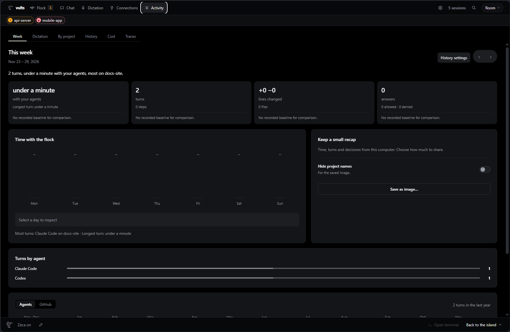 | **Activity**<br>Your week with the flock: time, turns, lines changed and answers, per day and per agent, plan usage and costs, and a recap you can save as an image, with project names hidden if you like. [Guide](docs/guide/activity.md) |
| 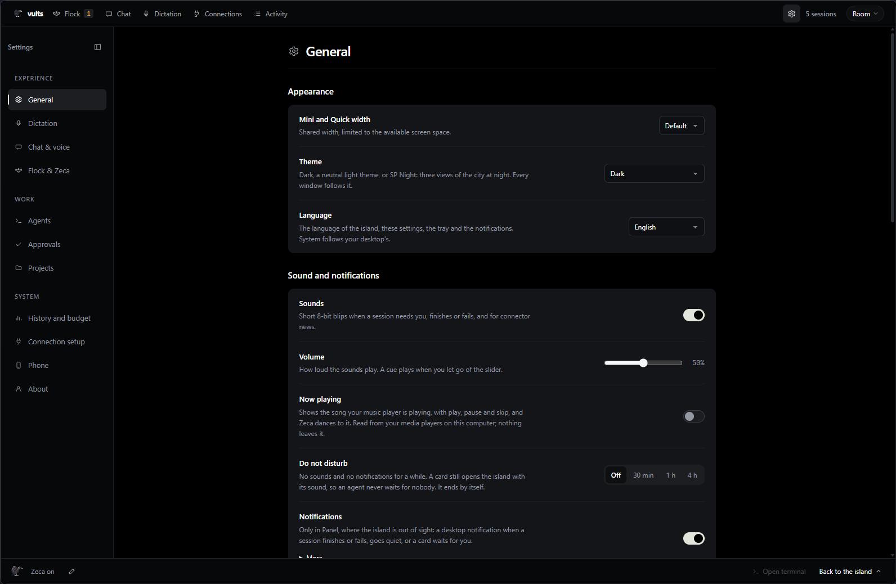 | **Settings**<br>Themes (Dark, Light and the three SP Night views of the city at night), languages, sounds and notifications, the flock's species and Zeca's look, agent setup with a diff and a dated backup, your approval rules and policies, history and budgets. [Reference](docs/reference/settings.md) |

### And also

- **Now:** what happened while you were away, in one list: requests that went back to the terminal,
  sessions that failed or finished, with a click to each.
- **Agent questions:** an agent can ask you a question in text (`ask_user`) and wait for your typed
  or dictated answer, never taken as a permission.
- **Live diffs:** a finished edit shows its lines on the session, and the Nest lists every file a
  session changed, with its counts.
- **Policies:** rules you write for a project or everywhere, shown as a diff before you accept them;
  a deny always beats an allow, and PowerShell and cmd count as shells too.
- **Memory:** an optional local journal of your days, with facts Zeca proposes and you accept in the
  Nest.
- **Phone (preview):** answer cards from a paired phone, signed by its key, through a relay.
- **Private by design:** no telemetry, secrets only in the OS keyring, and every request the app
  makes on its own behind its own switch, budget and local trace.

## Download and install

### Linux

Download the `.deb` or `.rpm` from the [latest release](https://github.com/rogeriojunior31/Vults/releases/latest)
and check it with `sha256sum -c SHA256SUMS --ignore-missing`. KDE Plasma, Hyprland, Sway and other
layer-shell compositors show the island at the screen's edge; GNOME uses an always-on-top window.
Arch source packages are in `packaging/aur/`.

### Windows (preview)

1. Download **`Vults_<version>_x64-setup.exe`** from the [latest release](https://github.com/rogeriojunior31/Vults/releases/latest).
2. Choose **Install just for me** (no administrator needed) or **Install for anyone using this
   computer**. Each user keeps their own settings and history either way.
3. Vults opens on the island and lives in the tray. **Settings → General → Start with the desktop**
   opens it when you sign in.

> [!WARNING]
> The installer is not code-signed yet, so Windows SmartScreen may say *"Windows protected your
> PC"*. Click **More info** and then **Run anyway**.

Meetings and the voice conversation with Zeca are still Linux-only. See
[Getting started](docs/getting-started.md) for dependencies, verification and silent installs.

## Getting started

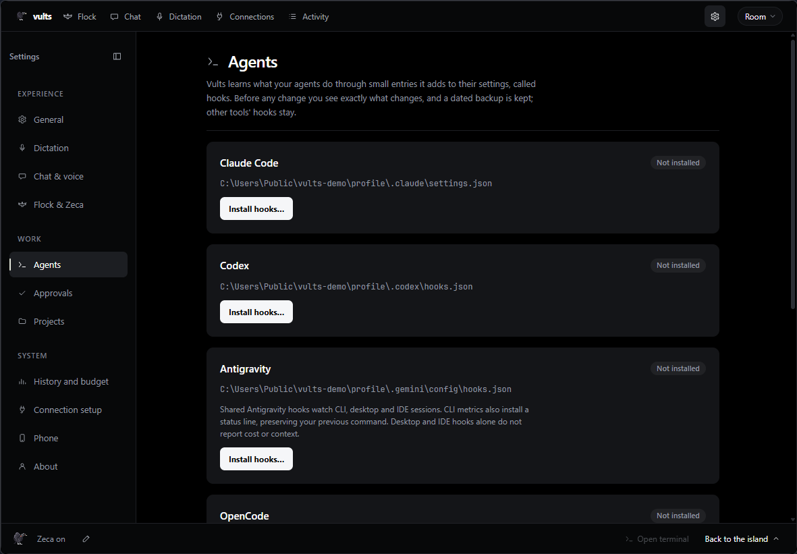

1. **Connect an agent.** Open **Settings → Agents** (or **Set up agents…** from the tray), pick
   **Install hooks…**, read the diff and write it. Vults keeps a dated backup and leaves other tools'
   hooks alone. Codex also asks you to trust the new hooks once in its own CLI.
2. **Work as usual.** Start your agent in any terminal or editor. Its bird lands on the wire; click
   it to see the session, and answer its cards as they come.
3. **Turn on only what you need.** A voice model under **Dictation**, a chat provider under
   **Settings → Chat & voice**, a repository under **Connections**. Everything that reaches the
   network is off until you turn it on.

### Shortcuts

| Action | Linux | Windows |
|---|---|---|
| Open the island with the keyboard | <kbd>Ctrl</kbd>+<kbd>Alt</kbd>+<kbd>Space</kbd> | <kbd>Ctrl</kbd>+<kbd>Alt</kbd>+<kbd>Space</kbd> |
| Allow / Deny the card in front | <kbd>Ctrl</kbd>+<kbd>Alt</kbd>+<kbd>Y</kbd> / <kbd>N</kbd> | <kbd>Ctrl</kbd>+<kbd>Alt</kbd>+<kbd>F8</kbd> / <kbd>F9</kbd> |
| Hold to dictate | <kbd>Ctrl</kbd>+<kbd>Alt</kbd>+<kbd>V</kbd> | <kbd>Ctrl</kbd>+<kbd>Alt</kbd>+<kbd>F4</kbd> |
| Hold for a voice command | <kbd>Ctrl</kbd>+<kbd>Alt</kbd>+<kbd>Z</kbd> | <kbd>Ctrl</kbd>+<kbd>Alt</kbd>+<kbd>F5</kbd> |
| Copy the last dictation again | <kbd>Ctrl</kbd>+<kbd>Alt</kbd>+<kbd>B</kbd> | <kbd>Ctrl</kbd>+<kbd>Alt</kbd>+<kbd>F6</kbd> |
| Cancel dictation or Chat voice | <kbd>Ctrl</kbd>+<kbd>Alt</kbd>+<kbd>X</kbd> | <kbd>Ctrl</kbd>+<kbd>Alt</kbd>+<kbd>F10</kbd> |
| Mini / Quick / Room | from the island | <kbd>Ctrl</kbd>+<kbd>Alt</kbd>+<kbd>F1</kbd> / <kbd>F2</kbd> / <kbd>F3</kbd> |
| Command palette, while Vults has focus | <kbd>Ctrl</kbd>+<kbd>K</kbd> | <kbd>Ctrl</kbd>+<kbd>K</kbd> |

On the island, <kbd>↑</kbd> <kbd>↓</kbd> move between sessions, <kbd>Enter</kbd> opens the session's
terminal and <kbd>Esc</kbd> folds it. Every key can be changed in Settings.

## Where your data lives

| What | Linux | Windows |
|---|---|---|
| Settings | `~/.config/vults/` | `%APPDATA%\Vults\` |
| History, memory, voice models, the hook relay | `~/.local/share/vults/` | `%LOCALAPPDATA%\Vults\` |
| API keys and tokens | Secret Service (the keyring) | Credential Manager, this computer only |

To take the hooks out of an agent, use **Remove hooks…** in **Settings → Agents**: the same diff, backup
and click as installing. See [Settings and files](docs/reference/settings.md) for every file.

## FAQ

<details>
<summary><b>Does Vults send my code or prompts anywhere?</b></summary>

No. The hooks talk to the app on your computer only, over a socket or named pipe that only your
account can open. Nothing goes out unless you turn on a feature that needs the network (a connector,
an API chat, web search, the phone relay), and each one has its own switch, budget and local trace.
There is no telemetry.
</details>

<details>
<summary><b>What happens if Vults crashes or is closed?</b></summary>

Your agents keep working. The hook exits at once with no answer, and each agent asks in its own
terminal as it always did.
</details>

<details>
<summary><b>Which agents can I answer from the island?</b></summary>

Claude Code, Codex, OpenCode, Qwen Code and Copilot CLI take answers from the island. Cursor,
Factory Droid, Hermes Agent and Kimi Code show on the wire but ask in their own prompt, and
so does Antigravity unless you turn on its **Approve commands from the island**: then its shell
commands that none of its own rules covers come to the island too. See the
[per-agent table](docs/guide/other-agents.md#what-each-agent-can-do).
</details>

<details>
<summary><b>Do I need Zeca?</b></summary>

No. Turn him off in **Settings → Flock & Zeca**: the flock, cards, notifications, connectors and
dictation keep working, and only the chat goes away.
</details>

<details>
<summary><b>Does dictation need the internet?</b></summary>

No. Speech is turned into text on your computer with whisper.cpp, on the GPU when there is one. Model
cleanup and translation styles are optional and use the provider you pick.
</details>

## Documentation

- **Start:** [Getting started](docs/getting-started.md) · [Agent support](docs/guide/other-agents.md)
- **Guides:** [Island](docs/guide/island.md) · [Nest](docs/guide/nest.md) · [Approvals](docs/guide/approvals.md) · [Chat](docs/guide/chat.md) · [Memory](docs/guide/memory.md) · [Dictation](docs/guide/dictation.md) · [Voice](docs/guide/voice.md) · [Meetings](docs/guide/meetings.md) · [Connections](docs/guide/connectors.md) · [Activity](docs/guide/activity.md) · [Phone](docs/guide/phone.md)
- **Reference:** [Settings and files](docs/reference/settings.md) · [Safety](docs/safety.md)
- **Development:** [Architecture](docs/contributing/architecture.md) · [Roadmap](docs/dev/ROADMAP.md) · [Changelog](CHANGELOG.md)

[Read the published documentation online](https://rogeriojunior31.github.io/en/docs/vults/). It
follows releases; the guides in this repository include unreleased changes.

## Building from source

On Linux, install `webkit2gtk-4.1`, `gtk3`, `gtk-layer-shell`, `libayatana-appindicator`, `openssl`,
`alsa-lib`, `gst-plugins-good` and `vulkan-icd-loader`, plus `cmake`, `vulkan-headers` and `shaderc`
to build. On Windows, see [Windows development](docs/contributing/windows-development.md).

```sh
git clone https://github.com/rogeriojunior31/Vults
cd Vults
npm install
npm run tauri dev        # the release hook first, then the UI and the app
cargo test --workspace
```

## Contributing

Bug reports, agent integrations, connectors and documentation are welcome. Start with
[CONTRIBUTING.md](CONTRIBUTING.md), the [Code of Conduct](CODE_OF_CONDUCT.md), and
[SECURITY.md](SECURITY.md) for private vulnerability reports.

## License

MIT. See [LICENSE](LICENSE) and the third-party attributions in [NOTICE](NOTICE).
