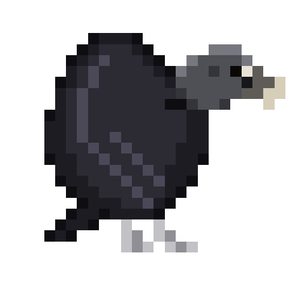
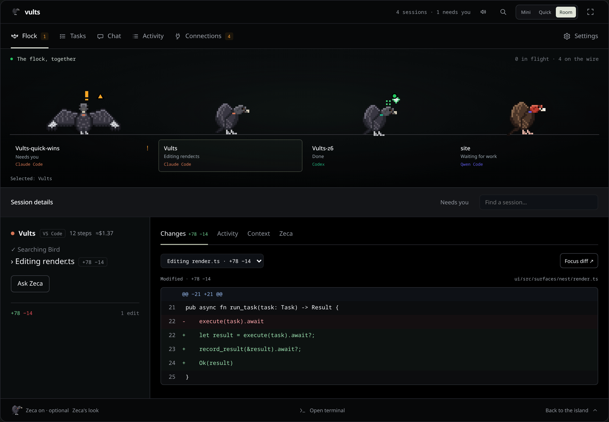
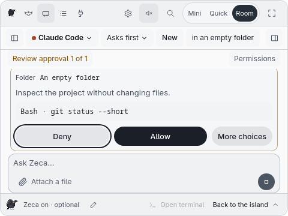
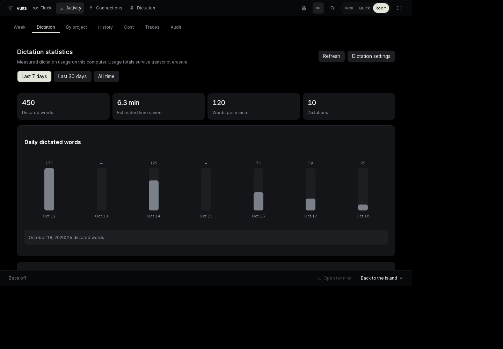

<!-- source: ca0cf7cb77b8 -->
<p align="center">
  
</p>

<h1 align="center">Vults</h1>

<p align="center">
  <strong>Seus agentes de programação no mesmo fio. Ditado, chat e GitHub à mão.</strong>
</p>

<p align="center">
  <a href="https://github.com/rogeriojunior31/Vults/actions/workflows/ci.yml"></a>
  <a href="https://github.com/rogeriojunior31/Vults/releases/latest"></a>
  <a href="https://rogeriojunior31.github.io/en/docs/vults/"></a>
  <a href="LICENSE"></a>
  
  
</p>

<p align="center"><a href="README.md">English</a> · <b>Português</b></p> <!-- check-english:allow (language name) -->

Acompanhe seus agentes de programação sem trocar de terminal. Cada sessão vira um urubu animado
em 8 bits: veja quem trabalha, quem terminou e quem precisa de você. Dite em outros aplicativos,
converse com o **Zeca** e acompanhe seu trabalho no GitHub pelo mesmo companheiro de desktop.
O Zeca é opcional.

[Recursos](#features) · [Capturas](#screenshots) · [Instalação](#installation) ·
[Primeiros passos](#quick-start) · [Suporte](#support) · [Documentação](#documentation)

<p align="center">
  <a href="docs/assets/island-flock.png"></a>
</p>

> **Estado da versão:** a versão publicada mais recente é a **0.1.8**. Este checkout inclui
> mudanças **Unreleased**, destinadas à **0.1.9**, sujeitas à validação no desktop e às verificações
> de lançamento. A tabela descreve este checkout; consulte o [changelog](CHANGELOG.md) para ver o
> que já foi lançado. As imagens são capturas existentes de versões anteriores; a navegação e os
> espaçamentos mudaram desde então.

<a id="features"></a>
## Recursos

| Quando você quer… | O que o Vults oferece | Guia |
| --- | --- | --- |
| Acompanhar vários agentes | Um urubu por sessão, espécies por projeto, estados de trabalho/conclusão/falha/espera, detalhes e diffs ao vivo | [Bando](docs/pt-br/guide/island.md) |
| Resolver interrupções em um lugar | Cartões de permissão e perguntas quando disponíveis, respostas pelo teclado, regras Sempre exatas, políticas revisadas e auditoria | [Aprovações](docs/pt-br/guide/approvals.md) |
| Voltar ao terminal certo | Ir ao painel ou à janela da sessão; continuar sessões compatíveis no Chat com controle de parada próprio | [Sessões e Chat](docs/pt-br/guide/chat.md#continuing-a-session) |
| Falar em vez de digitar em outro app | Ditado global local, cópia por padrão, rotas opcionais de inserção compatíveis, atalhos para cancelar e copiar o último texto | [Ditado](docs/pt-br/guide/dictation.md#global-dictation-first-slice) |
| Adaptar o ditado ao seu vocabulário | Dicionário, trechos, código falado, escolhas por app e estilos opcionais de revisão e tradução por modelo | [Suas palavras](docs/pt-br/guide/dictation.md#your-words-processing) |
| Controlar o bando e a reprodução por voz | Tecla separada de comando, reconhecimento local de frases e controles opcionais de reprodução/volume do reprodutor selecionado; interpretação natural por IA ainda planejada | [Comandos de voz](docs/pt-br/guide/dictation.md#voice-commands-development-status) |
| Encontrar e gerenciar o que ditou | Histórico local com busca, retenção, estatísticas de uso, configuração de microfone/modelo e diagnóstico | [Histórico de ditado](docs/pt-br/guide/dictation.md#dictation-history) |
| Pedir ajuda sem sair do desktop | Chat do Zeca pelo login existente da CLI Claude Code/Codex, API ou modelo local; Markdown, arquivos, conversas salvas e escolhas de acesso | [Chat](docs/pt-br/guide/chat.md) |
| Dar um papel consistente a um especialista | Criar ou copiar perfis com instruções, espécies, acessórios e skills fixadas; conversas de especialistas Claude Code ou Codex dentro do Chat | [Perfis de agentes](docs/pt-br/guide/chat.md#agent-profiles) |
| Preservar contexto entre conversas | Diário local opcional, recuperação de contexto e fatos propostos que você revisa antes de guardar | [Memória](docs/pt-br/guide/memory.md) |
| Acompanhar e agir no GitHub | Repositórios pelo seu login no gh, PRs, checks, revisões e escritas confirmadas explicitamente; acesso limitado por escopo para Desenvolvedor/Revisor | [GitHub](docs/pt-br/guide/connectors.md) |
| Transformar reuniões em notas pesquisáveis | Captura consentida de microfone/áudio do sistema, transcrição local, texto salvo, identificação manual de falantes, busca e exportação Markdown/SRT/VTT; resumos opcionais por modelo | [Reuniões](docs/pt-br/guide/dictation.md#meeting-recording) |
| Conversar em voz alta com o Zeca | Configuração separada, turnos manuais e rotas opcionais de microfone contínuo, com consentimento explícito e orçamento de API | [Conversa por voz](docs/pt-br/guide/dictation.md#voice-conversation-settings) |
| Rever sua semana e seus gastos | Atividade por projeto, uso disponível dos planos, custos, orçamentos e resumo compartilhável com opção de ocultar nomes de projetos | [Atividade](docs/pt-br/guide/activity.md) |
| Adaptar o Vults ao seu trabalho | Mini, Rápido, Sala e tela cheia; temas claro/escuro, quatro idiomas, notificações, controles de mídia opcionais e Zeca ligado/desligado | [Ninho](docs/pt-br/guide/nest.md) · [Configurações](docs/pt-br/reference/settings.md) |
| Responder longe do desktop | Protocolo de aprovação por celular pareado e relay, em prévia; o aplicativo Android ainda não está concluído | [Prévia do celular](docs/pt-br/guide/phone.md) |

<a id="screenshots"></a>
## Capturas

Clique em uma captura para abrir na resolução original. Elas ilustram fluxos individuais, não o
layout final da 0.1.9. Novas capturas para o lançamento ainda estão pendentes.

<details>
<summary>Veja o bando e inspecione uma sessão</summary>

[](docs/assets/nest-room.png)

[Guia: o Ninho](docs/pt-br/guide/nest.md). Layout anterior da Sala, incluindo a antiga aba de tarefas.

</details>

<details>
<summary>Revise uma permissão do Chat no tema claro</summary>

<p align="center"><a href="docs/assets/nest-chat-approval.png"></a></p>

[Guia: acesso do Chat](docs/pt-br/guide/chat.md#what-it-may-do). Layout compacto anterior do Chat.

</details>

<details>
<summary>Entenda seu uso do ditado</summary>

[](docs/assets/dictation-statistics.png)

[Guia: ditado](docs/pt-br/guide/dictation.md). As estatísticas agora ficam na área de Ditado.

</details>

<a id="installation"></a>
## Instalação

**Linux primeiro.** Baixe o `.deb` ou `.rpm` da
[versão mais recente](https://github.com/rogeriojunior31/Vults/releases/latest).
Confira o arquivo com `sha256sum -c SHA256SUMS --ignore-missing` na pasta de downloads.
No KDE Plasma e em outros compositores com layer-shell, a ilha fica na borda da tela; no GNOME,
é uma janela comum sempre no topo. As compilações Windows são prévias; o macOS fica para depois.

Os pacotes-fonte para Arch estão em `packaging/aur/` e ainda não foram publicados no AUR.
Para dependências, verificação e instalação, veja [Primeiros passos](docs/pt-br/getting-started.md).

Para executar o checkout atual de desenvolvimento, depois de instalar as dependências Linux documentadas:

```sh
git clone https://github.com/rogeriojunior31/Vults
cd Vults
npm install
npm run tauri dev
```

As CLIs dos agentes são instaladas separadamente. O GitHub usa `gh`; a fala local exige o download
de um modelo verificado. Chat, revisão e voz por API podem gerar cobranças do provedor.

<a id="quick-start"></a>
## Primeiros passos

1. **Conecte um agente.** Abra **Configurar agentes…** pelo ícone da bandeja. Revise o diff dos
   hooks e aprove a escrita. O Vults guarda um backup datado e preserva hooks de terceiros.
   No Codex, também é necessário confiar nos hooks instalados pela própria CLI.
2. **Comece a trabalhar.** Execute seu agente normalmente. Selecione seu urubu para inspecionar
   atividade, mudanças e cartões compatíveis. Comece no **Mini**; abra **Rápido** para uma interação
   curta ou **Sala** para o Ninho.
3. **Ative só o necessário.** Configure a fala local em **Ditado**, escolha um provedor de Chat ou
   adicione um repositório em **Conexões**. As abas do Ninho são **Bando**, **Chat**, **Ditado**,
   **Conexões** e **Atividade**; o Chat fica oculto quando o Zeca está desligado.

| Atalho padrão no Linux | Ação |
| --- | --- |
| Ctrl+Alt+Space | Abrir a ilha com foco no teclado |
| Ctrl+Alt+Y / Ctrl+Alt+N | Permitir / negar o cartão à frente |
| Segurar Ctrl+Alt+V | Ditado global para cópia ou destino habilitado explicitamente |
| Ctrl+Alt+X | Cancelar ditado ou voz do Chat |
| Ctrl+Alt+B | Copiar novamente o último ditado bem-sucedido |
| Segurar Ctrl+Alt+Z | Modo de comando de voz, separado do ditado |
| Ctrl+K, com o Vults em foco | Abrir a paleta de comandos |

O microfone do Chat grava no Chat; **Ctrl+Alt+V é ditado global**. A inserção depende do desktop e
do destino e nunca envia uma mensagem automaticamente.

<a id="support"></a>
## Suporte

Integrações incluídas: **Claude Code, Codex, Antigravity, OpenCode, Qwen Code, Copilot CLI, Cursor,
Factory Droid e Kimi Code**. Observar uma sessão, responder aos cartões e controlá-la são
capacidades diferentes: alguns agentes mantêm as aprovações no próprio terminal. Veja a
[tabela de capacidades por agente](docs/pt-br/guide/other-agents.md#what-each-agent-can-do).

Os especialistas atualmente executam pelo Claude Code ou Codex. A conversa por voz usa configuração
e orçamento próprios de API; a consulta por voz ao Codex não está disponível. Os fluxos do GitHub,
as rotas de voz e a nova UI ainda têm validações nativas pendentes no [roadmap ativo](docs/dev/ROADMAP.md).

<a id="safety-and-control"></a>
### Segurança e controle

- **Hooks não bloqueiam em caso de falha.** O hook termina com sucesso sem responder, deixando
  o agente perguntar no próprio terminal.
- **Você escolhe o acesso.** Cartões são respondidos por uma pessoa, regra Sempre exata, política
  aceita ou resposta assinada de celular pareado. O Chat também respeita o acesso selecionado;
  ações destrutivas continuam perguntando e negativas/perguntas de políticas continuam valendo.
  O Zeca nunca responde às aprovações do bando.
- **Revise mudanças de configuração.** Escritas nas configurações dos agentes exigem backup
  datado, diff e seu clique.
- **Controle seus dados.** Sem telemetria; segredos ficam no chaveiro do sistema. Recursos de rede
  exigem ativação própria e passam pelo controle de rede, orçamentos e registros locais.
  Transcrição local e processamento opcional por provedor são escolhas separadas. Veja
  [Segurança](docs/pt-br/safety.md).

<a id="documentation"></a>
## Documentação

| Seu objetivo | Comece aqui |
| --- | --- |
| Instalar e conectar um agente | [Primeiros passos](docs/pt-br/getting-started.md) · [Suporte de agentes](docs/pt-br/guide/other-agents.md) |
| Entender os fluxos do desktop | [Ilha](docs/pt-br/guide/island.md) · [Ninho](docs/pt-br/guide/nest.md) · [Aprovações](docs/pt-br/guide/approvals.md) |
| Configurar fala ou reuniões | [Ditado e voz](docs/pt-br/guide/dictation.md) |
| Trabalhar com Zeca e especialistas | [Chat](docs/pt-br/guide/chat.md) · [Memória](docs/pt-br/guide/memory.md) |
| Conectar GitHub ou rever atividade | [Conexões](docs/pt-br/guide/connectors.md) · [Atividade](docs/pt-br/guide/activity.md) |
| Configurar ou resolver problemas | [Configurações e arquivos](docs/pt-br/reference/settings.md) · [Segurança](docs/pt-br/safety.md) |
| Acompanhar o desenvolvimento | [Changelog](CHANGELOG.md) · [Roadmap](docs/dev/ROADMAP.md) · [Arquitetura](docs/pt-br/architecture.md) |

[Leia a documentação publicada online](https://rogeriojunior31.github.io/pt-br/docs/vults/).
Ela acompanha os lançamentos; os guias deste checkout incluem mudanças em desenvolvimento.

<a id="contributing"></a>
## Como contribuir

Relatos de bugs, integrações de agentes, conectores e melhorias na documentação são bem-vindos.
Veja [CONTRIBUTING.md](CONTRIBUTING.md), o [Código de Conduta](CODE_OF_CONDUCT.md) e
[SECURITY.md](SECURITY.md) para relatar vulnerabilidades em privado. Feito com Rust e Tauri.

<a id="license"></a>
## Licença

MIT. Veja [LICENSE](LICENSE) e as atribuições de terceiros em [NOTICE](NOTICE).
