<!-- source: 4b2b641924f0 -->
<div align="center">

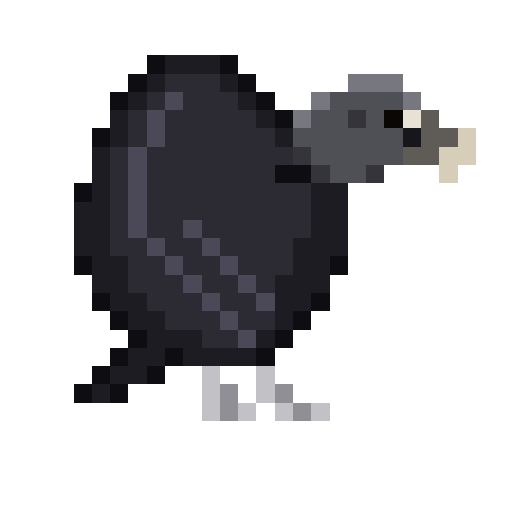

# Vults

**Seus agentes de programação no mesmo fio. Aprovações, ditado, chat e GitHub à mão.**

[](https://github.com/rogeriojunior31/Vults/actions/workflows/ci.yml)
[](https://github.com/rogeriojunior31/Vults/releases/latest)
[](LICENSE)

-0078D6?logo=windows)


[English](README.md) · **Português (Brasil)**

[Baixar](https://github.com/rogeriojunior31/Vults/releases/latest) · [Documentação](https://rogeriojunior31.github.io/en/docs/vults/) · [Changelog](CHANGELOG.md) · [Como contribuir](CONTRIBUTING.md)

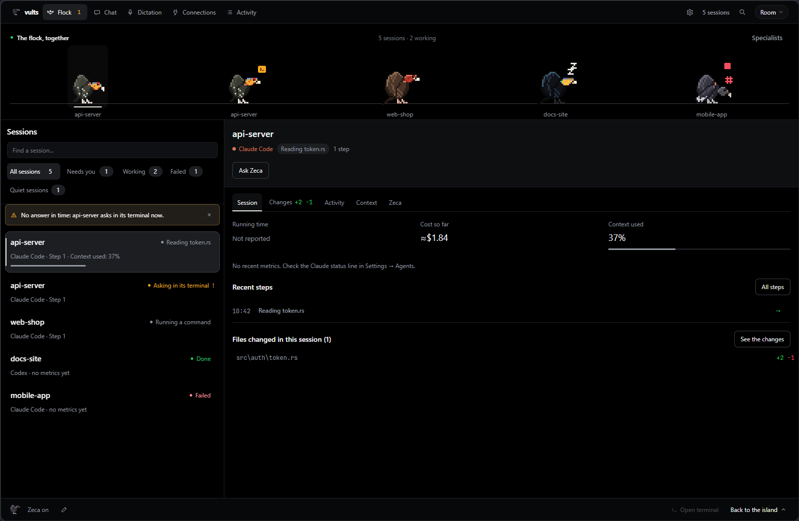

</div>

---

<a id="what-is-vults"></a>

## O que é o Vults?

O Vults é um companheiro de desktop livre e de código aberto para quem usa agentes de programação. Ele
fica no topo da tela e faz quatro coisas:

- **Ele observa seus agentes.** Cada sessão do Claude Code, Codex, OpenCode, Qwen Code, Copilot CLI,
  Cursor, Antigravity, Factory Droid, Kimi Code ou Hermes vira um urubu animado em 8 bits. Você vê
  quem está trabalhando, quem terminou, quem falhou e quem precisa de você, sem trocar de terminal.
- **Ele traz as perguntas deles até você.** Um card de permissão mostra exatamente o que **Allow**
  autoriza: o comando inteiro, o arquivo, o plano. Você responde com um clique ou uma tecla, e toda
  resposta fica numa trilha de auditoria.
- **Ele escuta.** Segure uma tecla e fale: a transcrição local escreve no app em que você está, ou
  copia o texto. Comandos de voz, reuniões e uma conversa por voz com o Zeca estão lá quando você
  quiser.
- **Ele responde.** O **Zeca**, o urubu-preto, é um chat pelo login do Claude Code ou do Codex que
  você já tem, uma chave de API ou um modelo local. Ele conhece seu bando, seu trabalho no GitHub e,
  se você deixar, lembra das coisas.

> [!IMPORTANT]
> O Vults nunca responde por você. Uma permissão é respondida pelo seu clique, por uma resposta
> assinada do seu celular pareado, por uma regra *Always* exata que você criou ou por uma política que
> você escreveu e aceitou. Comandos destrutivos sempre perguntam. Se algo falhar, o agente pergunta
> no próprio terminal como se o Vults não existisse.

> [!NOTE]
> O Vults fala **inglês**, **português do Brasil**, **espanhol** e **chinês simplificado**. Ele segue
> o idioma do seu desktop; escolha outro em **Settings → Appearance → Language**.

<a id="features"></a>

## Recursos

| | |
|---|---|
| 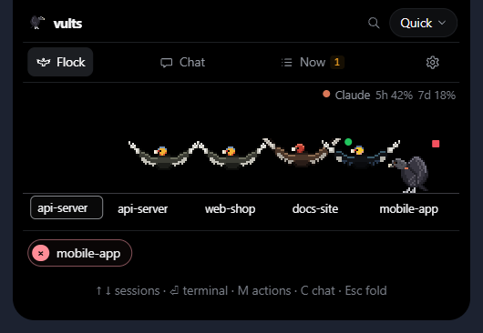 | **A ilha**<br>Seu bando num fio no topo da tela: um pássaro por sessão, uma espécie por projeto, um selo para o que cada um está fazendo. **Mini** mostra só os pássaros, **Quick** abre a ilha para ver e responder, **Room** e **Full** abrem o Nest. Os medidores do plano do Claude e do Codex ficam no canto, e uma etiqueta mostra qualquer sessão que precisa de você ou falhou. [Guia](docs/pt-br/guide/island.md) |
| 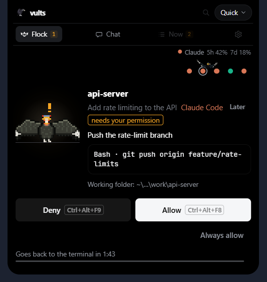 | **Cards de permissão**<br>Quando um agente pede para rodar uma ferramenta, a ilha abre num card com as palavras do próprio agente, o comando, arquivo ou URL inteiro, as linhas que uma edição adiciona e remove, a pasta em que ele trabalha e quanto falta para voltar ao terminal. **Deny**, **Allow** ou **Always allow** para essa chamada exata, com o mouse ou com uma tecla. Um card ignora cliques nos primeiros instantes, então um clique perdido nunca cai no Allow. [Guia](docs/pt-br/guide/approvals.md) |
| 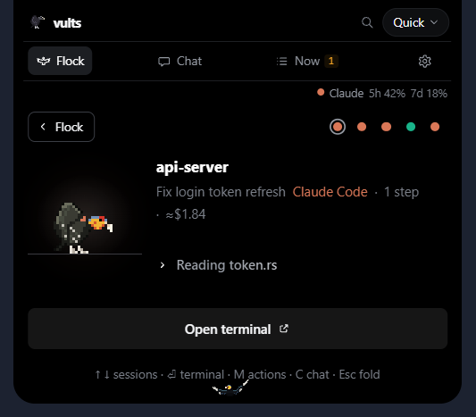 | **Uma sessão de perto**<br>Escolha um pássaro para ver o projeto, o título que o Claude Code deu à sessão (ou o seu `/rename`), o agente, os passos e o custo, o que ela está fazendo agora, e **Open terminal** para trazer o terminal, painel ou editor dela para a frente. [Guia](docs/pt-br/guide/island.md#getting-to-a-session) |
| 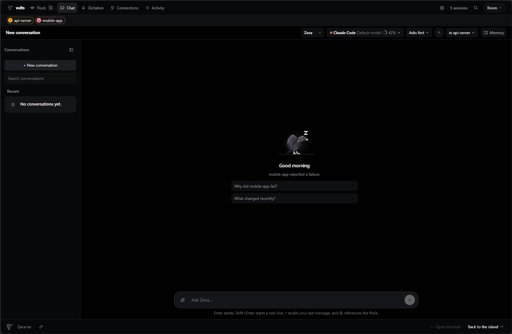 | **Chat com o Zeca**<br>Um chat pelo Claude Code ou Codex que você já usa, uma API ou um modelo local. Markdown, arquivos, conversas salvas, referências `@` às suas sessões e uma escolha de acesso para o que o Zeca pode fazer sozinho. Perfis de especialista dão ao Claude Code ou ao Codex um papel, uma aparência e skills fixas. [Guia](docs/pt-br/guide/chat.md) |
| 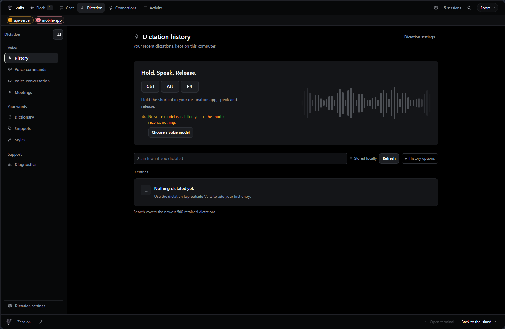 | **Ditado**<br>Segure a tecla, fale, solte: a transcrição local com whisper.cpp vai para o app em que você está ou para a área de transferência. Dicionário, trechos prontos, código falado, estilos por app, histórico pesquisável e estatísticas. Comandos de voz e notas de reunião também ficam aqui. [Guia](docs/pt-br/guide/dictation.md) |
| 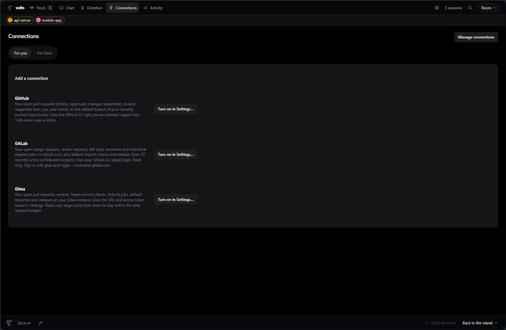 | **Conexões**<br>Seus pull requests, revisões e checks do GitHub pelo `gh` em que você já está logado, além de GitLab e Gitea só para leitura. As novidades chegam à ilha; o Zeca e os especialistas podem lê-las quando você deixar, e qualquer escrita pergunta antes. [Guia](docs/pt-br/guide/connectors.md) |
| 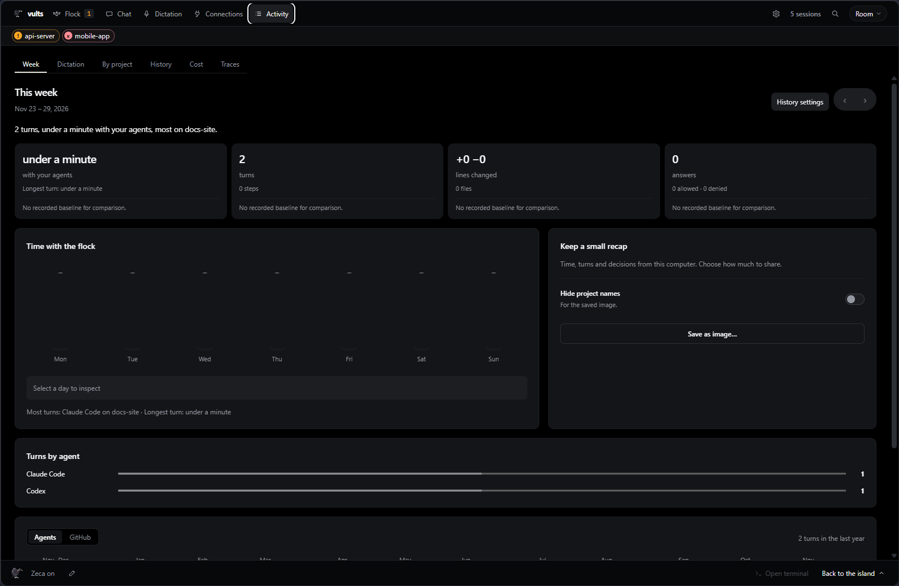 | **Atividade**<br>Sua semana com o bando: tempo, turnos, linhas alteradas e respostas, por dia e por agente, uso do plano e custos, e um resumo que você salva como imagem, com os nomes dos projetos escondidos se quiser. [Guia](docs/pt-br/guide/activity.md) |
| 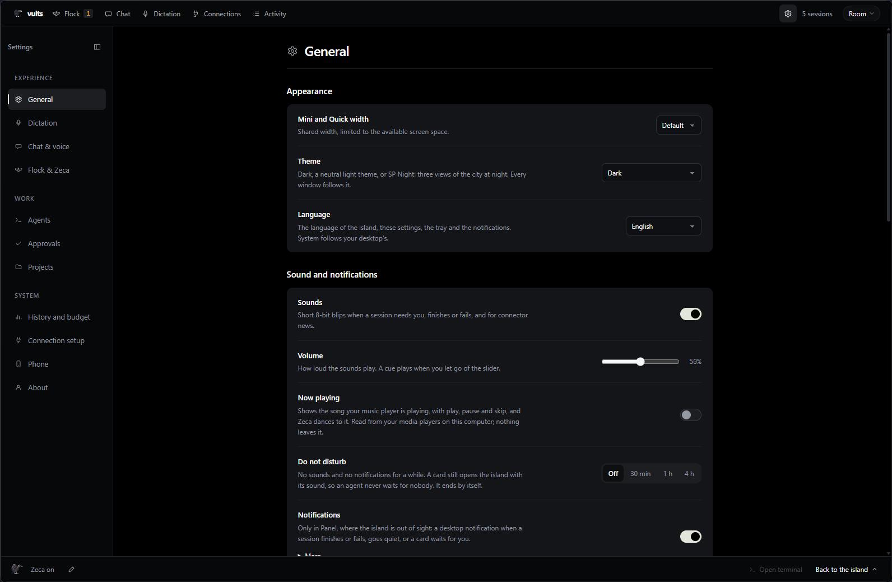 | **Configurações**<br>Temas (Dark, Light e as três vistas SP Night da cidade à noite), idiomas, sons e notificações, as espécies do bando e o visual do Zeca, a configuração dos agentes com diff e backup datado, suas regras e políticas de aprovação, histórico e orçamentos. [Referência](docs/pt-br/reference/settings.md) |

<a id="and-also"></a>

### E também

- **Now:** o que aconteceu enquanto você estava fora, numa lista só: pedidos que voltaram ao terminal,
  sessões que falharam ou terminaram, com um clique para cada uma.
- **Perguntas dos agentes:** um agente pode te fazer uma pergunta em texto (`ask_user`) e esperar sua
  resposta digitada ou ditada, nunca tomada como permissão.
- **Diffs ao vivo:** uma edição terminada mostra suas linhas na sessão, e o Nest lista cada arquivo que
  uma sessão alterou, com suas contagens.
- **Políticas:** regras que você escreve para um projeto ou para tudo, mostradas como diff antes de você
  aceitar; um deny sempre vence um allow, e PowerShell e cmd também contam como shells.
- **Memória:** um diário local opcional dos seus dias, com fatos que o Zeca propõe e você aceita no Nest.
- **Celular (prévia):** responda cards de um celular pareado, assinados pela chave dele, por um relay.
- **Privado por padrão:** sem telemetria, segredos só no chaveiro do sistema, e toda requisição que o
  app faz por conta própria atrás do próprio botão, orçamento e registro local.

<a id="download-and-install"></a>

## Baixar e instalar


### Linux

Baixe o `.deb` ou o `.rpm` da [última versão](https://github.com/rogeriojunior31/Vults/releases/latest)
e confira com `sha256sum -c SHA256SUMS --ignore-missing`. KDE Plasma, Hyprland, Sway e outros
compositores com layer-shell mostram a ilha na borda da tela; o GNOME usa uma janela sempre por cima.
Os pacotes-fonte do Arch estão em `packaging/aur/`.

<a id="windows-preview"></a>

### Windows (prévia)

1. Baixe o **`Vults_<versão>_x64-setup.exe`** da [última versão](https://github.com/rogeriojunior31/Vults/releases/latest).
2. Escolha **Install just for me** (sem precisar de administrador) ou **Install for anyone using this
   computer**. Cada usuário mantém as próprias configurações e histórico nos dois casos.
3. O Vults abre na ilha e fica na bandeja. **Settings → General → Start with the desktop** abre ele
   quando você entra no Windows.

> [!WARNING]
> O instalador ainda não tem assinatura de código, então o SmartScreen do Windows pode dizer *"O
> Windows protegeu o computador"*. Clique em **Mais informações** e depois em **Executar assim mesmo**.

Reuniões e a conversa por voz com o Zeca ainda são só do Linux. Veja os
[Primeiros passos](docs/pt-br/getting-started.md) para dependências, verificação e instalação
silenciosa.

<a id="getting-started"></a>

## Primeiros passos


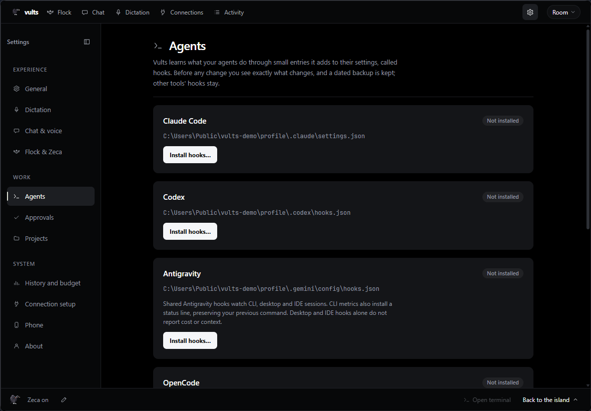

1. **Conecte um agente.** Abra **Settings → Agents** (ou **Set up agents…** na bandeja), escolha
   **Install hooks…**, leia o diff e grave. O Vults guarda um backup datado e não mexe nos hooks de
   outras ferramentas. O Codex também pede que você confie nos novos hooks uma vez, no próprio CLI.
2. **Trabalhe normalmente.** Inicie seu agente em qualquer terminal ou editor. O pássaro dele pousa no
   fio; clique nele para ver a sessão e responda os cards conforme chegam.
3. **Ligue só o que precisar.** Um modelo de voz em **Dictation**, um provedor de chat em
   **Settings → Chat & voice**, um repositório em **Connections**. Tudo que usa a rede fica desligado
   até você ligar.

<a id="shortcuts"></a>

### Atalhos


| Ação | Linux | Windows |
|---|---|---|
| Abrir a ilha pelo teclado | <kbd>Ctrl</kbd>+<kbd>Alt</kbd>+<kbd>Space</kbd> | <kbd>Ctrl</kbd>+<kbd>Alt</kbd>+<kbd>Space</kbd> |
| Allow / Deny no card da frente | <kbd>Ctrl</kbd>+<kbd>Alt</kbd>+<kbd>Y</kbd> / <kbd>N</kbd> | <kbd>Ctrl</kbd>+<kbd>Alt</kbd>+<kbd>F8</kbd> / <kbd>F9</kbd> |
| Segurar para ditar | <kbd>Ctrl</kbd>+<kbd>Alt</kbd>+<kbd>V</kbd> | <kbd>Ctrl</kbd>+<kbd>Alt</kbd>+<kbd>F4</kbd> |
| Segurar para um comando de voz | <kbd>Ctrl</kbd>+<kbd>Alt</kbd>+<kbd>Z</kbd> | <kbd>Ctrl</kbd>+<kbd>Alt</kbd>+<kbd>F5</kbd> |
| Copiar o último ditado de novo | <kbd>Ctrl</kbd>+<kbd>Alt</kbd>+<kbd>B</kbd> | <kbd>Ctrl</kbd>+<kbd>Alt</kbd>+<kbd>F6</kbd> |
| Cancelar o ditado ou a voz do Chat | <kbd>Ctrl</kbd>+<kbd>Alt</kbd>+<kbd>X</kbd> | <kbd>Ctrl</kbd>+<kbd>Alt</kbd>+<kbd>F10</kbd> |
| Mini / Quick / Room | pela ilha | <kbd>Ctrl</kbd>+<kbd>Alt</kbd>+<kbd>F1</kbd> / <kbd>F2</kbd> / <kbd>F3</kbd> |
| Paleta de comandos, com o Vults em foco | <kbd>Ctrl</kbd>+<kbd>K</kbd> | <kbd>Ctrl</kbd>+<kbd>K</kbd> |

Na ilha, <kbd>↑</kbd> <kbd>↓</kbd> passam de uma sessão a outra, <kbd>Enter</kbd> abre o terminal da
sessão e <kbd>Esc</kbd> recolhe. Toda tecla pode ser trocada nas Configurações.

<a id="where-your-data-lives"></a>

## Onde ficam seus dados


| O quê | Linux | Windows |
|---|---|---|
| Configurações | `~/.config/vults/` | `%APPDATA%\Vults\` |
| Histórico, memória, modelos de voz, o relay dos hooks | `~/.local/share/vults/` | `%LOCALAPPDATA%\Vults\` |
| Chaves de API e tokens | Secret Service (o chaveiro) | Gerenciador de Credenciais, só neste computador |

Para tirar os hooks de um agente, use **Remove hooks…** em **Settings → Agents**: o mesmo diff, backup
e clique da instalação. Veja [Configurações e arquivos](docs/pt-br/reference/settings.md) para cada
arquivo.

<a id="faq"></a>

## Perguntas frequentes


<details>
<summary><b>O Vults manda meu código ou meus prompts para algum lugar?</b></summary>

Não. Os hooks falam só com o app no seu computador, por um socket ou named pipe que só a sua conta
abre. Nada sai a não ser que você ligue um recurso que precisa da rede (uma conexão, um chat por API,
busca na web, o relay do celular), e cada um tem o próprio botão, orçamento e registro local. Não há
telemetria.
</details>

<details>
<summary><b>O que acontece se o Vults travar ou for fechado?</b></summary>

Seus agentes continuam trabalhando. O hook sai na hora sem resposta, e cada agente pergunta no próprio
terminal, como sempre fez.
</details>

<details>
<summary><b>Quais agentes eu posso responder pela ilha?</b></summary>

Claude Code, Codex, OpenCode, Qwen Code e Copilot CLI aceitam respostas da ilha. Cursor, Factory
Droid, Hermes Agent e Kimi Code aparecem no fio mas perguntam no próprio prompt, e o Antigravity
também, a não ser que você ligue o **Approve commands from the island** dele: aí os comandos de shell
que nenhuma regra dele cobre também vêm para a ilha. Veja a
[tabela por agente](docs/pt-br/guide/other-agents.md#what-each-agent-can-do).
</details>

<details>
<summary><b>Eu preciso do Zeca?</b></summary>

Não. Desligue ele em **Settings → Zeca**: o bando, os cards, as notificações, as conexões e o
ditado continuam funcionando, e só o chat some.
</details>

<details>
<summary><b>O ditado precisa de internet?</b></summary>

Não. A fala vira texto no seu computador com o whisper.cpp, na GPU quando existe uma. A limpeza por
modelo e os estilos de tradução são opcionais e usam o provedor que você escolher.
</details>

<a id="documentation"></a>

## Documentação


- **Começo:** [Primeiros passos](docs/pt-br/getting-started.md) · [Agentes suportados](docs/pt-br/guide/other-agents.md)
- **Guias:** [Ilha](docs/pt-br/guide/island.md) · [Nest](docs/pt-br/guide/nest.md) · [Aprovações](docs/pt-br/guide/approvals.md) · [Chat](docs/pt-br/guide/chat.md) · [Memória](docs/pt-br/guide/memory.md) · [Ditado](docs/pt-br/guide/dictation.md) · [Voz](docs/pt-br/guide/voice.md) · [Reuniões](docs/pt-br/guide/meetings.md) · [Conexões](docs/pt-br/guide/connectors.md) · [Atividade](docs/pt-br/guide/activity.md) · [Celular](docs/pt-br/guide/phone.md)
- **Referência:** [Configurações e arquivos](docs/pt-br/reference/settings.md) · [Segurança](docs/pt-br/safety.md)
- **Desenvolvimento:** [Arquitetura](docs/contributing/architecture.md) · [Roadmap](docs/dev/ROADMAP.md) · [Changelog](CHANGELOG.md)

[Leia a documentação publicada online](https://rogeriojunior31.github.io/en/docs/vults/) (em inglês). Ela segue
as versões publicadas; os guias deste repositório incluem mudanças ainda não lançadas.

<a id="building-from-source"></a>

## Compilar a partir do código


No Linux, instale `webkit2gtk-4.1`, `gtk3`, `gtk-layer-shell`, `libayatana-appindicator`, `openssl`,
`alsa-lib`, `gst-plugins-good` e `vulkan-icd-loader`, além de `cmake`, `vulkan-headers` e `shaderc`
para compilar. No Windows, veja [Desenvolvimento no Windows](docs/contributing/windows-development.md).

```sh
git clone https://github.com/rogeriojunior31/Vults
cd Vults
npm install
npm run tauri dev        # primeiro o hook de release, depois a UI e o app
cargo test --workspace
```

<a id="contributing"></a>

## Como contribuir


Relatos de bugs, integrações de agentes, conexões e documentação são bem-vindos. Comece pelo
[CONTRIBUTING.md](CONTRIBUTING.md), pelo [Código de Conduta](CODE_OF_CONDUCT.md) e pelo
[SECURITY.md](SECURITY.md) para relatar vulnerabilidades em particular.

<a id="license"></a>

## Licença


MIT. Veja a [LICENSE](LICENSE) e as atribuições de terceiros no [NOTICE](NOTICE).
