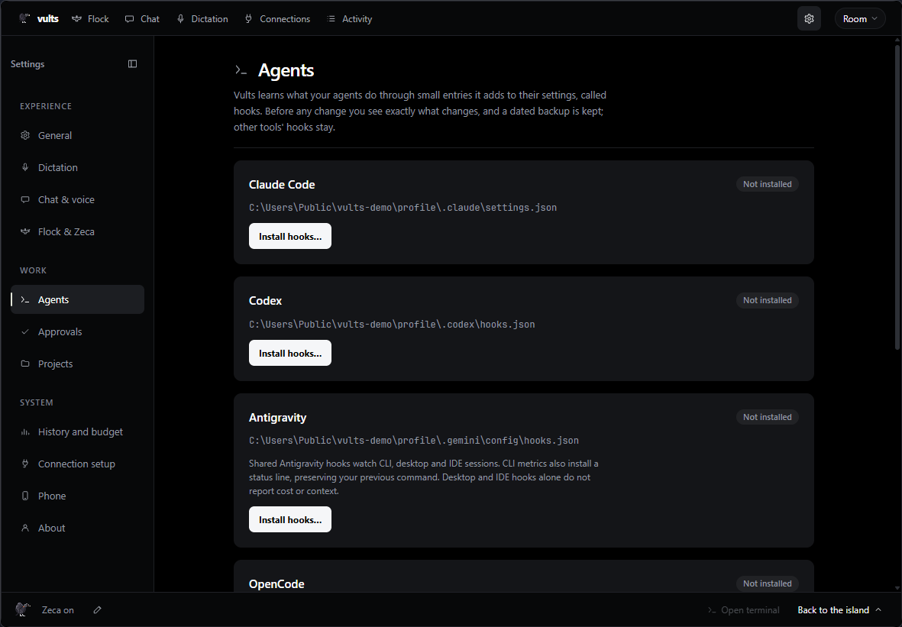

# Getting started

## Install

Releases ship a `.deb` and an `.rpm` (Ubuntu 22.04, Debian 12, Fedora and newer) and a preview
installer for Windows (meetings, talking with Zeca, typing into terminals and a few other
features are still Linux-only). There is no AppImage for now. Get them from the
[latest release](https://github.com/rogeriojunior31/Vults/releases/latest) and check a download
with `sha256sum -c SHA256SUMS --ignore-missing`. To check that it was built by this repository's
release workflow: `gh attestation verify <file> --repo rogeriojunior31/Vults`.

On Arch Linux, build the package with `makepkg`: `packaging/aur/vults` builds the latest release,
`packaging/aur/vults-git` follows `main`. Both build from source, so the first install takes a
while. They are not on the AUR yet.

```sh
git clone https://github.com/rogeriojunior31/Vults
cd Vults/packaging/aur/vults && makepkg -si
```

Or build from source:

```sh
git clone https://github.com/rogeriojunior31/Vults
cd Vults
npm install
npm run tauri dev        # run it
npm run bundle:linux     # or build the .deb and .rpm into target/release/bundle/
```

Linux needs `webkit2gtk-4.1`, `gtk3`, `gtk-layer-shell`, `libayatana-appindicator`, `openssl`,
`alsa-lib`, `libpulse`, `gst-plugins-good` (WebKitGTK plays the island's sounds through GStreamer) and the
Vulkan loader (building also needs `cmake`, the Vulkan headers and `glslc`). On KDE Plasma,
Hyprland, Sway and other compositors with layer-shell, the island sits on the top edge like a panel;
on GNOME it is a regular always-on-top window. **Settings → General → Start with the desktop** opens
Vults when you log in.

### On Windows

The Windows installer is a preview. To build Vults on Windows, see
[Windows development](contributing/windows-development.md).

The installer asks whether to install Vults for you only or for every user of the computer.
**Install just for me** goes to `%LOCALAPPDATA%\Programs\Vults` and never needs an administrator;
a standard account always installs this way. **Install for anyone using this computer** goes to
`%ProgramFiles%\Vults` and needs an administrator. On an administrator account, Windows asks for
approval (UAC) when the installer opens, whichever you choose. Either way each user keeps their own
settings, hooks and history in `%LOCALAPPDATA%\Vults`, and Vults installs that user's hooks on its
first run. An update keeps the earlier choice and folder. For a silent install, run the installer
with `/S` and `/CURRENTUSER` or `/ALLUSERS` (the latter from an elevated prompt).

Windows shortcuts use non-printing keys to preserve AltGr: **Ctrl+Alt+Space** opens the island;
**Ctrl+Alt+Left/Right** changes the session; **Ctrl+Alt+F1/F2/F3** selects Mini/Quick/Room;
**Ctrl+Alt+F4** records dictation; **Ctrl+Alt+F5** records a voice command; **Ctrl+Alt+F6** copies
the last dictation again; **Ctrl+Alt+F8/F9** allows/denies the visible card;
**Ctrl+Alt+F10** cancels dictation and Chat voice. A key already
owned by another application is left unbound. Settings shows only successful registrations.

Change Windows keys in **Settings → Keyboard shortcuts** (also available in Dictation's
keys section). Choose the modifiers and key for each action, or **Disabled**, then **Apply shortcuts**.
Changes take effect immediately and persist across restarts. **Restore defaults** stages the original
combinations; apply them explicitly. A conflict or save failure keeps the previous active bindings.
Windows/typing keys, Escape, Delete and F12 are excluded. The OS can detect other registered global
shortcuts; an application's private/local shortcuts cannot be detected. If a choice interferes with
one of those, disable it or choose another combination here. Linux retains its desktop shortcut editor.

Meetings, talking with Zeca, agent questions over MCP, the specialists' GitHub tools, typing into
terminals and most apps, and terminal tabs for *Open terminal* are still Linux-only.

## Connecting your agents

Open **Set up agents…** from the tray icon and click **Install hooks…** next to an agent. You see the
file that will change, the exact diff, and a **Write the file** button; a dated backup is taken
first, and hooks from other tools are kept. **Remove hooks…** takes out only what Vults added.



| Agent | File | After installing |
|---|---|---|
| Claude Code | `~/.claude/settings.json` | Nothing: new sessions report to the island |
| Codex | `~/.codex/hooks.json` | Open Codex, type `/hooks` and trust the Vults hooks (Codex runs a hook only when it is trusted and on); Settings shows how many still wait. A reinstall asks again |
| Antigravity | `~/.gemini/config/hooks.json` | Nothing ([it asks in its own terminal](guide/other-agents.md#antigravity)) |
| OpenCode | `~/.config/opencode/plugins/vults.js`, a plugin of ours | Restart OpenCode ([its cards](guide/approvals.md#opencode)) |
| Hermes Agent | `~/.hermes/plugins/vults/` on Linux; `%LOCALAPPDATA%\hermes\plugins\vults\` on Windows (`HERMES_HOME` overrides either) | Enable with `hermes plugins enable vults`; open a new CLI session ([details](guide/other-agents.md#hermes-agent)) |
| Qwen Code | `~/.qwen/settings.json` | Restart Qwen Code ([its cards](guide/approvals.md#qwen-code)) |
| Copilot CLI | `~/.copilot/hooks/vults.json`, a file of ours | Restart Copilot CLI ([its cards](guide/approvals.md#copilot-cli)) |
| Cursor | `~/.cursor/hooks.json` | Restart Cursor ([it asks in its own prompt](guide/other-agents.md#cursor)) |
| Factory Droid | `~/.factory/settings.json` | Restart Droid ([it asks in its own prompt](guide/other-agents.md#factory-droid)) |
| Kimi Code | `~/.kimi-code/config.toml` | Restart Kimi ([it asks in its own prompt](guide/other-agents.md#kimi-code)) |

With `CLAUDE_CONFIG_DIR`, `CODEX_HOME`, `QWEN_HOME`, `COPILOT_HOME`, `FACTORY_HOME_OVERRIDE`,
`KIMI_CODE_HOME` or `XDG_CONFIG_HOME` set, the file in that folder is used
([details](reference/settings.md#agent-configs-vults-edits)). Antigravity's is always
`~/.gemini/config/hooks.json`: `GEMINI_CLI_HOME` does not move it.

Other tools (Pi…) can report too, with a few lines in their own config: see
[Other agents](guide/other-agents.md).

### Coming from Vultures AI

Vults was called Vultures AI up to 0.1.5; on its first start it moves the old folders, keyring entry
and login entry to the new names, and the `.deb` and `.rpm` replace the old package. Then click
**Update hooks…** next to each agent in **Set up agents…** (Codex asks for its trust again).

## Keys

On Linux, from anywhere: **Ctrl+Alt+Space** opens the island and hands it the keyboard,
**Ctrl+Alt+Y** / **Ctrl+Alt+N** allow or deny the card in front, **Ctrl+Alt+J** / **Ctrl+Alt+K**
put the next or previous session in front, and holding **Ctrl+Alt+V** talks to Zeca
([all of them](guide/island.md#getting-to-a-session)).

## Language

Vults speaks English, Brazilian Portuguese, Spanish and Simplified Chinese. It follows your
desktop's language; **Settings → Appearance → Language** picks another for the island, Settings, the
tray and the notifications. What your agents say stays in their own words.

## Next

- [The island](guide/island.md): the flock, folded and open, getting to a session
- [Approving from the island](guide/approvals.md)
- [Activity](guide/activity.md)
- [Other agents](guide/other-agents.md)
- [The Nest](guide/nest.md): the whole flock, chat, records and connections
- [Chatting with Zeca](guide/chat.md)
- [Zeca's memory](guide/memory.md)
- [Connectors](guide/connectors.md)
- [The phone](guide/phone.md)
