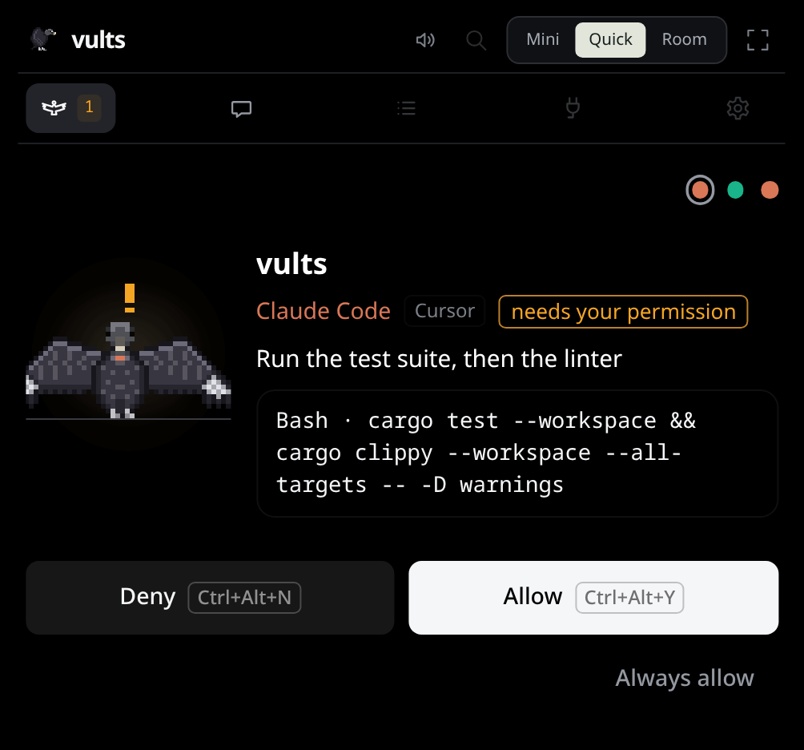
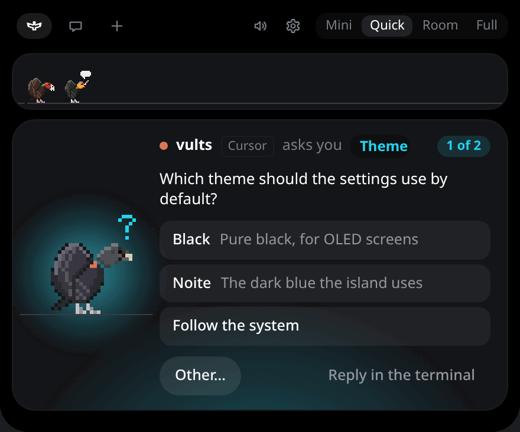

# Approving from the island

When Claude Code, Codex, OpenCode or Qwen Code asks permission for a tool call, the island opens on a
card that shows exactly what **Allow** authorizes (Gemini CLI and Antigravity are the exceptions,
[below](#gemini-cli)):

- the agent's own words for it, when it gives them (*Run the test suite, then the linter*);
- the whole command, file or URL, not just the tool's name. A long command shows in full (up to four
  lines, then it scrolls);
- for an edit, the lines it adds and removes (**+12 −3**). Codex patches show their files and counts
  too.



The card takes the whole width of the island until you answer. Then it says what happened for a
moment (**Allowed** in green, **Denied** in red) before the next thing shows.

## Answering

- **Allow** and **Deny** answer the agent directly; it carries on at once.
- **Ctrl+Alt+Y** and **Ctrl+Alt+N** do the same from anywhere, without leaving your window. They are
  global shortcuts through the desktop portal, so Linux only (the Windows preview has none): KDE asks
  you once to accept them, and **System Settings → Shortcuts** changes the keys. The buttons show the
  keys actually bound. A shortcut only answers a card on screen; with nothing waiting, it does
  nothing.
- In *Panel* mode the island is out of sight, so a card also shows as a desktop notification. Its
  **Open** brings the island up on the card; it has no Allow or Deny
  ([notifications](island.md#desktop-notifications)).
- While the app is *Paused* ([presence](island.md#presence-how-much-it-shows)) no card shows: the
  agent asks in its terminal at once, and neither *Always* rules nor [policies](#policies) answer.
- **Always allow** allows the request and every identical one from then on: the same agent, tool
  and exact command, file or URL, in the same project folder. `cargo test` does not cover
  `cargo test && rm -rf build`, nor the same command in another project. Those requests are answered
  without a card, and the step says *always allowed*; an identical request already waiting is
  answered too. **Settings → Approvals** lists every rule, and
  **Remove** takes one away. A command of more than one line, or over 300 characters, offers no
  **Always allow**: a rule would only see its start.
- Only you answer: with a click or a shortcut now, or earlier with **Always allow** or a
  [policy](#policies) you accepted. No timer or default ever approves anything.

## Policies

A policy answers cards for you: you write it in **Settings → Approvals → Policies**, see it as a
diff against the one in place, and accept it with a click. One policy per project folder, plus one
for everywhere; a newer one replaces the older. **Revoke** turns it off at once, and its cards ask
again. For now a policy **allows** only Claude Code's calls, the one agent whose cards show the
whole call (the others' shells run in a folder the card leaves out); for Codex, OpenCode and Qwen
Code it can deny or ask. Agents whose permissions get no card (Gemini CLI, Antigravity) are not
answered by one, nor is Zeca's chat.

```
# Lines that start with # are notes.
project ~/Projects/site
agents claude codex
allow read
allow write
allow command git status
allow command git diff *
deny external
ask tool WebFetch
```

- `project` sets the folder it holds in (and below); without it, it holds everywhere. `agents`
  limits it to some agents; without it, every built-in agent.
- `allow`, `deny` or `ask`, then a class (`read`, `read-external`, `write`, `external`), `command`
  and its words (a last `*` lets more words follow), or `tool` and a tool's exact name (a shell or
  an MCP tool only with `deny` or `ask`).
- A destructive action (`rm`, a forced push, a redirect over a file) always asks: no line can
  answer it.
- A deny beats an ask, and an ask beats an allow, across every policy that holds; a deny beats an
  older **Always allow** too. A `deny` or `ask` line covers whatever follows its words, `*` or not,
  and a command holding its first two words anywhere (`git --no-pager push`, or a bare `git push`,
  under `deny command git push origin main`) is never allowed. It names one program: `deny command
  curl` says nothing about `wget`. `deny tool Bash` stands for every agent's shell.
- An allow needs Vults to know what the action does: an MCP tool, an unknown tool or command, an
  interpreter, a build or a test (`cargo test` runs the project's code) always ask, and so do the
  git commands that run the repository's hooks (`commit`, `merge`, `rebase`, `pull`, `push`,
  `checkout`, `switch`, `cherry-pick`, `revert`, `am`, `worktree`, `clone`). So does a
  command with a shell symbol, quote, glob or tab, a long or multi-line command, and a card whose
  target is cut. **Always allow** still covers one exact command.
- An allow reaches only the session's folder: the one Vults saw it start in, never `/` or your
  home folder, and nothing once the agent moved out of it (a session Vults first saw later, after a
  restart, gets no allow). A path outside it, one that climbs (`..`), several paths in one target,
  or a write under `.git` asks. An allowed command's words name no absolute path, URL, `@file`,
  `..`, `.git` or option glued to a path, so a fetch with a URL always asks.
- A broad line covers all its class: `allow external` covers `git push`, `gh pr merge`,
  `gh workflow run`, `gh gist create` and other actions beyond this computer Vults knows, including
  ones that send a file from the folder out; `allow write` covers every known write that can be
  undone. Prefer `command` lines.
- An answer by a policy shows no card; the step says *allowed by your policy*, and the audit log
  names the policy's consent ([Safety](../safety.md)).
- Editing a policy so it names another folder revokes the one you edited when you accept; the
  review says so.
- What it can't see: links. A symlink inside the folder that leads outside it reads as inside. And
  `allow write` lets the agent change files that run later, when you or a tool run them (a
  `Makefile`, `.envrc`, `package.json`'s scripts). A
  policy is a row in your local database: another program running as you could add one, as it could
  change any of your files.

## More than one at a time

Requests wait in line, each for its own agent. The card shows the first one with **1 of 3**; the
sessions behind it wear an amber badge in the habitat. Answer one and the next
comes up.

To answer one further back first, click **Open** on its notification (in *Panel*) or its bird in
the corner widget: its card comes to the front, keeping its own deadline. Muted and hidden projects
([per project](island.md#per-project-mute-pin-hide)) still get their cards and sounds.

A question half answered starts over when another card comes in front of it. A card whose agent
moved on is not brought forward, but a subagent working in parallel does not take a card away. When
one agent asks for two calls at once, answering the first leaves the second waiting.

## When nobody answers

A request waits as long as its agent does (a little under two minutes); meanwhile the terminal says
*Waiting for your answer on the island*. During the last 30 seconds the card counts down, *Goes back
to the terminal in 0:25*, and then the terminal asks as if Vults were not there. If you answer in the
terminal instead, the card says so and goes away.

While it waits, a card climbs a ladder, so a card you missed reaches you:

1. It opens the island, with its sound (in *Panel*, with a desktop notification too, if
   notifications are on).
2. Its sound plays again at 45, 75 and 105 seconds.

**Do not disturb** (**Settings → General**, for 30 minutes, 1 hour or 4 hours) silences the sounds
and notifications of everything at rest, and this ladder's reminders, until it ends by the clock (a
suspend does not stretch it). A moon in the island's header says it is on; a click on it ends it. A
card still opens the island with its sound (and in *Panel* its notification): nothing hides a card an
agent is waiting on.

If the app is closed or not responding, the hook answers nothing within milliseconds and every agent
asks in its terminal as usual.

<a id="auto-mode-and-questions"></a>

## Claude Code's auto mode

In auto mode the classifier clears most requests in a blink, so the island only shows a card, plays
a sound or opens for a request still waiting after a moment. The same goes for "finished": only a
session that stays done is news.

## Questions

When Claude Code or OpenCode asks you something with choices (Claude Code's `AskUserQuestion` tool,
OpenCode's `question` tool), the island opens on a question card:



- One question at a time, with its tag (**Theme**) and **1 of 2** when it asks several.
- A click on a choice answers it. When several may be picked, tick them and press **Next** (or
  **Send** on the last one).
- **Other…** opens a field for your own words; **Enter** sends it, **Escape** goes back.
- **Reply in the terminal** puts the question back in the agent's terminal. Until then, or until the
  card runs out of time, Claude Code waits for the island.
- **Ctrl+Alt+Y** and **Ctrl+Alt+N** never answer a question.

This needs Claude Code 2.1.85 or later and hooks installed by this version. Older hooks show
**Update available** in **Settings → Agents**; until you update them, the island shows the question
and takes you to the terminal, as it does for Gemini CLI and Qwen Code.

## Gemini CLI

Gemini's hooks can block a tool but not approve one: its own confirmation always runs, so a Gemini
session never gets a card. When Gemini asks, its bird shows the question (*Run rm -rf dist? Answer in
Gemini's terminal.*) and you answer there.

## OpenCode

OpenCode's permissions and [questions](#questions) get a card through the plugin **Settings →
Agents → OpenCode** writes (checked with OpenCode 1.18.35 and 2.0.26). OpenCode's own prompt stays
up meanwhile: answer on the island or in OpenCode, and the first answer wins; the card goes away
when you answer in OpenCode.

- **Allow** is OpenCode's *Allow once*; **Deny** its *Reject*. **Always allow** is a Vults rule:
  OpenCode's own *Always*, which would change its settings, is never used.
- Some questions stay in OpenCode's prompt: all of them in OpenCode 2, which lets no plugin answer
  them, and in OpenCode 1 those with more than four choices or more than four at once. The island
  shows that one waits there.
- With no click in time, the app closed or an outdated plugin (**Update plugin…** in **Settings →
  Agents**), OpenCode simply waits in its own prompt.

## Qwen Code

Qwen Code's permissions get a card through the hooks **Settings → Agents → Qwen Code** installs
(checked with Qwen Code 0.25.0). Qwen reads the same answer as Claude Code, so **Allow**, **Deny**
and **Always allow** work as they do there.

- While the card is up, Qwen shows only its spinner; with no click in time, or the app closed, it
  asks in its own prompt.
- Its questions (`ask_user_question`) stay in its terminal: Qwen takes no hook answer to them. The
  island shows that it waits there.
- Cards come up in Qwen's *default* approval mode (**Shift+Tab** in Qwen, or
  `qwen --approval-mode default`); a new install starts in *auto*, where its own classifier decides. In *yolo* Qwen approves
  everything, so no card comes up.

## Antigravity

Antigravity asks its permissions in its own terminal, and the island never answers them: its bird
shows the steps ([Other agents](other-agents.md#antigravity)).
