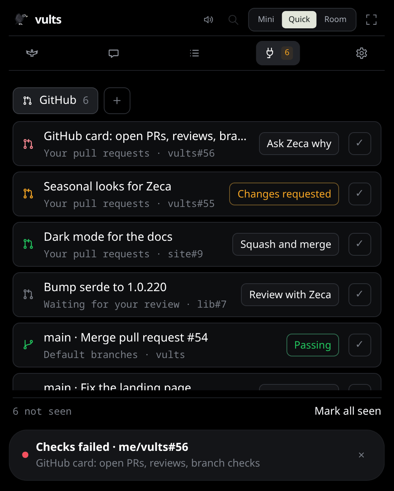

# Connectors

Connectors put news from outside services on the island. Each one is off until you switch it on in
**Settings → Connectors**.

## GitHub

Every five minutes it checks, and every minute while CI checks are still running:

- your open pull requests: checks failed or passed, approved, changes requested;
- pull requests where your review is requested;
- the checks on the default branch of the ten repositories you own that were pushed most recently.

It uses the GitHub CLI you are already logged into (`gh auth login`), so Vults never sees a token.
The first check only learns how things are; alerts start with the next change. Click an alert to
open it on GitHub, × to dismiss it. Passing checks replace a failure, and a newer review decision
the older one.

After an error it tries again in 15 minutes for a GitHub rate limit, 10 when `gh` is missing or
signed out, and 4 to 15 (doubling) otherwise. Opening the island or the card checks sooner when the
last check is over a minute old, except under a rate limit. GitHub is checked at most 3,000 times a
day; past that, **Settings → Connectors** says **Budget spent**. A repository GitHub cannot answer
for (say, behind SAML sign-in) leaves the rest showing.

### The GitHub card

Once GitHub has answered, the open island has a GitHub tab beside Flock, Chat and Drop:

- **Your pull requests**, most recently updated first: a dot for the checks (green passing, amber
  running, red failing) and the review (*Approved* or *Changes requested*);
- **Waiting for your review**;
- **Default branches**: the latest commit on each, with how its checks went. Repositories without
  checks are left out.

Click a row to open it on GitHub. When a pull request is merged or closed, or a review request
withdrawn, its alerts go with it.

When a check fails, the card keeps what it last saw and shows when it last updated, and the error.
While a permission card waits, the GitHub tab is dimmed until it is answered.

What the last check saw (the titles, links and check states the card shows, nothing else) is kept
in `connectors/github.json` in the app's data folder (`~/.local/share/vults/` on Linux), so a
restart does not alert again about old news.

Want another service? See [Adding a connector](../contributing/connectors.md).
