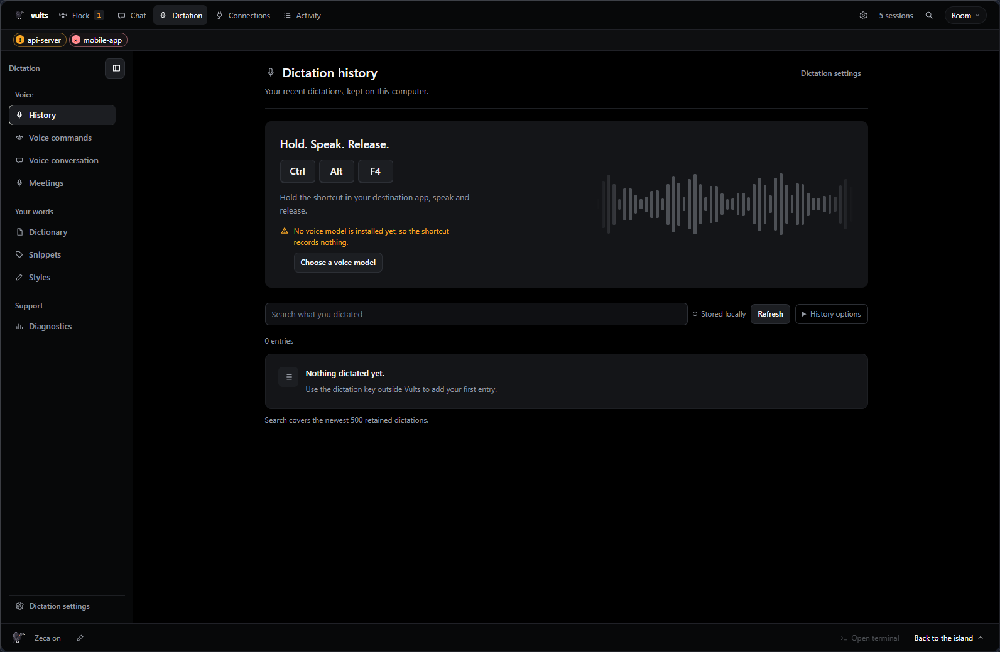
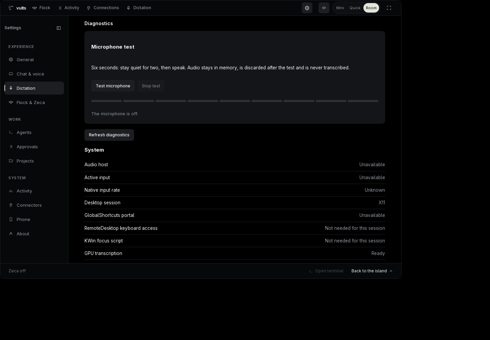

# Dictation

Speak and your words become text in whatever app you were using. Everything runs on this
computer: the speech model is local, audio stays in memory, and nothing is ever sent with Enter.
Dictation works with Zeca on or off.

Voice commands and talking with Zeca have their own page, [Voice](voice.md); recording a meeting
is [Meetings](meetings.md).

## First dictation

1. Open **Settings > Dictation > Voice** and install a speech model. *Small* is a good start; on a
   computer with a GPU (Vulkan), *Turbo* is faster and more accurate.
2. Accept the desktop's request for the global shortcuts. **Settings > Keyboard shortcuts > Dictation**
   shows the keys actually bound, once dictation has a voice model.
3. Click in the app where you want the text, **hold Ctrl+Alt+V**, speak, and release.
4. Wait for **Copied**, then paste (Ctrl+V, or Ctrl+Shift+V in a terminal).

A short capsule at the bottom of the screen shows the microphone, the sound bands while you speak,
and the result. It never takes focus or clicks, and it hides whenever a permission card appears.

## Dictate into any app

| Key | What it does |
| --- | --- |
| **Ctrl+Alt+V** | Hold for at least 300 ms, speak, release. Two short taps keep recording hands-free until the next tap |
| **Ctrl+Alt+X** | Cancel the dictation, even while it is transcribing |
| **Ctrl+Alt+B** | Copy the last dictation again |

- **Hold only** (in **Settings > Keyboard shortcuts > Dictation**) turns off the double tap.
- On X11, **Space** while holding also locks hands-free, and **Esc** cancels. Both can be turned off.
  On Wayland use the double tap and Ctrl+Alt+X.
- Saying **cancel** or **never mind** at the end (*cancela*, *deixa pra lá*, *déjalo*) discards the <!-- check-english:allow -->
  dictation. Turn **Cancel by voice** off if you need to dictate those words.
- The key always starts dictation, even over a Vults window. To dictate into Chat's draft, use the
  microphone button in Chat.
- Recording stops at ten minutes. Quiet or very short audio produces no text.

## Where the text goes

By default the text is **copied**, and you paste it. **Settings > Dictation > Paste > Insert
dictation in supported editors and tmux panes** (off by default) lets Vults paste for you, only
where it can check the destination:

| Destination | X11 | Plasma Wayland |
| --- | --- | --- |
| KWrite, GNOME Text Editor, Mousepad, Leafpad | Pasted | Pasted, after you grant keyboard access |
| A flock session in tmux, inside XTerm/UXTerm or Kitty | Typed into that exact pane | Same, with keyboard access |
| Everything else (Firefox, Kate, Konsole, IDEs, Vults) | Copied | Copied |

The result tells you what happened: **Copied** (the clipboard holds the text), **Pasted** (Ctrl+V
was sent to the app you were in) or **In session** (tmux accepted the text). None of them means the
app saved, sent or ran anything.

Vults never pastes if the focus changed, never sends Enter, and never types into a session that is
waiting on a card. A multi-line text goes to a terminal only through the clipboard.

**Automatic paste, in detail.** Pasting borrows the clipboard: your previous text comes back after
about 0.7 s, unless you copied something new meanwhile. Only plain text up to 64 KiB is restored,
not images. On Wayland the desktop asks once for keyboard access (RemoteDesktop portal, keyboard
only); its token stays in the system keyring, and turning the switch off removes it. Copied
dictation asks clipboard managers that honor it (Klipper does) to keep it out of their history.

## Your words

- **Dictionary**: names and words to spell your way (`Vults`, `kubectl`).
- **Replacements**: what you say → what is written (`cloud code` → `Claude Code`). Case and
  separators are ignored; whole words only.
- **Snippets**: a short trigger that expands to a fixed text, line breaks included (a signature).
- **Try a sentence** applies your rules to a typed sentence without recording or copying anything.

Rules apply in this order: snippets are protected, replacements run in your order, dictionary
spellings are fixed, spoken code is converted, snippets expand. Edits during a recording apply to
the next one.

**Help the model with these words** and **Project vocabulary** (Settings > Dictation > Vocabulary,
off by default) also pass your words and your Git projects' names to the model. That only helps
with *Turbo* in English; replacements and snippets work with every model.

## Spoken code

In a terminal or a flock session, `src slash main dot rs` becomes `src/main.rs`. The words for
`.` `/` `_` `-` `:` are *dot, slash, underscore, dash, colon* (also in Portuguese and Spanish).
Other apps keep the words. Turn it off in **Settings > Dictation > Paste > Spoken code**.

## Styles and text clean-up

Optionally, a model can tidy the text after it is transcribed. **Dictation > Styles**, **Clean up
with a model** is off by default; it uses the API provider chosen in **Settings > Agents**
(a local Ollama or LM Studio works too). Only text is sent, never audio.

| Style | Result |
| --- | --- |
| As spoken | Your words, with your local rules; no model |
| Natural | Without hesitations and repetitions |
| Polished | Full sentences, written punctuation |
| Prompt | An instruction for an agent, organized, never answered |

Terminals and editors default to As spoken, mail to Polished, chat apps to Natural; **Style per
app** changes that. **Write in** can translate the result. If the model fails or takes too long,
you get the local text. There are at most 2,000 requests a day.

## Music while you speak

While you dictate, playing music is lowered to 25 % (the default), paused, or left alone
(**Settings > Dictation > Voice > Music while you speak**). It comes back when you stop. On Windows
the choices are pause or leave it.

## History

**Dictation** in the Nest lists what you dictated, by day, with search. **Details** shows what was
heard next to what was written. Each entry can be copied, used again (copied as the last
dictation) or deleted; **History options** erases everything.

**Settings > Dictation > Privacy > Keep dictation history**: *Do not keep*, 7 days, **30 days**
(the default), 1 year or always. History keeps text only, never audio or your previous clipboard.
Word counts and time saved are in [Activity > Dictation](activity.md#dictation-statistics).

## Diagnostics

**Dictation > Diagnostics** checks the setup without recording: the microphone and its format,
the shortcuts, the keyboard grant on Wayland, the GPU and the speech detector.

**Test microphone** records six seconds: two quiet, four speaking. It reports the background noise,
a weak or missing signal and clipping, then discards the audio. The timing table shows how long
transcription, text processing, clean-up and delivery take (p50 and p95 of recent dictations).

## If something goes wrong

| You see | Do this |
| --- | --- |
| No text | Check the model in **Voice**, then run **Test microphone** |
| **Copied** but you expected **Pasted** | The app is not in the table above, the focus moved, or keyboard access is missing |
| An error instead of Copied on Wayland | Your desktop lacks the clipboard protocol (`ext-data-control`); Plasma has it |
| The shortcut does nothing | **Keyboard shortcuts** shows *Not bound*: bind it in the desktop settings (**Change in KDE…**) |

When you report a problem, include the desktop, the model and language, the result you saw and the
step that failed. The dictated text is not needed.
