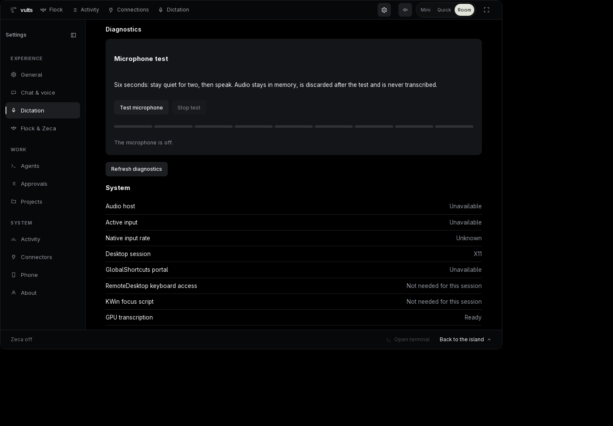

# Dictation

The N3 development build provides local dictation to the clipboard, with optional paste into
supported native X11 or Plasma Wayland text editors and exact tmux flock panes. It includes
measured island feedback, searchable History, Dictionary/Snippets, Activity statistics and
Settings with Diagnostics. Nothing is submitted automatically. Features shown only in the separate
approved prototype are not enabled here.

Model sources, licenses and the experimental meeting installer are documented in
[Meeting model artifacts](../reference/meeting-models.md).

## Voice available today

Use [Chat's voice input](chat.md#speaking-instead-of-typing) after choosing a local model in **Dictation > Voice**.
Each Chat recording keeps up to one minute of audio in memory. The preview and final transcript
use the same local model; you review the draft before sending it.

The shared audio capture now converts input to mono at 16 kHz, keeps a bounded buffer and reports
a device or capture failure instead of silently returning incomplete audio. This change adds no
automatic model downloads.

Speech detection filters brief noise and keeps short pauses inside a phrase. In tap-to-talk,
Chat still waits about 1.5 seconds of silence after speech before finishing; silence before
you speak does not end the recording.

By default, the preview and final transcript share a local text filter. Runs of six or more repeated
words or phrases are reduced to one occurrence (units up to 60 characters); shorter repetitions
are kept. Known sound annotations are removed while other bracketed text stays intact.
A standalone silence artifact such as "Thank you.", "Obrigado." or "Gracias." is omitted,
even if intentionally spoken; longer sentences containing those words are kept. You can edit
the draft before sending it. This filter uses no model or network request.

## Voice conversation settings

Open **Dictation > Talk with Zeca** to prepare realtime voice. The model and budget are separate
from Chat and your CLI subscription. **Configure OpenAI key** opens the shared key settings; keys
stay in the system keyring. This configuration page does not record or send audio.

Voice is off by default. Review the OpenAI audio/context destination, choose a supported model and
set the rolling 24-hour USD limit before enabling it. Use a decimal point or comma, with up to six
decimal places and no thousands separators. Zero disables remote voice; enabling requires a
positive limit. Unsettled requests retain their reserved cost.

Edit the choices and click **Save**. Vults reads them back before confirming the save. A failure
keeps your draft; **Discard edits and reload** explicitly replaces it with saved settings. Changes
made elsewhere block saving stale edits until you reload. Leaving the page preserves unsent edits.
Voice never answers a permission card, and Codex consultation remains unavailable. See
[Realtime accounting](../reference/realtime-accounting.md#runtime-transport).

## Manual voice turns

On Linux, open **Dictation > Work > Voice conversation** after enabling voice and installing a
local model under **Voice**. Use **Start recording**, speak, then **Finish recording** to stop the
microphone, transcribe locally and request Zeca's response. After playback finishes, the microphone
stays off. **Record another turn** continues the same conversation and provider context; **End
conversation** closes it. A local command also returns to this waiting state. Each following
recording requires your click. A provider error or timeout ends the session. This manual entry
does not use the global dictation shortcut or barge-in.
Recording is capped at 30 seconds; reaching the cap discards it rather than sending automatically.
The combined local capture/transcription wait is limited to 60 seconds.

Once Zeca's audio starts playing, **Stop response** replaces Finish recording. It stops the spoken
reply without ending the conversation or opening the microphone. The page waits for the interrupted
reply's heard-text result before offering **Record another turn**; remote truncation and the next
upload use the existing acknowledgement/repair path. Unheard words are excluded from the displayed
reply. Duplicate/late clicks cannot stop a new generation or start capture. During generation before
audible output, **Cancel** still ends the whole session. This is a click control; interruption by
speaking over Zeca uses the separate opt-in continuous routes below.

Optionally select **Finish automatically after a pause** before Start. It starts off when the app
opens and is frozen for that conversation. It uses the installed local speech detector and GPU
transcription preview; it downloads nothing. Confirmed speech, local partial words and fresh audio
are required. The policy waits 1.6 seconds of detected silence, or 2.6 seconds after an English/
Portuguese continuation word; detection/decoding may add latency. Final local transcription still
runs after the microphone closes. This choice alone does not enable the optional semantic model.
A Linux x64 GNU developer build with `voice-semantic` can separately offer **Use local semantic turn
detection (preview)**. It starts off for each conversation and needs explicitly provisioned checked
files; the app downloads nothing. It may wait up to 1.2 seconds beyond the silence policy. A failure
shows **Semantic finish is unavailable. This conversation uses local silence detection.** and
keeps that fallback for following turns. Ordinary builds do not offer the preview. See
[Semantic turn model](../reference/semantic-turn-model.md#conversation-preview-integration).

If the detector or preview is unavailable/fails, the page says **Automatic finish is unavailable.
Use Finish recording.** Manual Finish and Cancel remain available. Empty input and the 30-second
limit never trigger an automatic send. Automatic finish does not reopen the microphone: each next
turn still requires **Record another turn**.

**Cancel**, **End conversation**, leaving the page, hiding/closing the Nest, lock or changed settings cancels owned work.
Lost page contact also stops admission after three seconds. A native worker that is still exiting
may temporarily keep voice busy. Cancellation cannot undo an already submitted remote request or
its charge. Voice uses the configured API model and independent budget, not a CLI subscription.

If remote voice fails with local words available, **Review recovered text** offers an editable,
unsent draft. **Copy text** copies only on your click. Nothing is sent to Chat or executed from
that draft. Your edits survive leaving and returning to this page. Starting a new recording
replaces the previous recovered draft after Start is acknowledged. The page retains only the
most recent reply/recovery in memory, not a saved conversation history. The active provider session
retains remote conversation context until it ends.

Microphone/speech quality, live-provider acceptance and interruption remain separate validation
steps before K8 is complete. This entry does not activate Codex consultation or answer permissions.

## Continuous microphone routes

**Microphone mode** defaults to **Manual turns**. For interruptions by voice, choose
**Continuous microphone with headphones** or **Continuous microphone with echo cancellation**.
Click **Refresh audio devices**, explicitly choose the microphone/output or installed AEC pair,
then confirm that the microphone may remain open until you end this conversation. Device names
never prove headphone use. Wear headphones for that mode; AEC needs a compatible pair configured
outside Vults. The app only reads the inventory: it changes no defaults and installs no modules.
The reviewed inventory expires after five minutes; refresh it if starting fails.

**Start recording** opens the chosen route and starts the first turn. During Zeca's audible reply,
confirmed local speech may interrupt him and start another recording with its retained onset.
**Finish recording** still sends each turn; scratch interruption words never become commands or
provider input. Local final transcription uses the same stream, not a second microphone. The
30-second recording cap still discards rather than automatically sending. Automatic pause finish
is unavailable in these modes. Device changes are locked during the conversation.

The microphone stays open during local transcription, Zeca's reply and the waiting state; the page
says so. After normal playback or **Stop response**, only **Record another turn** starts another
recording. **End conversation**, Cancel, departure, lost page contact, lock, changed configuration
or lost route authority cancels the owner. A new conversation needs fresh confirmation. Stop
response itself never starts capture. The same final-transcript router, remote truncation
acknowledgements, heard-prefix history and next-turn repair apply. Voice never answers permissions.

The controls and native owners are covered with controlled fixtures. Real microphone/headphone/AEC
quality and a live provider still require physical acceptance before K8 is complete.

## Global dictation (first slice)

For a first dictation, choose a model, focus your destination, hold the talk shortcut, speak and
release. Wait for **Copied**, then paste there. Automatic insertion is a separate choice and
only supports the destinations below; it never sends Enter.

Choose and install a local voice model in **Dictation > Voice**. The desktop asks for the
new global shortcut bindings; **Dictation > Keyboard shortcuts** shows the actual
bindings and updates when you change them in the desktop settings. **Change in KDE…** opens
KDE System Settings > Shortcuts through its installed desktop entry. If that entry is missing
or cannot launch, the page offers retry; other desktops use their own shortcut settings. Vults
does not edit desktop bindings itself. Suggested keys:

- **Ctrl+Alt+V**: hold for at least 300 ms, speak and release. Capture keeps the
  last 600 ms before local transcription. Two short taps, the second within 400 ms of the first
  release, keep recording hands-free; the next tap finishes. A single short tap is discarded.
- **Ctrl+Alt+X**: cancel dictation or Chat voice, including dictation that is already transcribing.
- **Ctrl+Alt+B**: copy the last successful dictation again. It does not interrupt an active turn.

The shortcut always starts independent dictation, including with a Vults window focused. It never
opens Chat or starts its microphone. Use the microphone button in Chat to dictate into its draft.
An active dictation keeps its owner if focus moves. The separate microphone diagnostic starts only
with **Test microphone**. Independent dictation works with Zeca on or off.
In **Dictation > Keyboard shortcuts**, choose **Hold + double tap** (the default)
or **Hold only**. Hold only discards short taps immediately; a second tap starts a fresh hold.
Space-lock remains an independent choice even in Hold only mode. **Space locks recording** and
**Esc cancels dictation** default on and can be changed on X11; their controls are unavailable
on Wayland. With Space-lock off, Space acts like other typing and can discard a held recording.
With Esc cancellation off, Esc leaves the turn running; the global Cancel voice shortcut always
works. Choices are saved locally and apply to the next recording, including after a restart;
changing them never interrupts an active recording or transcription.

With the default choices on X11 with XI 2.1 available, press **Space** while
holding the talk shortcut to keep recording hands-free. **Esc** cancels during recording, the
capture tail or transcription. Other non-modifier keys discard a hold or a pending single tap;
ordinary typing does not cancel a recording already locked hands-free. The listener does not
consume those keys in your destination app. Talk and Copy again's actual shortcut chords are
excluded from other-key cancellation; auto-repeat is ignored. Space-lock keeps the default
Open-island chord from moving focus while recording. A remapped Open shortcut on another key
still follows its usual action.

On Wayland, use double tap and the separate cancel shortcut; Space-lock and global Esc are not
available. No raw keys are observed through XWayland. If an X11 listener or its actual binding
cannot be recognized, the portal's hold, double-tap and cancel controls still work. Key observation
ends with the turn and keeps no typed text or key history.

**Dictation > Voice > Dictation microphone** chooses an input for independent
local dictation; Chat keeps using its system default. The page lists inputs without recording,
and **Refresh microphones** updates that list explicitly. Loading, failed reads, stale lists
and no inputs have separate feedback. A disconnected saved microphone stays selected as
unavailable; if it is missing when capture starts, the existing capture fallback chooses the
system default or another input. It does not rewrite the saved preference. An input that is
listed but cannot open reports an error. Choose **System default microphone** to clear the
preference. The choice is saved on this computer and used by the next recording; an active
recording keeps its input. Opening the page or refreshing never starts a recording.

**Dictation > Voice** also owns **Remove repeated loops** and **Retry empty
dictation with Base**; both start on. Turning loop removal off keeps repetitions in both the
preview and final text. Known sound annotations and standalone silence phrases are still removed.
Turning Base retry off skips the extra speech check and second decode for an empty result.
Choices are saved locally and captured when a new independent recording starts; changing them
never changes an active turn or Chat's processing. Neither choice downloads or contacts a model.

On Linux, temporary status appears in a separate capsule at the bottom center of the selected
screen, clear of desktop panels. It uses the production Black/Light theme and never takes focus
or mouse input. Listening shows a microphone and nine measured audio bands; hands-free capture
adds an amber border. Finishing, transcription, retry and delivery outcomes show their existing
text. The capsule disappears after the result expires and has no idle hint or new controls.
The island and Nest do not repeat this feedback. If the capsule cannot be created, their existing
inline status remains available. A waiting card, locked screen or Paused presence hides the capsule;
expired feedback does not return when a card leaves. Its fixed native surface is never resized.

During listening and hands-free capture, nine bands follow the microphone's measured audio.
On a supported GPU, the existing local voice preview can show the words heard so far in the optional caption. These tentative words can change before final transcription; CPU-only capture still
shows the bands and state, followed by the final clipboard or insertion result. Preview text
stays in memory, is discarded when capture ends and is never written to the app log or history.
Cancelling or starting another dictation rejects late audio and preview updates. Reduced motion
hides the moving bands while retaining the state and words.

**Dictation > Voice > Dictation start sound** controls a short start cue;
it starts on and follows the app's sound switch, volume and Do Not Disturb. Only a new recording
plays it. Opening another surface, changing this setting or returning from mute never replays
a cue. Failures and cancellations stay silent.

**Dictation > Voice > Dictation captions** controls the optional caption;
it starts on. The caption expands a clipped line or shows the final text after a confirmed copy
or delivery, in at most two rows. It uses free space below a top-docked island or above a
bottom-docked island; a full-height Quick view leaves it hidden. In the Nest or Settings it sits
above the temporary feedback line, with space reserved in the page to keep its controls visible.
Cards and screen lock hide it immediately. The caption takes
no clicks or focus and does not enlarge the island's input region. It clears within two seconds
of completion; changing surfaces or toggling captions does not renew that deadline. The text
stays in memory. Dictation has its own Settings category.

**Copied** means the clipboard was read back and matched the text; use your destination
app's Paste command (often Ctrl+V, or Ctrl+Shift+V in terminals). Nothing is submitted automatically.

Confirmed delivery also shows a word total from the final text, with a localized singular or
plural label. It uses Unicode word boundaries: punctuation and emoji do not count, and Chinese
ideographs count individually. The total stays with the delivery line after its caption clears.
Recording, failures and cancellations do not reuse an earlier count. Correction totals await
the metrics phase; no correction count is shown yet.

On Wayland, background copying requires the desktop's `ext-data-control` or `wlr-data-control`
clipboard support. If unavailable, dictation reports an error instead of claiming Copied; it
never takes focus or silently writes only to XWayland. Clipboard access uses in-memory text,
not a transcript file. The app log records dictation phases without recording the text.

At the first talk-key press, Vults requests the focused app's class, title, process id and window
identity without activating a window. X11 checks the foreground window again after reading it.
Plasma Wayland uses a read-only KWin script; this asynchronous observation can happen just after
the press, so it is context rather than proof of the exact destination. Late or failed observations
stay unknown. GNOME and wlroots Wayland also stay unknown, even if XWayland is available.
When known, the copied status names the observed app and suggests Ctrl+Shift+V for a recognized
terminal. A title or process match does not establish a focused terminal pane or permit insertion.
Shared terminal processes with several flock sessions leave the session association unknown.
Window titles and native window identities stay in memory and are not sent to the renderer,
written to history or logged. The recognized application and session may be kept with a successful
transcript under its retention choice. Copy again starts without reusing that app context.

## Supported destinations

Independent dictation works with Zeca on or off. The current delivery paths are deliberately
limited; recognizing an application does not grant insertion.

| Destination | Native X11 | Plasma Wayland |
| --- | --- | --- |
| Firefox text field | Copied; paste manually | Copied; paste manually |
| Kate | Copied; paste manually | Copied; paste manually |
| Konsole, including tmux inside Konsole | Copied; paste manually | Copied; paste manually |
| KWrite, GNOME Text Editor, Mousepad, Leafpad | Opt-in paste after focus and clipboard checks | Opt-in paste with a ready keyboard grant and focus/clipboard checks |
| Tracked flock session in an exact tmux pane hosted by XTerm/UXTerm or Kitty | Opt-in literal single-line delivery after live session/pane checks | Same checks, plus the ready keyboard grant |
| Any focused Vults window | Copied; paste manually | Copied; paste manually |

Firefox, Kate and Konsole keep manual paste even when the insertion switch is on. Direct Kitty
or WezTerm panes also remain copy-only without the supported exact tmux path. A fallback reports
**Copied** rather than **Pasted** or **In session**. On Wayland, copying additionally requires
the clipboard protocol described above; it can fail honestly when that protocol is unavailable.

The talk key uses independent dictation over the Nest, island and Settings as well as other apps.
It does not switch tabs or fill Chat automatically. An active dictation keeps its original owner
when focus moves; returning focus never restores an insertion capability.

## Cancel by voice

**Dictation > Keyboard shortcuts > Cancel by voice** starts on and works on X11
and Wayland. End the recording normally; the final transcript is checked before spoken-code
conversion and before any clipboard write or insertion. These whole phrases cancel when said
alone or at the end of the transcript:

| Language | Cancel phrases |
| --- | --- |
| English | `cancel`, `never mind` |
| Portuguese | `cancela`, `deixa pra lá` (also without the accent) | <!-- check-english:allow -->
| Spanish | `cancela`, `déjalo` (also without the accent) | <!-- check-english:allow -->

Matching ignores case, extra whitespace, the phrases' acute accents and final sentence
punctuation. A trailing phrase must start at a whitespace boundary; `cancel the meeting at noon`,
`path/cancel`, `cancel_by_voice` and quoted `"cancel"` remain ordinary text. This is a literal
suffix rule: even `src slash cancel` cancels the turn. Turn the option off to dictate content
that ends with one of these phrases.

A match reports **Cancelled**, copies/inserts/submits nothing and adds no history or usage totals.
It leaves the previous successful dictation available for Copy again. Replay uses already delivered
text literally, so reusing `cancel` does not trigger this check. This applies only to independent
dictation; Chat's draft voice input keeps its existing behavior. The setting is saved locally and
captured when a recording starts, so a change does not affect the active turn. No continuous
spoken-command listener or model download is added.

## Your words processing

Independent dictation now applies the local Your words entries after final transcription.
Open **Dictation > Dictionary** to add/remove word chips and save replacement rules. Saving
the same replacement source updates its text without changing its order. **Snippets** adds short
triggers and literal bodies, including spaces and line breaks. Deletion asks for confirmation;
failed saves retain the draft and offer another attempt. These pages do not change Chat voice.

**Dictation > Vocabulary > Help the model with these words** is off by default.
When enabled, only Turbo with fixed English receives the coding seed plus dictionary words,
limited to 224 model tokens with whole entries. English may be chosen
directly or resolved from the system language; automatic detection is excluded. Preview and final
transcription use the same recording snapshot. Replacement and snippet bodies never enter this
context, and it never persists in the cached model or Chat. A Base retry stays unprimed.
Base, Small, Portuguese, other languages and automatic detection receive no dictionary context:
only Turbo/English
both improved WER and kept silence/noise empty in the local synthetic comparison. These fixtures
do not establish human-speech accuracy; real microphone validation remains pending. The local
post-transcription rules below still work with every transcription language, independently of
model vocabulary. You do not need either vocabulary switch to use replacements or snippets.

**Dictation > Vocabulary > Project vocabulary** is independently off by default.
When enabled, Vults caches names from known Git projects:
Cargo/npm packages and dependencies, shallow workspace members, module names, root file names
and the branch. It reads small manifests and file names locally; it does not read source bodies,
execute package scripts or download anything. Refresh happens on session start and the existing
repository refresh (at most once per minute on subsequent agent events).

The captured session's folder selects the working tree. Otherwise a terminal or recognized
editor title must name exactly one cached project; browsers, unknown and ambiguous titles add
nothing. This is best-effort foreground context, never permission to type. The first preview/final
decode freezes its names, including a missing context, for the whole recording. Project names
follow personal dictionary words under the same 224-token cap and Turbo/English gate. They never
become saved dictionary rules or alter the spelling pipeline. Other models/languages, Base retries
and Chat keep their existing behavior. This reuses V2.3's qualification; it does not establish
accuracy for every project name or replace real microphone validation.

**Try a sentence** in Dictionary runs the real saved local text rules. Changed spans are marked;
**Terminal context** includes spoken code if its Settings choice is on. Spoken cancellation also
uses the current saved choice and runs before your rules. It reads a fresh rules snapshot for
each test, never starts a microphone/model, changes the clipboard or stores a history entry.
Changing the sentence or rules discards an outdated result. This previews text processing,
not speech recognition or destination permission. **How it is applied** explains order and limits.

At recording start, Vults reads a consistent snapshot of the dictionary, replacement rules and
snippets. Edits made during that recording apply to the next one. If the snapshot cannot be read,
the recording fails explicitly before capture rather than silently ignoring the entries.

The order is: protect snippet triggers, apply replacements in their stored order, correct plain
dictionary spellings, convert spoken code for a recognized terminal/session, then restore each
snippet's literal body. Snippet bodies keep spaces, line breaks, dollar signs and punctuation;
no later rule or spoken-code conversion rewrites them. Text that looks like an internal marker
is still ordinary text. Replacements insert literal text, not regular-expression substitutions;
later replacement rules can match the preceding rule's result, followed by dictionary spelling.

Matching ignores case with Unicode case keys and requires whole-word boundaries. Between parts
of a phrase, spaces, underscores, hyphens and other non-word separators are interchangeable;
letters, digits and combining marks remain word content. Control characters, including tabs and
line breaks, are barriers and are never consumed by a match. Dictionary spellings apply only to
entries containing at least two letters/digits and otherwise only letters, digits, spaces,
hyphens or straight apostrophes. Other entries can still be used as optional model vocabulary.

For example, a replacement from `cloud code` to `Claude Code` also matches `CLOUD-CODE`; a
`Vults` dictionary entry fixes `vults` without changing `prevults`. A snippet body is never run
as code or submitted. Newlines or control-bearing output still follow the existing clipboard
fallback and terminal delivery restrictions.

Spoken cancellation is checked against the heard transcript **before** these rules. Expanding
a snippet to `cancel` therefore writes that literal text; saying `cancel` still discards before
expansion. The original heard transcript and final written text stay separate in History.
Copy again and History reuse the final text without applying the rules again. Correction figures
remain unavailable until their metrics phase. Processing stops with an explicit error above
256 KiB of input or intermediate output, with no partial copy or insertion.

## Check Your words locally

1. In **Dictionary**, add `Vults` and a replacement from `cloud code` to `Claude Code`.
   A duplicate word is rejected; saving the same replacement source updates its existing row.
2. In **Snippets**, add `signature` with this exact body:

   ```text
   Regards,
   Ada
   ```

3. Back in **Dictionary**, test `cloud code vults signature`. The result should contain
   `Claude Code Vults Regards,`, followed by `Ada` on the next line. Changed spans are marked;
   the saved snippet's line break stays literal. Test `source slash main` with **Terminal context**
   off, then on: it changes to `source/main` only if **Spoken code** is enabled in Settings.
4. With **Cancel by voice** enabled, test `cancel`: it reports cancellation before rules run.
   These tests do not copy, insert or add History. Delete a test entry, cancel its confirmation
   once, then confirm: only the explicit confirmation removes it.
5. For microphone acceptance, dictate into your usual external app and check the final text,
   the actual Copied/Pasted outcome and, when history is kept, the heard/written History pair. Keep the existing
   [destination restrictions](#supported-destinations); snippets never authorize submitting text.
   A rules change during capture affects the next recording; Copy again reuses the final text.

The first four checks test local processing without downloading or enabling a model feature.
If you also test Whisper vocabulary, use an installed Turbo with English chosen directly or
resolved from the system, and turn on only the context you want. Base/Small, Portuguese and
automatic detection keep their previous prompts even when the switches are on. Project names
require a known Git project cached after session start/repository refresh; unknown or ambiguous
foreground context adds nothing. Compare with the switches off; this is not a promise that a
name or a microphone recording will improve. Restore any preferences you changed for the test.

## Music while you speak

**Dictation > Voice > Music while you speak** offers **Lower to 25%** (the default),
**Pause it** and **Leave it**. The next independent recording keeps this choice until it stops,
including cancellation. Chat voice and meeting capture do not use this control.

On Linux, Vults temporarily controls only MPRIS players that are already playing. Lowering caps
the player's own volume at 25%; muted or quieter players stay unchanged. Stopping capture
restores each player's original volume, or resumes players paused by this recording. A player
whose relevant state or volume changed meanwhile is left alone, even if it later returned to
25% or Paused. Crashed players and replacement processes are never resumed or restored.

This uses local media controls without reading track metadata or making network requests.
It works independently of **Now playing**, which controls the song shown in the app.
**Leave it** does not open a media-control connection. Unavailable players or the session bus
never prevent dictation, and restoring one failed player does not prevent restoring the others.
Restoration runs in the background; microphone capture does not wait for a media player.

## Spoken code

**Dictation > Paste > Terminals & sessions > Spoken code** starts on. For a recognized
terminal or session captured for the dictation, it joins identifier chunks around these terms:

| Language | Spoken terms for `.`, `/`, `_`, `-`, `:` |
| --- | --- |
| English | `dot`, `slash`, `underscore` or `underline`, `dash`, `colon` |
| Portuguese | `ponto`, `barra`, `underline` or `underscore`, `traço` or `traco`, `dois pontos` | <!-- check-english:allow -->
| Spanish | `punto`, `barra`, `guion bajo` or `guión bajo`, `guion` or `guión`, `dos puntos` | <!-- check-english:allow -->

For example, `src slash main dot rs` becomes `src/main.rs`. Existing case and punctuation
are preserved: no capitalization or ending period is added. A marker must have identifier-like
chunks on both sides. Whitespace outside a converted chain stays intact; line breaks, tabs and
control characters are never removed to create a chain. This is literal punctuation syntax,
not prose interpretation: turn it off when you want those words verbatim in a terminal.

Prose apps, unknown targets and the Chat microphone keep their text. Changing the setting applies
to the next recording. A terminal's clipboard fallback keeps its converted text; formatting never
grants insertion, sends Enter or bypasses a waiting session. Copy again and History reuse the
already delivered text without formatting it again. When retained, History's **Show what was
heard** keeps the transcript before spoken-code conversion beside the written result. No audio
or previous clipboard contents are added to history.

## Opt-in X11 insertion

In **Dictation > Paste**, enable **Insert dictation in supported editors and tmux panes** only
if you want Vults to insert text. It starts off, including after upgrading. This first
implementation supports KWrite, GNOME Text Editor, Mousepad and Leafpad. Other apps and IDEs keep the clipboard path;
terminal delivery requires the exact tmux checks below. Native X11 is described below; Plasma Wayland uses the separate
keyboard grant in the next section. There is no XWayland input bypass.

On native X11, the shortcut callback captures a separate target before queuing recording work.
It checks the active window, exact keyboard-focus child, class, process and process start time,
then observes focus loss until delivery. Changing focus and returning also prevents insertion.
The asynchronous app context above never authorizes a paste. Immediately before Ctrl+V, Vults
rechecks this target, verifies the clipboard owner and requires released keys. It does not raise
an app, release your held modifiers or send Enter. A failed check leaves the transcript copied.
A terminal never gets Ctrl+Shift+V automatically; the tmux path below uses literal bytes.

Insertion temporarily owns the text clipboard. After dispatch, Vults waits about 700 ms and
restores the previous text only while this exact lease still owns it. A newer copy wins even
when its text equals the transcript. Overlapping dictations inherit the original text; an old
lease cannot restore over the new one. A clipboard-only fallback keeps the transcript available.
Previous clipboard contents stay in memory and are never written to history, logs or files.

The lease restores plain text only, up to 64 KiB; it does not restore images or rich formats.
Larger previous text or transcripts use the ordinary copy fallback. The clipboard history
exclusion hint depends on desktop support. Settings explains these limits before enabling
insertion. **Pasted** confirms dispatch to the validated foreground; review the result in your
editor. It does not confirm that the editor consumed, submitted or saved it.

## Plasma Wayland insertion

The same off-by-default insertion switch supports Plasma Wayland with `ext-data-control` and
one clipboard seat. Enabling it requests **keyboard input only** through the RemoteDesktop
portal. The desktop grants the ability to type into other apps; Vults limits its use to paste
in the supported editors above and exact tmux delivery below. It does not request pointer control or screen sharing.

Settings shows whether keyboard access is waiting, ready, temporary or unavailable. Later
dictations reuse the open session. A refusal, missing portal, failed input call or revoked grant
keeps dictation copying. It does not reopen a dialog on the next dictation; **Request keyboard
access** in Settings is the explicit retry. Other Wayland desktops keep the clipboard path.

A reusable restore token lives only in the OS keyring, under the app's own account. It is
removed before use and replaced by the portal's rotated token. Without a usable keyring, an
approved session works for this run without persisting a token. On restart, Vults attempts a
restore only when an existing token can be read and consumed; otherwise it waits for your
Settings request. A desktop can ask again if it no longer accepts a token.

Turning insertion off immediately invalidates pending deliveries, closes the portal session
and removes the saved token. If the keyring cannot remove it, insertion stays off and Settings
shows the failure with **Retry token removal**. Quit closes the session while retaining a usable
token for the next start. No token goes to settings, history, logs, the renderer or a file.

A read-only KWin monitor runs while the grant is active, before the talk key is pressed. The
press captures its current window identity and focus epoch. A compositor checkpoint before
delivery must match that identity, epoch, class, same-user process and process start time;
changing focus and returning also prevents insertion. A Vults window gaining focus invalidates
the captured destination. Missing or late checkpoints leave the text copied. This monitor keeps
no titles or key history and never activates a window. The tmux path uses this same window capability.

The Wayland text lease uses the same 64 KiB limit and in-memory retention as X11. Restoration
changes the bytes served by its own source, without claiming the selection again: a newer copy
wins even if its cancellation event has not arrived yet. The history exclusion hint is desktop
dependent. Multiple seats or missing `ext-data-control` yield ordinary copying. A successful
validated Ctrl+V dispatch shows **Pasted**, with the same limits described above.

Capture is capped at ten minutes and stays in memory. Quiet or very short audio produces no text.
With **Retry empty dictation with Base** enabled (the default), if the selected model returns
no text but Silero heard speech, an already installed Base model can retry once, with visible
feedback; Base is not downloaded for this retry. Successful independent
dictations now update the local History page and usage totals. The last successful text also stays
in memory for Copy again until voice is turned off,
the screen locks or Vults exits. Copied text may remain in the system clipboard or its manager.

## Exact tmux session delivery

The insertion switch also supports a flock session in **tmux inside XTerm/UXTerm or Kitty**.
Kitty needs the `kitten` CLI and must already allow read-only queries through its same-user Unix socket;
Vults does not edit its configuration or enable remote control. Other terminal hosts, missing
socket/pane metadata, shared or ambiguous clients and direct Kitty/WezTerm delivery stay copy-only.
Kitty's [send-text implementation](https://github.com/kovidgoyal/kitty/blob/master/kitty/rc/send_text.py)
does not acknowledge delivery, so its success status is insufficient. WezTerm's
[copy/search overlay](https://github.com/wezterm/wezterm/blob/main/wezterm-gui/src/overlay/copy.rs)
shares the underlying pane id; its CLI cannot establish which input field owns that pane.
Direct delivery therefore remains a clipboard fallback. **Open terminal** can navigate to the
hook's exact WezTerm instance, but that does not authorize typing into it.

The talk press captures the exact active tmux pane, attached client and agent process. A same-user
socket, process ancestry and start times tie them to the captured window. Kitty additionally
reports that exact focused pane. Its child process ancestry, shared PTY and foreground process
group must identify the tmux client. Before delivery, Vults checks them again,
checks the window capability, then asks core for the session's **current** state. Permissions,
questions and any pending card, including an explicitly deferred card, keep the text copied.
The status points you to the card or terminal; answering it does not release queued dictation.
A changed session, process, pane, focus or grant also falls back to copying.

Delivery sends literal UTF-8 bytes with tmux's hex-key path and waits for a server acknowledgement.
The server rechecks the attached client, pane process, active window/pane, copy mode and liveness in its command
queue. No transcript is interpolated into a shell or tmux command, and no Enter is sent. Only a
single line up to 8 KiB with no control characters is supported; multiline or control-bearing
text is copied instead. Copy mode also prevents delivery. **In session** means that this transport
accepted the insertion, not that the agent submitted or executed it. Successful session delivery
does not touch the clipboard; **Copy again** remains an explicit clipboard-only action.

Plasma Wayland requires the existing keyboard grant even for this path; a refusal or revocation
never falls through to terminal IPC. Only the Chat microphone fills its unsent draft directly;
the dictation shortcut keeps the independent delivery path.
The former Lab/Quick task-run composers were removed in N0 and are not recreated.

<a id="coming-in-n3"></a>

## Styles and text clean-up

Open **Dictation > Styles** to configure optional final-text clean-up. It uses the API provider
selected in **Settings > Chat & voice**, including local Ollama/LM Studio. It is separate from the
local speech model in **Dictation > Voice** and never uses a chat CLI, tools or Zeca's conversation.

**Clean up with a model** starts off. Before enabling it, review the provider/model, the text and
spelling/style context it receives, the rolling quota and possible provider charges. Cloud providers
receive text outside this computer; local providers use literal loopback addresses. No audio is sent.
Opening Styles reads local preferences and key-presence metadata without calling a model or fetching
its model list. A missing key or unreadable provider prevents enabling; **Chat & voice** opens the
shared provider editor. Local dictation and Your words processing keep working with clean-up off.

| Style | Intended result |
| --- | --- |
| As spoken | Keep the local result, including snippets, replacements and spoken-code processing; no model request or translation |
| Natural | Remove hesitations and repetitions while preserving the speaker's phrasing |
| Polished | Use full sentences and written punctuation |
| Prompt | Organize an instruction for the agent as text, without answering or executing it |

These are editing goals, not a guarantee of semantic faithfulness. Questions should remain questions;
review the written result before sending it. Protected local edits stay literal, including during
translation. **Write in** chooses English, Brazilian Portuguese, Spanish, Simplified Chinese or the
spoken language; it does not change Whisper's input language. **Agent sessions in English** starts
off and overrides Write in only in recognized flock sessions, which keep Prompt.

With clean-up enabled, recognized sessions use Prompt; otherwise an explicit **Style per app** choice
wins over the application's category, then the global **Default style** applies to uncategorized apps:

| Captured application | Default |
| --- | --- |
| Known terminals and editors, including Obsidian | As spoken |
| Known mail applications | Polished |
| Known chat applications | Natural |
| Other identified applications | Default style, initially Natural |
| Missing focus or unreadable style preferences | Local text, without a model |

Expand **Style per app** to choose a preset, add an application's name/desktop ID or reset it with
**Use app default**. Exact reviewed desktop aliases share preferences; browser titles and URLs do not
select mail/chat styles. Choices freeze when recording starts. Later style/language edits affect the
next recording. Turning clean-up off or changing its provider/model/key cancels in-flight filtering;
later consent cannot revive an old recording.

At most one tool-free request follows local processing. The deadline is four seconds normally,
eight with an output-language choice and twelve for Prompt, including Prompt with translation.
Invalid replies, unavailable providers, timeout or exhausted/unreadable quota keep the complete local
result, including local text rules. Cancelling the dictation itself still discards it. No failed
request is automatically retried. Admission consumes one of 2,000 attempts per rolling 24 hours,
including local calls and admitted attempts that fail or are interrupted. The ledger survives restart
and Clear history; removing/recreating it cannot renew an existing consent's quota.

Only request metadata enters the trace. Heard/written text and applied style/output-language labels
follow Dictation history retention. A failed filter keeps local processing labels; an old row does not
invent a translation. Clean-up timings are recorded when filtering is measured, including a fallback;
unmeasured stages stay Unknown. Meeting summaries and realtime voice remain later, separate features.
Dictation never answers an agent's permission; see [insertion rules](../adr/0032-dictation-into-other-apps.md)
and [voice and recording rules](../adr/0028-spoken-replies-through-a-realtime-model.md).

### Check styles locally

1. Use a disposable sentence and the spoken language you actually use in **Dictation > Voice**.
   With clean-up off, dictate into your usual editor, check the actual delivery result, and paste
   manually after **Copied**. Local snippets/replacements still apply; no filter request should appear.
2. If you choose to test a provider, review the disclosure and enable clean-up explicitly. Editors
   default to As spoken: set your test editor to Natural under **Style per app** to exercise a model.
   Dictate a question such as "Can you explain the next step?" It should remain a question, with no
   answer, tool action or submission. Exact wording may differ between providers.
3. Check Polished and Prompt with disposable text, then a different Write in language. Verify meaning,
   names and literal snippets, and compare **Show what was heard** with the written text. Keep input
   language and output language distinct. With As spoken selected, Write in should make no request.
4. Turn clean-up off during filtering. Local text should remain available unless you also cancel the
   dictation. A slow/unavailable provider should keep the local result. Check the delivery outcome
   separately: model success never grants insertion or submits text. Automated checks cover malformed
   responses, quota boundaries and lost-ledger failures; do not spend 2,000 live calls to test a limit.
5. Restore the preferences you changed. Check the page in Black/Light and Room/Full, including a short,
   narrow window. Returning to Dictation during the app run should restore the configuration section;
   work-page links open their named destination. No microphone or provider request starts on navigation.

Use this checklist for real-speech/provider acceptance. Authored cassettes, local HTTP doubles and
isolated native UI fixtures establish their tested contracts, not live-model quality or desktop
insertion acceptance. A useful report includes model/provider, spoken/output languages, style,
desktop, actual delivery result and the failed step; no personal transcript or API key is needed.

## Dictation history

Open **Dictation** in the Nest header, or choose **Open Dictation** in the palette. It remains
available with Zeca off. The page groups the newest 500 retained dictations by local day and
searches their heard/written text, application and session without another database read.
Text and long values wrap within the scrolling history column. **Show what was heard** expands
the original transcript. It can differ from the written text when Your words or spoken-code
conversion applies.

Today's figures use measured audio duration and committed word totals. No recorded day shows
**Unknown**, rather than a measured zero. Speed is unknown below one second of audio. Estimated
time saved compares dictation time against typing at 45 words per minute, floored at zero.
Unknown correction counts stay absent. These figures survive deleting transcript rows.

Retained deliveries also save local stage timings in milliseconds: transcription (including model
loading and any Base retry), text processing, optional clean-up and confirmed delivery. The total starts when you
release the held key, press to finish hands-free recording or reach the capture limit; it includes
the microphone tail and time waiting for the worker. Delivery ends when copying or native dispatch
returns; it does not measure the destination app's rendering. The history API provides per-stage p50/p95
using nearest ranks over the newest 50 retained deliveries, ignoring unknown measurements.
Old entries and unmeasured stages stay unknown. Optional clean-up can have a measured duration even when it keeps local text. Cancellation, failure, empty results and
replay add no samples. Erasure, expiry and **Do not keep** remove these timings with their rows;
daily/app usage totals stay independent. [Activity > Dictation](activity.md#dictation-statistics)
shows usage figures; **Dictation > Diagnostics** shows the stage timings.

**Copy** uses the clipboard with success/failure feedback. **Use again** asks the existing
Copy again worker to copy that retained entry and remember it as the last text. Follow the
island's actual delivery status, then return to your destination to paste. It never types into
the Nest search field, sends Enter, reuses an old window capability or counts another dictation.
An active recording/transcription rejects this action; a deleted or expired entry cannot replay.

**Delete…** and **Erase dictation history…** require their own confirmation. Erasure clears
cached transcripts even if the next read fails. Clearing all history or changing retention
invalidates earlier in-flight history writes; Copy again's existing in-memory lifetime stays
separate from retained history. Audio and the previous clipboard are never written to history.

In compact windows, search comes before the figures; expand **Today’s dictation** to read them. An explicit disclosure choice survives size changes.

The **Dictation** tab has one shared navigation for work and configuration. Choose **Voice**,
**Keyboard shortcuts**, **Command settings**, **Vocabulary**, **Styles**, **Paste**, **Privacy** or
**Diagnostics** to configure that part, without leaving the tab. The shared model and spoken
language are edited in **Voice**; **Chat & voice** links there. Configuration stays in its privileged
webview and does not display transcript contents. **Privacy > Keep dictation history** offers
the retention choice. Choose **Do not keep**, **7 days**, **30 days**
(the default), **1 year** or **Always**. Shortening retention immediately erases older text;
opening history and recording also prune it. **Do not keep** writes no transcript or session to
the history, while measured daily/app totals still update. Dictionary/Snippets are working
pages, alongside Voice commands and Meetings. **Statistics** opens Activity > Dictation.
**Privacy > Erase dictation
history…** uses the same confirmed erasure as the work page, with explicit failure and retry.
Recording mode, microphone, repetition removal, Base retry, spoken code, spoken cancellation
music and vocabulary choices are working controls. Additional delivery options remain
later steps. Active recordings retain their captured choices.

## Diagnostics

Open **Dictation > Diagnostics**. **Refresh diagnostics** reads
current audio, desktop and local model state without starting capture or requesting a desktop grant.
The selected input uses dictation's normal missing-device fallback; its name and **native input rate**
refer to the device format, before resampling to 16 kHz. An unavailable input remains unknown.
GlobalShortcuts readiness means the talk binding is currently registered. RemoteDesktop reports the
existing keyboard grant; KWin reports whether that grant owns its verified focus script. Neither is
needed for X11 insertion. GPU availability does not establish transcription speed, and VAD readiness
only establishes that its local model is installed.

**Test microphone** opens the selected input for six seconds. Stay quiet for the first two seconds,
then speak for four. Nine speech bands show the live signal. The result estimates the initial quiet
noise floor in **dBFS**, a digital level rather than acoustic room loudness, and flags weak/missing
signal, excessive background level or clipping. Digital silence is floored at -120 dBFS. **Stop test**,
leaving the page/window, locking the screen or beginning Chat/dictation stops the test. Loss of contact
with the Settings page also ends capture. A new test waits for the previous capture to close.
Audio is discarded from memory; this test does not transcribe, copy, insert, save history or fetch models.

The counters count repetitive runs collapsed during final dictation decodes, installed-Base retries
and confirmed **Copied** outcomes since Vults started. Preview and Chat do not add counts; **Copy again**
can add a Copied outcome. These counters are memory-only and reset on exit. The stage table shows the
retained-delivery sample count and p50/p95 in milliseconds; an unmeasured stage is **Unknown**. A failed
refresh preserves the previous readings with a warning. Failed timing reads remain distinct from an
empty timing history, where each stage has zero samples and unknown durations.



Isolated native validation example: unavailable input and shortcuts are reported explicitly.

The timing summary combines the newest retained deliveries, even when model, language or destination
changed. **p50** is the middle observed duration; **p95** is the observed duration at the 95th-percentile
rank, with no interpolation. The total includes the tail and worker queue; the other stages need not
sum to it. A Copied outcome measures clipboard delivery, not insertion into another app. GPU **Ready**
and a few quick samples do not establish a latency guarantee for a particular model or destination.

## Check statistics and Diagnostics locally

1. In **Dictation > Diagnostics**, use **Refresh diagnostics**. Confirm that it does not
   record or ask for a desktop grant. An unavailable probe should stay unavailable/unknown; X11 does
   not need RemoteDesktop or the KWin focus script.
2. Choose **Test microphone**, stay quiet for two seconds, then speak. Check the bands, noise estimate
   and verdict. Start another test and use **Stop test**, then try leaving the page during a test.
   Capture should end without adding a transcript, changing the clipboard or adding usage/timing samples.
3. Dictate one short sentence into your usual app. Confirm its actual **Copied**, **Pasted** or
   **In session** result and its final text. In **Activity > Dictation**, check the new words, daily
   bar and application attribution. A destination that could not be identified belongs to Unknown.
4. Return to Diagnostics and refresh. A retained successful dictation should add a timing sample;
   unmeasured clean-up stays Unknown; measured clean-up can record time even when falling back to local text. **Copy again** should leave usage and timing samples unchanged;
   a successful copy may increment the separate Copied counter. Cancelling a new dictation adds no samples.
5. If you retained a disposable test transcript, delete just that entry from History. Its timing sample
   disappears after refresh while usage totals remain. With **Do not keep**, subsequent successful
   dictations add usage but no retained timing samples. Choose retention deliberately; shortening it
   also removes older retained text immediately.
6. Review the pages in Black and Light, at your usual size and in a short, narrow window. Reach Stop,
   Refresh, period selection and the stage table by keyboard. Switch Room/Full and reopen the Nest;
   the statistics period should remain selected. Restart Vults: usage remains, retained timings follow
   their text, and the in-memory counters reset.

When reporting a problem, include the app version, desktop/session and scale, selected microphone,
model/language, actual delivery outcome, the relevant timing sample counts and the steps that failed.
There is no need to share the dictated text. These checks cover the V4 screens; the commands checklist below covers V8. Physical long-meeting acceptance and continuous realtime voice remain separate checks.

## Voice commands development status

V8.1 adds a pure command grammar in English, Brazilian Portuguese and Spanish. It recognizes
navigation, project preferences and read requests, plus explicit sequences such as `next session
and then who is waiting?`. Every part must be recognized; an unknown part produces no command batch,
and a card-answer request such as `next session and then approve` refuses the whole utterance.
Case, accents, punctuation, opening fillers and polite phrasing are normalized. Target names remain
unresolved descriptions, including punctuation-folded names such as `api-gateway` -> `api gateway`.
The parser does not execute those descriptions, record audio or submit text.

V8.2 adds the name resolver over a local snapshot of project/agent names and Your words replacements.
Aliases apply only when their target is a complete known name. Matching tries aliases, exact names,
a single whole word, then the closest Unicode edit distance: one edit for queries up to four normalized
characters, two for longer queries. Single-word queries compare each name's words too, so `apy` is
ambiguous between `api` and `api-gateway`, while the saved alias `cloud code` -> `Claude Code` resolves
directly. Ties remain choices; the clarification state accepts only an original choice within 90 seconds,
expires without renewal, and becomes invalid if any choice disappears or changes its normalized name.

V8.3 adds a local dispatcher for navigation, mute/pin/hide and reads of pending cards, session details,
cached plan usage and the current GitHub card. Reads use templates in all four app languages, without
a model or a fresh network request. A sequence is applied only after every command and target is ready;
an ambiguous or unavailable later step leaves earlier steps unapplied. A reply to a clarification
revalidates the original choices and previously resolved targets before the batch can run. Multiple
sessions in the same folder share project preferences, while navigation requires an exact session.

The dispatcher keeps repeat/undo context for 90 seconds. `same for web` repeats the last supported action
or session read with a new target; `undo` restores the last preference's actual previous value or the
previous focused session. It does not reverse terminal/folder opens or reads. An intervening preference
or focus change, moved folder or missing previous session prevents undo. Locking or cancelling clears
the context. Card answers, release/skip/review and merges cannot be dispatched by voice commands.

V8.4 connects the command key to the shared local capture/transcription worker and the runtime's
dispatcher. Hold **Ctrl+Alt+Z** for at least 300 ms, speak and release; the desktop may bind a different
key, shown under **Dictation > Command settings > Command key**. It works with Zeca
off and never fills Chat's draft. This mode uses hold only, with the same microphone tail; dictation's
double-tap/Space lock and spoken text transformations do not apply. **Ctrl+Alt+X** cancels capture and
command context. On X11, Esc/typing cancellation also invalidates the recording.

The active surface shows Command, Command done, Answer, Which one?, Not by voice or Not a command.
The optional caption carries what was heard and clears within two seconds; a clarification line keeps
only the remaining original 90-second deadline across surfaces and unsuccessful replies. Feedback
uses the existing Black/Light roles and yields to cards, locked screens and short-window controls.
Long results remain readable in History. The inactive island/Nest does not duplicate feedback.

The command path never invokes clipboard, editor or terminal text insertion. With History enabled,
it retains what was heard and the result as a **Voice command**, without **Use again**; the backend
also rejects replay. Commands do not add dictated words, typing time or delivery latency samples.
Copy last dictation still uses the last successful ordinary dictation, including after a command.
An unrecognized utterance reports that it is not a command by default.

V8.5 adds **Dictation > Voice commands**: a searchable view of retained commands/results, with explicit
Copy/Delete and no replay. It shares History's retention and individual erase confirmation. Its
**What you can say** guide lists supported phrases; **Dictionary** opens the same names/replacements
editor used by dictation. The settings link opens the privileged **Dictation** destination.
The page filters the newest 500 retained dictations, so older commands may be outside that window.

**Dictation > Command settings** owns:

- **Enable voice commands**, on by default. Turning it off stops a command recording or pending handoff
  and clears clarification/repeat/undo context. Ordinary dictation and Copy last dictation keep working.
- **Command key**, the desktop's actual binding; change it through the existing desktop shortcut editor.
- **Names it understands**, explaining current project/agent names, dictionary aliases and clarification.
- **When it is not a command**, default **Say so on the island**. Explicitly choosing **Send it to Zeca
  as a message** allows an unknown utterance to use the current Chat conversation and its provider/model,
  access rules, network gate, budget and traces. Zeca must be on; Chat must be idle with no unsent text,
  files or references. Nothing is added to or sent from the existing draft. A busy or unavailable Chat
  reports failure locally rather than queuing a later turn. A new conversation keeps its selected
  folder/provider; changing that source during preparation cancels the handoff. Refusal, unresolved names and expired or
  stale clarifications never enter this fallback. Changing either choice invalidates old command tickets.
- **What you can say**, the same read-only phrase guide as the work page. Chinese UI explains the supported
  English/Portuguese/Spanish grammar; it does not claim Chinese speech commands.

A successful handoff says **Sent to Zeca. Follow the reply in Chat.** The transcript and reply appear in
the current Chat, using its ordinary tool cards and Stop action. Command history retains the handoff
status, not a duplicate of the streamed reply. Cancelling an admitted Chat turn uses Chat's Stop action.

For local validation, try `next session`, `who is waiting?`, `mute web`, `same for docs` and `undo` with
matching active projects. Try an ambiguous name and answer one offered choice; wait 90 seconds and
check expiry. `approve` and `next session and then approve` must refuse without answering a waiting
card, with either fallback setting. With fallback off, an unknown sentence stays local. With it on,
check Chat idle, busy, draft present and Zeca off; disable/re-enable while transcription is pending and
verify the old recording never sends. Review the work page in Black and Light, including 480 x 360.
Real microphone, compositor and end-to-end provider acceptance remain separate from isolated native
UI fixtures and automated checks; continuing to the next phase does not sign them off.

<a id="meeting-recording-check"></a>
## Meeting recording

Optional speaker-analysis files can be prepared in **Dictation > Meeting settings > Meeting speaker models
(experimental)**. Review the package, confirm the download consent and install within one minute.
The installer shows progress and cancellation, and preserves existing versions on failure.
Installation continues when navigating away; an unconfirmed review is discarded. It never
activates speaker labels or recording. See [Meeting model artifacts](../reference/meeting-models.md)
for licenses, verification and the persistent request limit.

On Linux, **Dictation > Meetings** offers recording for up to **four hours**, followed by local
transcription. Choose an installed local model in **Dictation > Voice** first. This works with Zeca
off. Recording/transcribing alone makes no network request or automatic model download.
**New recording** owns the temporary recording; **Saved meetings** opens explicitly saved text without recording or making a model request.

Choose **Review audio sources** to read the microphone and system-output monitor without opening
an audio stream or loading a model. Check both identifiers, any fallback warning, the selected
local model and spoken language. Inform the participants, then confirm temporary audio capture
and local transcription with the checkbox and **Record and transcribe**. Each review permits one
start and expires after a minute. Changed default sources fail before opening either stream;
review again. Capture stays bound to the reviewed names. A changed voice model or language
requires a new review before starting, and cancels a recording or transcription already running.

The neutral line, state, timer and actions stay outside the scroll area. **Stop recording** closes
both streams, then transcribes the microphone and system audio locally, one after the other. At
four hours recording stops itself and follows the same path. The page shows transcription progress;
the microphone is closed while the local model loads and works. Ordinary dictation keeps its
independent stream and has priority over background meeting decoding. Background chunks yield
through Whisper's cooperative abort callback; a native cold model load already in progress cannot
be interrupted, so cancellation may wait for it before cleanup finishes.

**Cancel recording** or **Cancel transcription** discards the result. Leaving Meetings, hiding,
minimizing or closing its window, losing the page connection, changing voice preferences or locking
the screen cancels pending work. The native owner requires a heartbeat within two seconds; a stale
page cannot continue recording or transcribing. Returning never starts work automatically.

After both sources finish and temporary audio cleanup succeeds, **Transcript** offers separate
**Microphone** and **System audio** views. Empty speech is stated explicitly. Segment times are
model estimates on each source's own recording clock, without inferred synchronization between
sources. Normal builds do not identify speakers. Unsaved text stays only in memory on this page:
**Discard transcript**, leaving, closing, locking or reviewing a new recording removes it. It is
never inserted into another app, copied automatically or added to dictation History. Only the
explicit **Save meeting** action writes a text snapshot to the local database. Failure or
cancellation publishes no partial transcript; another attempt needs a new reviewed recording.
After completion, **Recording actions** keeps discard, source review and Voice settings available;
**Saving details** explains the saved snapshot without taking space from the transcript.

A developer build with `--features meeting-speakers` additionally offers **Also identify voices
for this recording (experimental)** during source review. It is unchecked for each recording;
installing models alone never enables it. With this choice, the local preview shows anonymous
**Voice N** or **Unknown voice**, using model-estimated word times where available. Uncertain
speech remains unknown; if speaker analysis fails or its files are missing, the transcript stays
available without identification. Voices are separate for Microphone and System audio and may be
wrong. Speaker analysis remains limited to 30 minutes per source; longer recordings keep their
plain transcript without voice labels. This preview does not qualify independent PT/EN accuracy.

Only an explicit meeting recording saves audio temporarily, under `meeting-audio/` in Vults' data folder.
The directory is private (0700), with 0600 WAVs and an exclusive lock retained through local
transcription. Normal completion, cancellation and failure attempt cleanup; startup removes
interrupted files without opening a source. A cleanup error remains visible and no new audio is
opened until recovery succeeds. Other webviews cannot control a recording or read its transcript.
Chat/dictation audio still stays in memory, and voice never answers a permission card.

Each source is downmixed/resampled incrementally to mono 16 kHz PCM16 before writing to disk.
Stateful resampling preserves each source clock across packets; the two sources remain independent.
Queues and processing windows are bounded, without retaining all audio in RAM. Four hours of both
tracks uses less than 1 GiB of temporary audio (about 220 MiB per hour); allow free disk space for
that audio and normal app work. File-write failures stop capture and attempt cleanup instead of
publishing a complete transcript. Transcription runs after Stop, in blocks of at most 28 seconds,
with progress and priority for interactive dictation. Hour-long recording/progress/segment clocks
use hours:minutes:seconds.

Keep Meetings open while recording or transcribing. A crash or interruption removes leftover
audio at the next startup; it does not resume the lost recording. Save the text explicitly after
completion. Summary input remains bounded to 256 KiB across both tracks; a longer transcript is
refused before a model request, while saving/export remain available. Four-hour capacity is a
resource bound, not a claim of four hours of physical-device or speech-quality acceptance.


### Summary and to-dos

Before recording, open **Dictation > Meeting settings** and review **Enable meeting summaries**.
It is off by default and independent of dictation cleanup. The page identifies the API chat provider
and model that will receive transcript text, never audio. Choose that destination and, for a cloud
provider, save its key in **Chat & voice** first. Ollama/LM Studio must use literal loopback; their
calls still require the same consent and quota. Installing speaker models grants none of this consent.

After a local transcript finishes, open **Summary** and click **Generate summary**. Nothing is sent
just by recording, opening a tab or returning to the page. There are at most 20 attempts per rolling
24 hours, including local calls, failures and interruptions; provider charges may apply. A single
120-second deadline covers the attempt. **Cancel summary** stops only notes generation and keeps
this transcript. Disabling consent or changing the provider/model/key also cancels pending notes.
Failures or invalid model replies keep the original transcript and require an explicit new attempt.

**Summary** shows the title, summary and key points. **To-dos** lists meeting notes with owners and
deadlines only when stated; missing values stay unassigned/not stated. These are inert notes, never
executable Tasks. Models can misread commitments: compare the notes with **Transcript**. The two
sources' clocks and anonymous voice labels do not establish a shared identity or timeline.

The tabs support Left/Right, Home and End. Generate/Cancel stays outside the scrolling notes, also
in the minimum window; **Summary details** keeps provider and request terms available. It also retains
Meeting settings and Reload before recording or after a read failure; failures open the disclosure.
While summaries
are off, the tab explains why and links to **Meeting settings**. Opening that configuration leaves
Meetings and discards the temporary transcript, so enable summaries before recording. Leaving,
hiding/closing the window, locking or reviewing another recording discards unsaved transcript and
notes. A previously saved copy remains in **Saved meetings**.

### Saved meetings and export

When a transcript is ready, enter a **Meeting title** and choose **Save meeting**. Finish a summary
first if you want its notes included. Saving freezes the current transcript and completed notes;
later generation or title edits do not change that saved copy. A retry keeps the first snapshot
and any voice names you later edited. Audio is never retained in the archive. Choose **View saved
meeting**, or open **Saved meetings** to search titles among the newest 500 saved entries.

Open a saved entry for **Transcript**, **Summary** and **To-dos**. Missing notes stay explicitly
absent; reading a saved entry never generates them. Microphone and System audio retain independent
clocks. In **Voice names**, enter a name and choose **Save name**; a blank name restores the anonymous
label. Names belong only to that voice in that source and meeting. They do not establish identity
across sources or future recordings. Unknown speech has no editable identity.

Choose **Export format** and **Export…** to pick a destination in the desktop's save dialog.
Markdown includes both separate source sections and saved notes. SRT/VTT require an explicit
**Subtitle source** because the source clocks cannot be combined safely. Text and names are escaped
for the selected file format. Cancelling the dialog writes nothing; failed exports report failure
and can be retried. New files use private permissions on Linux. Files you export are independent
copies: deleting a meeting or clearing history cannot remove them.

**Delete…** asks before removing the selected saved transcript, notes and names. **Keep meeting**
cancels it. **Clear all history** in Activity settings also removes every saved meeting and revokes
pending archive reads/saves, even when dictation retention is off. Dictation-only erasure and its
retention setting do not remove meetings. The list and details clear on lock or departure and reload
when reopened. Saving, viewing, renaming, deleting and exporting use no model or network request.

## Agent question dictation

On Linux, the Claude Code process started by Vults can use M7's `ask_user` or its `vults_dictate`
alias to display a text question in Quick or the visible Nest. Type your reply, then choose
**Send reply** or press plain Enter in its editor. Shift+Enter adds a line; IME composition never
sends. The question identifies the requesting process and has a fixed two-minute lifetime. Your
reply is plain text, never a tool approval.

With an installed local voice model, hold the dictation shortcut shown on the question. Speak,
release the key, then review/edit the words appended to your current draft. Recording is limited
to 60 seconds or the remaining question lifetime, whichever ends first. The editor stays editable
while recording/transcribing; Send stays disabled until the local result has been applied. The
question uses hold-to-talk even when ordinary dictation uses another gesture. No microphone button,
agent request, focus change, key repeat, key release, silence or spoken "send" submits a reply.

**Cancel dictation** stops recording/decoding and keeps the manual draft. Failed, empty or oversized
results never replace it. If the combined text exceeds 2000 UTF-8 bytes, cancel dictation and shorten
the draft. Model/language/microphone changes discard pending capture. An already-running native
model load may finish releasing its resources before another question recording can start.

**Cancel**, navigation, hide/close, screen lock, expiry or requester disconnection clears the unsent
question draft and cancels its recording. Late results cannot enter another question. Sending
consumes the reply once, saves a content-free audit row and waits for the relay's confirmation that
it flushed the MCP response. An uncertain delivery is explicit: ask for a new question instead of
resending the consumed reply. Prompts/replies are not copied into this audit. An existing or newly
arriving permission takes priority over a text question.

This path implements the [voice decision](../adr/0028-spoken-replies-through-a-realtime-model.md#human-confirmed-question-drafts)
using local, memory-only transcription. It does not download a model, use provider clean-up, interpret
voice commands, copy/insert text elsewhere or save dictation history. A permission card never accepts
dictation or a spoken approval/denial. Ordinary dictation still cannot insert text into a waiting
agent session. Both question tool names use the same typed request and content-free `ask_user` audit.

### External agent setup

On Linux, open **Dictation > Agents** and turn on **Agents may ask for a spoken answer**. It is off
on a new install and when upgrading without a saved choice. An MCP configuration alone cannot enable
access. Turning it off cancels external questions, including pending recording or audited delivery;
turning it on again requires a new question. A reply already handed off cannot be recalled: uncertain
delivery remains consumed and must not be retried.

Choose **Review setup…** for Claude Code or Codex, read the configuration diff and choose **Write the
file**. Previewing writes nothing. The installer keeps a dated backup, refuses a changed/unreadable
file or another server using its name, and preserves other servers, hooks and Codex trust. The
question-only server does not expose Zeca's flock, journal or memory tools. It runs locally as this
app's executable, without a model/provider request or automatic microphone access.

Restart the agent after setup. Ask it to use `ask_user` or `vults_dictate` for a text question, then
answer in Quick/Nest. The requesting process must still be alive and verified on this computer.
The agent may ask for its own permission before calling an MCP tool; the Vults switch does not
change the agent's permission policy. Reconnect the agent if it cached an empty tool list while
the option was off. Built-in installers currently cover these two clients; other clients are not
included in the installation compatibility checks.

**Review removal…** remains available when access is off. Turning access off leaves configuration
files in place; removal needs its own diff and click. **Review setup…** on an installed entry also
updates the managed executable path after moving the app. No hook installation or removal is
included in this operation.

The installers use Claude Code's user MCP configuration (`~/.claude.json`, or `.claude.json` in its
explicit `CLAUDE_CONFIG_DIR`) and Codex's `config.toml` in its configured home. Codex's server entry
sets a 150-second tool timeout to cover the question's two-minute lifetime. These formats follow the
[Claude Code MCP documentation](https://code.claude.com/docs/en/mcp#user-scope) and
[Codex MCP documentation](https://developers.openai.com/codex/mcp).
