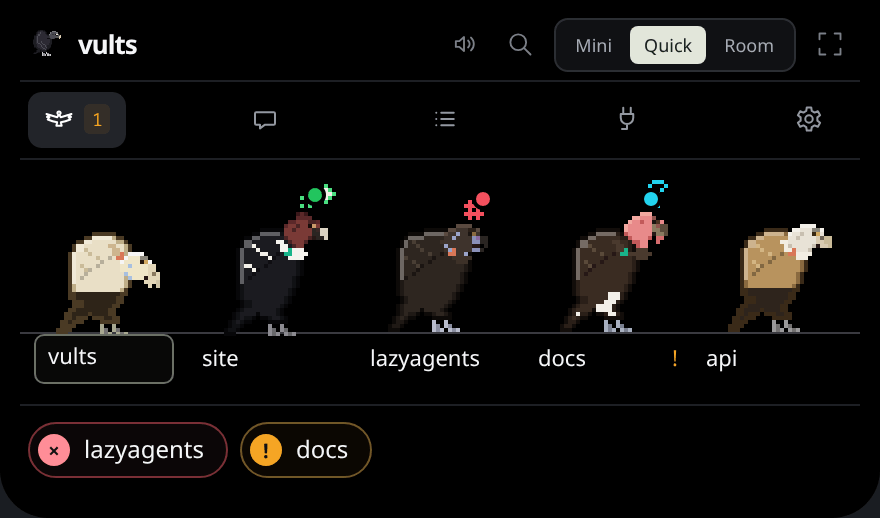
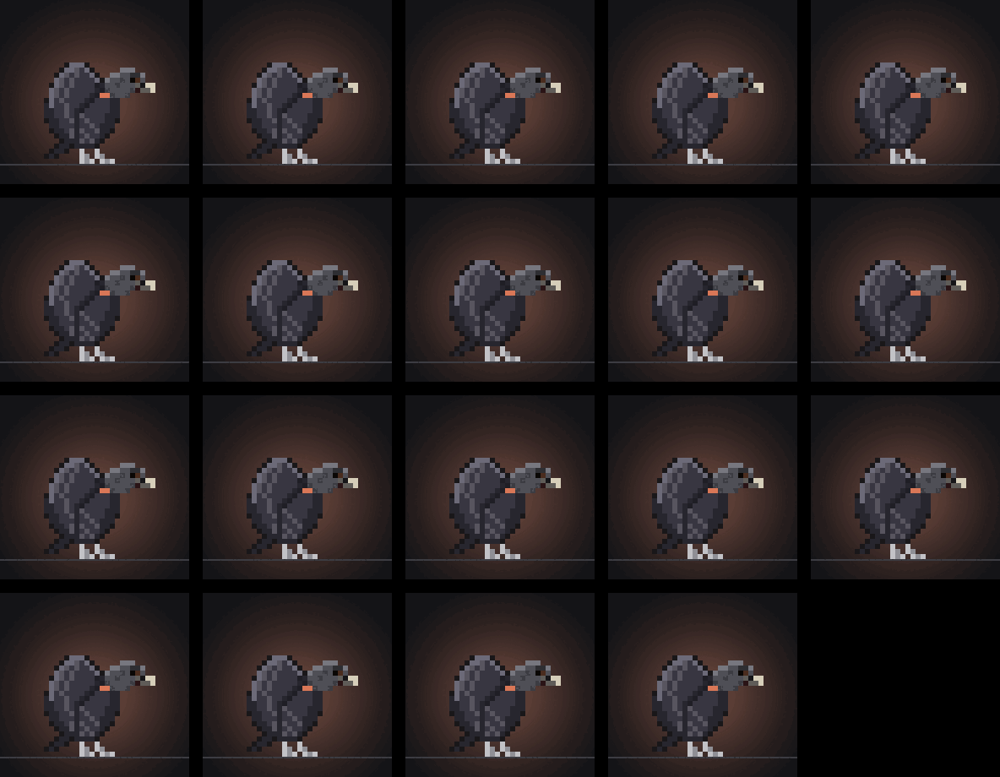
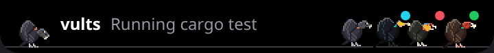
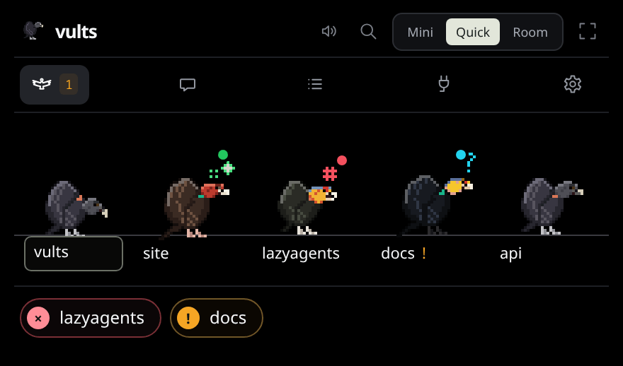
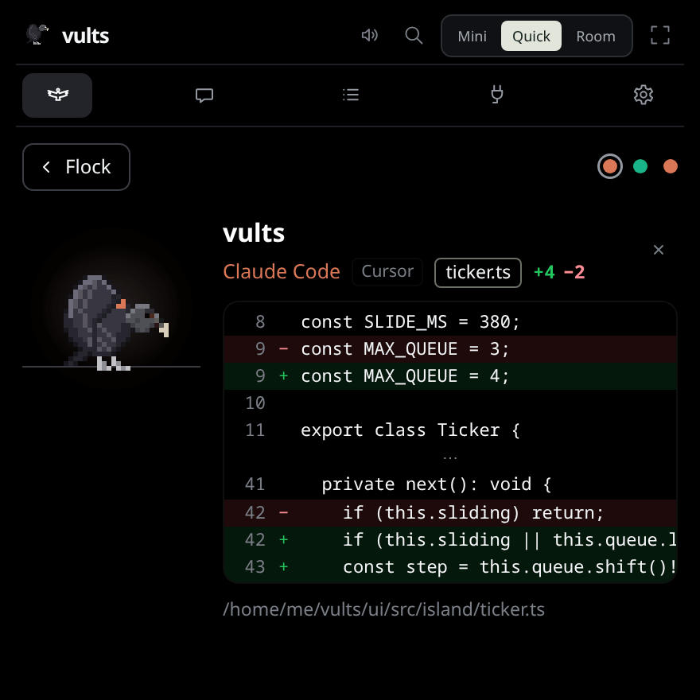
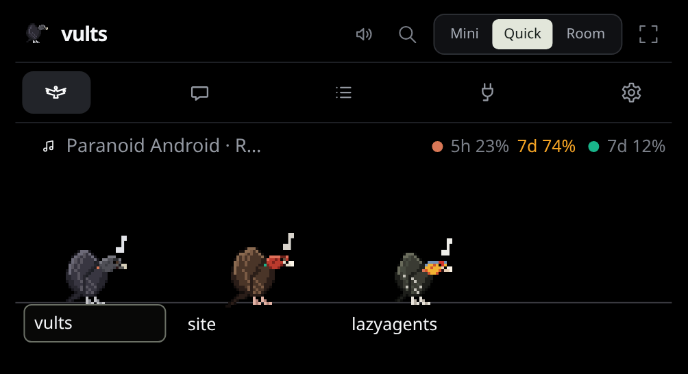
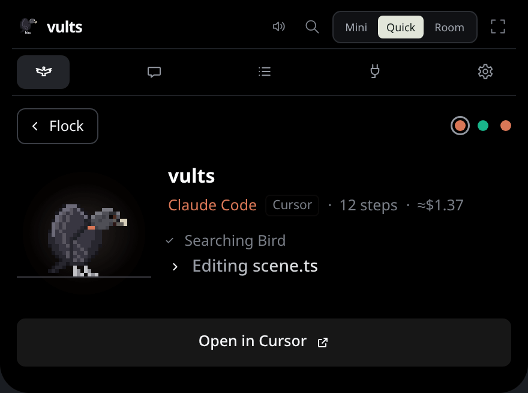

# The island

The island hangs from the top edge of your screen. On KDE Plasma, Hyprland, Sway and other compositors
with layer-shell it sits above every window like a panel; on GNOME it is a regular always-on-top window.
On X11 it shows on every workspace. It takes the keyboard only while you type in the chat, or after
**Ctrl+Alt+Space** ([below](#getting-to-a-session)).

With more than one screen, the desktop picks one (usually the focused screen at start). To pin the
island to a screen, choose it in **Settings → General → Screen**. If that screen goes away, the
island moves to another one and comes back when it returns.

On Windows (a preview build) there are no global shortcuts, desktop notifications, **Open terminal**
or tray presets yet.

## The flock

Each agent session is one bird, a vulture. A project is a species: all its sessions share it, and it
keeps it every time the app starts. A small band at the base of each neck shows the agent: orange for
Claude Code, teal for Codex, pink for OpenCode, indigo for Qwen Code, blue for Copilot CLI, and violet
for any other tool (Antigravity, Pi, Cursor…).

**Zeca** is not a session: he sits on the wire when nothing runs, and he is the one you talk to in the
chat. The session in front (the one that needs you, the one you clicked, or else the first to arrive)
takes his spot. Every other session is a **vult**.

The birds act out what their sessions do: they read, peck the wire while editing, take off for the
web, and spread their wings when a permission waits (with a mark over the head; at dawn the resting
birds open theirs to the sun, with no mark). New sessions fly in; ended ones fly off. Reduced
motion keeps them on their perches. **Settings → Flock & Zeca** picks the species pool, Zeca's species and
the rare visitors. [Animations](../ANIMATIONS.md) lists every clip.

### Zeca's seasonal looks

Zeca dresses for the season: a witch hat in October, a Santa hat in December, a party hat at New
Year, bunny ears at Easter, by your computer's date. **Settings → Flock & Zeca → Look** (with Zeca drawn
beside it: in the look you pick, in his own feathers on Auto) keeps one look all year, or none, and adds sunglasses and fourteen outfits with no season. **Right-click Zeca** on the
island to pick one in place: he wears whatever the pointer rests on, a click keeps it, Escape leaves
him as he was. Only Zeca wears them.

### Without Zeca

Zeca is optional. **Settings → Flock & Zeca → Zeca** turns him off; the flock keeps working: sessions on the
wire, permission and question cards, the Allow / Deny shortcuts, notifications, connectors and the
presets. What goes with him:

- The chat, its tab, files dropped on the island, the Nest's Chat, the tray's *Chat…*, the
  microphone and the talk shortcut. The usage meters stay: they read your agents' subscriptions.
- His hello at start-up.
- His place on the wire: the session in front sits there as its own bird, and with nobody running
  the pill reads *Nothing running*.

Turn him back on in the same place; no restart either way.

## Compact, open and hidden

**Compact** (the size switch's **Mini**), the island is a small pill with no text, only the flock:
Zeca on the left with the session in front, up to eight vults spread along the wire, and under it a
hairline per plan showing its usage, in the usage meters' colors (amber from 70%, red from 90%).
For sessions, colors mean the
same everywhere: amber for a permission, cyan for a question, green when done, red when it failed. A
vult in one of those states wears a badge of that color, and of its own shape, so no state rests on
color alone: a triangle for a permission, a diamond for a question, a circle when done, a square
when it failed. While someone needs you the pill's edge pulses amber; when a session failed (and
nobody needs you) it stays red; a cyan dot at its corner says a connector has news. Rest the pointer on a vult and it looks at you (one in the air comes down);
**click** it to open the island on its session, **right-click** it for its quick actions. Connector
news waits in the open island.

**Click** anywhere else on the pill to open the island. It folds back 15 seconds after the pointer leaves (a thin line
at the bottom counts down; coming back cancels it). The size switch at the top right
changes how much you see, keeping what you were looking at: **Mini** folds it to the pill at once,
**Quick** is the island, **Room** opens the [Nest](nest.md) on what the island shows (the flock, the
chat, your connections or this week; Settings from the gear), and the full-screen button beside it opens it on the whole screen. While
a card waits, it takes the flock's place. **Settings → General →
Fold the island** sets the wait.

With **Settings → General → Open on hover** on, resting the pointer on the pill opens it without a
click. Opened that way, it folds as soon as the pointer leaves, unless you clicked in it. Off by
default, and not in *Panel*.

Two things keep it open until you are done:

- **A permission card.** It opens the island by itself and stays until you answer. Nothing else
  opens it by itself: a session that finishes, fails or asks something plays its sound and gets its
  badge.
- **The chat.** The island never folds while you type.

With nobody on the wire for a minute, the island **hides**. Move the pointer to the middle of the top
edge of the screen to bring it back.

## Presence: how much it shows

**Settings → General → Presence**, or the tray's menu (Linux), picks one of four presets, at once.

| Preset | At rest | A card that needs you |
|---|---|---|
| *Island* (the default) | The flock at the top of the screen | Opens the island, with its sound |
| *Panel* | Nothing at the top; Zeca in the tray | Opens the island by the panel, with its sound |
| *Quiet* | Nothing, and no sound for finished or failed sessions or connector news. The top edge still brings the island back | Opens the island at the top, with its sound |
| *Paused* | A pill that says *Paused* | None: the agent asks in its terminal, as if the app were closed |

Nothing hides or quiets a card an agent waits on: not a preset (except *Paused*), not muting or
hiding a project, not Do not disturb. The card opens the island and waits for your click.

*Paused* is for no interruptions at all: permissions and questions, including cards already waiting,
go to the agent's terminal, and your *Always* rules answer nothing. Connectors stop checking, and no
desktop notifications show. Pick another preset to come back.

### In the panel

Nothing is drawn at the top of the screen. Zeca sits in the panel's tray and shows the flock's
state: perched, working, wings open with an amber mark (something waits for you), green sparkles
(done), a red mark (failed).

- **Click** him and the island opens in the panel's corner. It folds once the pointer leaves, with
  **Mini** or Escape, and when you open Settings.
- **Right-click** him for the menu: *Chat…* (with Zeca on), *Nest…* (with Zeca off too), *Set up
  agents…*, the four presets (Linux), *Quit*.
- A card opens the island by the panel, and Zeca calls for attention in the tray until you answer.
  Allow and Deny are always clicks on the card.
- Connector news plays its sound but does not open the island: click Zeca to read it.

On KDE Plasma the island opens beside the panel that holds the tray; elsewhere at the bottom right.
The tray needs a panel that shows StatusNotifierItems (Plasma does; on GNOME, the AppIndicator
extension, where a left click may open the menu instead). Without a tray, start Vults again to
open its settings.

In the other presets Zeca is in the tray too, with the same states and menu, and a click opens the
island at the top.

## The corner widget

**Settings → General → Corner widget** puts a small window in a corner you pick; it is off until you
pick one. It works with every preset. It shows up to three birds (the session in front, then the ones
that want you most) and how many sessions need you or are working. An amber rim means someone needs
you.

**Click** it to open the island, on the card when one waits. Click a bird to put its session in front
first; if that bird's card waits behind another, it comes first. The widget never answers a card.

It stays clear of panels and under full-screen windows. Without layer-shell it is an always-on-top
window. It costs about 40 MiB of memory while it is on.

## Desktop notifications

Only in *Panel*, where the island is out of sight, Vults also uses your desktop's notifications (any
Linux desktop with a notification server). At the top of the screen the island already shows it all,
so you are never told twice; *Paused* shows none.

They say when a session **finished** (with the first line of its reply), **failed** (with the error),
**needs you** (a card waits), or [**has gone quiet**](#a-quiet-bird). Each session has at most one,
titled with its project; it goes away once the card is answered, the session works again, or it
leaves (a finished session leaves the wire after 10 minutes, a silent one after 30). What happened while they were off is not raised later.

**Open** (or a click) brings up the island with that session in front. A notification never has Allow
or Deny. Turn them off in **Settings → General → Notifications**.

## The open island

Open, the island's header has its mark and name, a sound toggle, the search (the palette, as
**Ctrl+K**), the size switch and the full-screen button. Under it, its five tabs as icons, as
the prototype draws them:

- **Flock**, with how many sessions need you;
- **Chat**, Zeca's, in a compact form: the engine and your conversations at the top, the composer
  with a paperclip (to hand Zeca files) and the microphone, the folder and model under it;
- **Activity**: this week, counted on this computer, its four figures and a bar per project (the most first; by day when no project is named), and **‹ Previous week** / **This week**;
- **Connections**, with how many rows its connectors show and you have not marked seen: a chip per
  connector and a card per row, with **Ask Zeca why**, **Review with Zeca**, **Squash and merge** and **✓**
  ([Connectors](connectors.md#the-github-card)); with none on, **+** leads to the Nest's Connections;
- **Settings** (the gear): **Presence** and **Fold the island** right there; its page list also
  draws **Activity** (the local history's switch) and **Flock & Zeca** (Zeca's switch and where the
  flock draws from) in place; any other page of Settings in the Nest, and **All settings** (at **Agents** while an agent's hooks are missing or
  out of date, at **General** otherwise).

Over the Chat, Activity, Connections and Settings tabs, the chips of the sessions that need you stay under the
tabs; one opens its session. Activity has **Open in the Nest** for the rest.
The [Nest](nest.md), Vults' own window, has tabs of its own; the arrow at the top of the chat
also opens it. The song and your plans' usage take a line under the tabs.
Below, the island's whole width (about 500 px on screen, the size switch's **Quick**):

- **at rest, the flock**: every session's vult on one wire, twice its size, its project's name under
  it (boxed for the one in front) and `!` when it needs you (up to six; past that, five stay and
  **+N** takes the last place, opening the Nest's Flock, amber when one of them needs you), with its
  badge; rest the pointer on one for its project, agent and what it is doing. Under the wire, a chip
  for each session that wants a look: a card or a question, a failure, a bird gone quiet;
- **a session**, once you click its vult or its chip: **‹ Flock** goes back, and a dot per session,
  in its agent's color, opens another. A permission card opens here by itself and keeps its session
  in front until you answer. On the left Zeca, large, with a glow and a mark in the color of the
  session's state (an amber `!` for a permission, a cyan `?`, green sparkles when done, a red `#`
  when it failed, sweat at a usage limit); beside him the project, its agent and its state, and under
  both the session's card.

| Session | Card |
|---|---|
| Working | Its project, the agent, steps so far, running subagents and, for Claude Code, *≈$1.37*: what its tokens would cost at API prices (a subscription is not charged it), then the step just done and the current one |
| Idle | *Waiting for the next prompt*, and the last step |
| Needs permission | The exact command, file or URL, with **Deny** and **Allow** ([Approvals](approvals.md)) |
| Has a question | For a question the island can't answer (Qwen Code, OpenCode 2): the question, and **Open terminal**. Claude Code's and OpenCode 1's questions get a [card](approvals.md#questions) |
| Finished | The first paragraph of the agent's last reply, **OK** and **Open terminal** |
| Failed | The error, **OK** and **Open terminal** |

A step reads like *Editing main.rs*, *Running cargo build* or, for an MCP tool, *Calling github ·
list_prs*.

A finished edit shows the lines it added and removed (*Editing main.rs* **+4 −2**). Click them to see
the diff in place of the card, with line numbers when the agent sends them (Claude Code does;
Codex's diffs have none). **×** or **Esc** goes back. Diffs are kept for the
session's last 32 edits, up to 400 lines each; a longer one says it stops short.

**OK** says you have seen it: the badge goes and the session shows as idle. With nobody on the wire,
the card offers **Ask Zeca**.

Zeca notices you: he looks toward the pointer, preens if you rest it on him, and startles at a click.
At start he says hello, by your first name when your user account has a full name (never taken from
the network).

## Now playing

Turn on **Settings → General → Now playing** and the island shows the song your player is playing
(any player that speaks MPRIS: Spotify, a browser tab, mpv). The compact island shows it when nothing
runs; the open island shows it in the top bar, with previous, play/pause and next on hover. While
it plays, Zeca dances and the flock's idle birds court on the wire instead of soaring.

## Subscription usage

The open island's top bar shows how much of your plans' limits you have used, next to each agent's
dot: *7d 12%* is 12% of the weekly window. It turns amber at 70% and red at 90%; hover to see when it
resets. No token of yours is read: each number comes from the CLI you logged into.

- **Codex**: with **Settings → General → Codex usage** on, asked every 5 minutes, read-only, never
  while the screen is locked. It reaches OpenAI through your codex, so it is off on a new install.
- **Claude Code** (Pro or Max): it reports usage only to a status line, so installing the hooks adds
  one of ours, which runs yours if you have one ([how](../reference/settings.md#agent-configs-vults-edits)).
  The numbers arrive after a session's first reply.

## Getting to a session

Click a vult in the flock to open that session; it stays in front until you pick another or it
leaves. A waiting card still comes first. With the keyboard (**Ctrl+Alt+Space**), **↑** and **↓**
move between sessions: at rest the boxed name moves, in a session the next one opens.

**Open terminal** on its card brings its terminal forward:

- a herdr, tmux, kitty or wezterm pane, on any desktop (kitty needs `listen_on unix:/tmp/kitty` and
  `allow_remote_control socket-only` in `kitty.conf`);
- the terminal window itself, on KDE Plasma (Wayland or X11) and in any X11 session, on its own
  workspace and unminimized (of several windows, the one titled after the session's folder first);
- on GNOME, Hyprland or Sway under Wayland, only a terminal running through XWayland.

When there is nothing to bring forward, the card says so. A session started in VS Code's or Cursor's
terminal carries a **VS Code** or **Cursor** tag, and its button raises that editor instead, on KDE
and in X11 sessions.

Global shortcuts work from any window:

- **Ctrl+Alt+Y** / **Ctrl+Alt+N** allow or deny the permission on screen
  ([Approvals](approvals.md)).
- **Ctrl+Alt+J** / **Ctrl+Alt+K** put the next or previous session in front. A waiting card stays in
  front; the keys choose who comes after it.
- **Ctrl+Alt+V**, held, talks to the chat ([Speaking](chat.md#speaking-instead-of-typing)).
- **Ctrl+Alt+1**, **Ctrl+Alt+2** and **Ctrl+Alt+3** switch to Mini, Quick and Room.
- **Ctrl+K**, in the open island or the Nest, opens the [palette](nest.md).
- **Ctrl+Alt+Space** opens the island and hands it the keyboard until it folds:
  - **↑ ↓** (or **K J**) change the session in front; **Enter** opens its terminal; **M** opens its
    quick actions; **C** opens the chat.
  - **Y** or **N** answer a permission; **1** to **9** pick a question's choice.
  - **Esc** folds the island and gives the keys back. On Wayland it is the way back to your terminal.

Opened with a click, the island takes no keys. The shortcuts go through the desktop portal: KDE asks
once, and **System Settings → Shortcuts** changes the keys (worth it if your editor uses Ctrl+Alt+J
or K, as JetBrains IDEs do). **Settings → General** lists them.

### Quick actions

**Right-click** a vult in the pill or the flock, or a session's card (away from Zeca) for
that session's quick actions:

- **Open terminal**, as above. Where the desktop can't, it is greyed out and offers the folder.
- **Open folder**: in VS Code when `code` is on your `PATH`, else in your file manager. Only an
  existing folder, by its full path, is opened, with no shell.
- **Activity**: the session's last eight steps, each finished edit with its diff.
- **View the last diff**, and **Open its file in VS Code** at the first changed line (or show it in
  the folder; a file is never run or opened with whatever handles its type).
- **Keep in front**, or *Let the flock choose*.
- **Mute**, **Pin** or **Hide this project**, and **This project's bird…** ([below](#per-project-mute-pin-hide)).

The menu never has Allow or Deny, and does not open over a waiting card. To reach a card waiting
behind another, see [More than one at a time](approvals.md#more-than-one-at-a-time).

### While you were away

While the screen is locked (a desktop that says so through `org.freedesktop.ScreenSaver`, as Plasma
and GNOME do), the island rests (no animation) and connectors stop checking. Agents and
cards go on as usual.

When you unlock, or leave *Paused*, a line says what happened meanwhile: *While you were away: 2
finished, 1 failed, 1 waits for you for 12 min.* In *Island* it opens the island once; it stays until
you dismiss it with **×**. Hidden and muted projects are left out.

### A quiet bird

A session that is working and sends nothing for **5 minutes** may be stuck (a command waiting for
input, a hung tool). Its bird gets a grey badge: *No news for 5 min*. At **15 minutes** the badge turns
amber, one alert plays, and in *Panel* a notification says so. Long thinking is not flagged; any news
clears it.

The card offers three answers, and none touches the agent:

- **Snooze**: gone for 15 minutes, then back if still quiet.
- **Keep going**: it is fine; the grey flag comes back only after 30 minutes, the amber one 10
  minutes later.
- **Dismiss**: no flag again until its next prompt.

Each answer counts as news, so the bird stays on the wire (a silent one leaves after 30 minutes);
after *Keep going* it stays until its flag could come back.

### Per project: mute, pin, hide

These choices belong to the project (its folder): every session in it follows them, now and later.

- **Mute**: no sounds or notifications when its sessions finish or fail.
- **Pin**: its sessions come first on the wire, in the pill and in the flock.
- **Hide**: its sessions stay off the island, the tray and the corner widget.
- **This project's bird…**: picks the species for all its sessions; **Automatic** gives it back to
  the flock's draw.

**Settings → Projects** lists them, and is the way back for a hidden project.

## Sounds

Short 8-bit blips when a session needs you, finishes or fails, and for connector news; softer ones
when the island opens or folds and when Zeca reacts to you. The speaker button on the island, or
**Settings → General → Sounds**, turns them off; **Volume** sets how loud. A card that keeps waiting
sounds again, and **Do not disturb** silences sounds and notifications for a while: see
[When nobody answers](approvals.md#when-nobody-answers).
