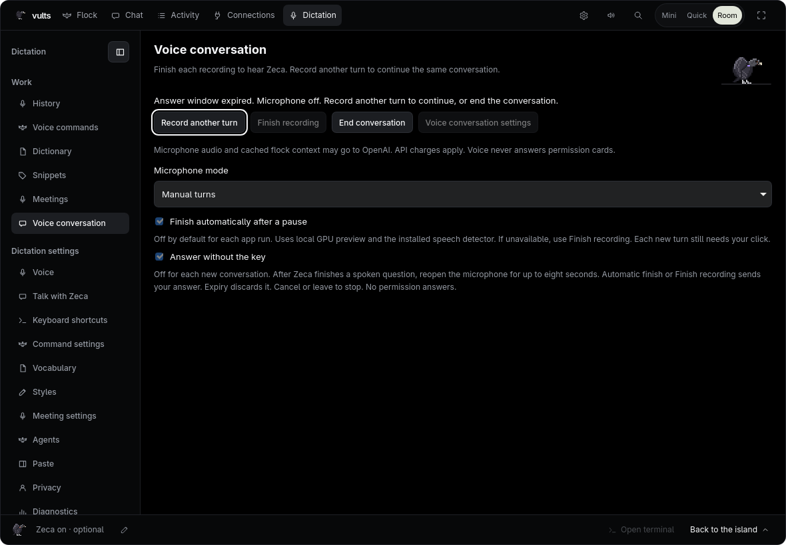

# Voice

Three ways to use your voice besides [dictation](dictation.md): commands that control the flock and
the computer, a spoken conversation with Zeca, and spoken answers to an agent's question. Voice
**never answers a permission card**, whatever you say.

## Voice commands

**Hold Ctrl+Alt+Z**, say a command, release. Commands work with Zeca off and are interpreted on this
computer by the same speech model as dictation; no other model and no network is used. English,
Portuguese and Spanish are supported.

| To | Say, for example | Needs |
| --- | --- | --- |
| Move through the flock | `next session`, `open project api`, `who is waiting?` | — |
| Quiet a project | `mute notifications for web`, `pin docs`, `hide api` | — |
| Ask about it | `what is api doing?`, `how much of my plan is left?` | — |
| Control the music | `pause media`, `resume music`, `next track`, `media volume 30` | **Media voice commands** and Now playing |
| Control the computer's sound | `mute computer`, `computer volume 40`, `lower computer volume` | **System audio voice commands** |
| Open an app | `open Obsidian`, `open app Firefox` | **Application voice commands** |
| Repeat or undo | `same for docs`, `undo` (within 90 seconds) | — |

The three switches are in **Settings > Dictation > Command settings**, all off by default.

- **Chain** commands with *and then*: `pause media and then open app Obsidian`. Every step is
  checked before the first one runs; if one fails, the rest stop and Vults says what was done.
- **Say the scope** for sound: *media/music* is the player shown in Vults, *computer* is the
  default output, and *mute notifications for …* is a project. `lower volume` alone asks which.
- **Names**: projects, agents and your dictionary's replacements are matched, typos included.
  When two match, Vults asks which; answer within 90 seconds. `open app …` and `open project …`
  remove the doubt.
- **Not executed**: a negated (`don't pause the music`) or quoted command, a phrase it does not
  know, anything about cards (`approve`), configs, merges, closing apps or deleting.
- Opening an app or a terminal confirms the request, not that the window is ready.

**When it is not a command** says so on the island by default. You can choose **Send it to Zeca as a
message** instead: the phrase goes to the current Chat, when Chat is idle and has no draft.

**Dictation > Voice commands** keeps your recent commands and their results, and **What you can say**
lists every phrase. **Check a command** explains how a typed phrase would be read, without running it.

On Windows, apps come from the Start Menu and the Microsoft Store, and a player's volume needs a
one-time choice of its app in **Command settings > Player audio app**.

## Talk with Zeca

A spoken conversation: you speak, Zeca answers out loud. Your speech is transcribed locally; Zeca's
voice comes from an OpenAI realtime model, so this part **sends audio and context to OpenAI** and
costs money on your API key, separate from your CLI subscription.

1. **Settings > Dictation > Talk with Zeca**: add the OpenAI key (it stays in the keyring), choose
   the model, set the daily USD limit, enable, **Save**.
2. Open **Dictation > Voice conversation**, choose **Start recording**, speak, **Finish recording**.
3. Zeca answers. **Stop response** interrupts him; **Record another turn** continues; **End
   conversation** closes it.

Options, all off for each new conversation:

- **Finish automatically after a pause**: the turn ends after about 1.6 s of silence.
- **Answer without the key**: after Zeca asks you a question, the microphone reopens for eight seconds.
- **Continuous microphone** (with headphones, or with echo cancellation): you can interrupt Zeca by
  speaking. The microphone stays open until you end the conversation, and the page says so.

A turn is capped at 30 seconds; at the cap it is discarded, not sent. Leaving the page, hiding the
Nest or locking the screen ends the conversation. If the provider fails, **Review recovered text**
gives you what you said as an editable draft that is not sent anywhere.

## Answer an agent's question

An agent can ask you a question in text and wait for your answer in Quick or the Nest. Type it, or
hold the dictation key shown on the question and speak; the words go into the draft for you to
review. Only **Send reply** (or Enter in the editor) sends it. The question expires after two
minutes, and a permission card always comes first. On Windows you type the answer: dictating into
a question works on Linux only for now.

The Claude Code that Vults starts can ask by itself. For your own Claude Code or Codex:

1. **Settings > Dictation > Agents**, turn on **Agents may ask for a spoken answer**.
2. **Review setup…**, read the diff, **Write the file** (a dated backup is kept).
3. Restart the agent and ask it to use `ask_user`.

**Review removal…** takes it out the same way.
