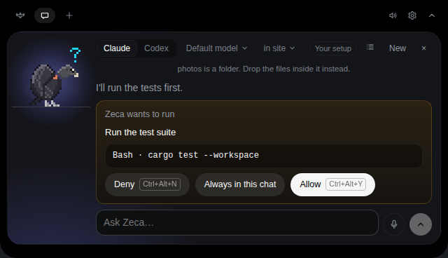

# Conversando com o Zeca
<!-- source: 935560b105f8 -->

Abra a aba **Chat**, escolha **Chat…** no ícone da bandeja ou solte um arquivo na ilha. O Zeca fica
à esquerda da conversa: ele pensa enquanto a resposta vem, inclina a cabeça quando pergunta algo a
você e engole os arquivos que você dá a ele. Escolha **Claude** ou **Codex** no topo (ou o provedor
de API que você configurou, veja abaixo). **New** começa uma conversa nova, e trocar de provedor
também; a anterior fica na lista (veja [Conversas](#conversations)). **Esc** fecha o chat de qualquer
ponto dele; a conversa continua lá quando você volta.

O chat é do Zeca: com ele desligado (**Settings → Flock → Zeca**) não há chat nem microfone, o atalho
de fala não faz nada e os arquivos soltos na ilha não são aceitos. Veja
[Sem o Zeca](island.md#without-zeca). No KDE Plasma, o desktop continua reservando **Ctrl+Alt+V**
para o app enquanto isso; para usar a tecla em outra coisa, limpe *Hold to speak to the chat* em
Configurações do Sistema → Atalhos; a tecla de fala então fica desligada até você dar uma tecla a
ela de novo ali.

<a id="where-it-works"></a>

## Onde ele trabalha

Antes da primeira mensagem, a pasta no topo (*in vults ▾*) diz onde a conversa vai trabalhar: a
pasta da sessão em primeiro plano, a menos que você escolha outra das sessões no fio, ou uma pasta
vazia só dela. Depois que a conversa começa, ela fica lá até **New**.

<a id="model-and-effort"></a>

## Modelo e esforço

Ao lado da pasta, *Default model ▾* escolhe o modelo e o quanto ele pensa, para o Claude e para o
Codex. O Claude oferece Opus, Sonnet e Haiku (os nomes do Claude Code para o mais recente de cada
um); o Codex lista os modelos que o seu próprio `codex` oferece, perguntados na primeira vez que você
abre o seletor com o Codex. O esforço vai de **Low** a **Max**, só com os que o modelo escolhido
aceita. **Default** deixa cada um para a CLI, como as suas configurações definem.

A escolha é lembrada por pasta e por motor: uma conversa nova naquela pasta começa com ela. Como a
pasta, ela fica fixa quando a conversa começa, então uma resposta nunca troca de modelo no meio;
**New** começa outra. O modelo do chat por API é escolhido em **Settings → Chat**.

<a id="the-nest"></a>

## O Nest

A seta no topo do chat da ilha abre o **Nest**, a janela do próprio Zeca. A aba **Chat** dele é a
mesma conversa, larga, com respostas em Markdown completo (um link mostra o endereço e nunca é
seguido); uma mensagem, **New** ou outro motor em qualquer um aparece nos dois. Só a ilha responde
cards: **Answer on the island** traz o chat dela. A aba **Tasks** guarda as suas
[tarefas](#tasks). As abas **Memory** e **Roosts** mostram o que o
Zeca lembra e o bando por repositório (veja [A memória do Zeca](memory.md)), e a aba **Agents** o
que cada agente consegue fazer com o Vults e o que este computador tem dele (veja
[Outros agentes](other-agents.md#what-each-agent-can-do)). O Nest some quando você o fecha ou
desliga o Zeca.

<a id="continuing-a-session"></a>

## Continuando uma sessão

`/continue <palavras>` entrega as suas palavras a uma sessão do Claude Code ou do Codex na pasta da
conversa que parou nos últimos dez minutos, como o próximo turno dela: o Vults a retoma aqui, com
as configurações dela, no sandbox dela, e ela volta a aparecer no bando com os cards dela na ilha.
Só uma sessão cujo processo acabou: uma que ainda está aberta no terminal é recusada, então você
fala com ela lá. Uma por vez; `/continue stop` encerra. Como o `/task`, não vai para nenhum modelo
do Zeca.

<a id="tasks"></a>

## Tarefas

`/task` no chat guarda uma tarefa numa mensagem só, mandada para nenhum modelo: o objetivo na
primeira linha, e depois uma linha para cada critério que diz que ela está pronta, começando com `-`:

```
/task Fix the flaky login test
- passes 20 runs in a row
- no sleep added
```

Numa linha só, `done when:` começa os critérios, separados por `;`. O roost dela é o repositório da
pasta da conversa. A aba **Tasks** do Nest lista as tarefas, as que faltam primeiro, com cada
critério para marcar, quem trabalha nela (você, o Zeca ou um agente), em que pé está (*To do*,
*Doing*, *Blocked*, *Done*, *Dropped*) e quanto custou depois que o Vults começar sessões para ela.
**New task** cria uma lá também. Com o conector do GitHub ligado, uma tarefa num repositório do
GitHub ganha **Open an issue**: no seu clique, o seu `gh` abre uma issue com o objetivo e os
critérios, e a tarefa fica ligada a ela. Qualquer tarefa pode se ligar a uma issue que você já tem:
`#12` (no repositório do GitHub dela) ou o endereço da issue, e depois **Link**. As tarefas ficam
no `vults.sqlite`, neste computador.

`/delegate` cria uma tarefa do mesmo jeito e a começa na hora no agente que o roteador escolhe, e
o card da tarefa diz por quê. A regra do próprio projeto escolhe primeiro (`/delegate default
codex`, ou `claude`, digitado numa conversa nesse projeto; `/delegate default none` a apaga); sem
ela, o Claude Code. Se o plano desse agente passa de 85% e o do outro está, que se saiba, abaixo
disso, a tarefa vai para o outro. Quando um projeto tem 10 tarefas terminadas de um tipo (uma
correção, testes, docs, uma funcionalidade), o agente que mais terminou delas ali substitui a regra
para esse tipo, mas os 85% continuam valendo. Uma tarefa conta para o agente dono dela quando é
marcada como feita ou abandonada.

**Start with Claude Code** trabalha numa tarefa que está num repositório. O Vults faz para a tarefa
um clone próprio, num branch só dela (`vults/task-12`), dentro da pasta de dados do Vults: um clone
`--shared`, que lê os objetos do seu repositório mas nunca os escreve. Ele começa o Claude Code ali
com o objetivo e os critérios da tarefa, orientado a fazer commit nesse branch e nunca dar push. Ele
roda no sandbox do Claude Code (bubblewrap): não começa sem ele, todo comando continua perguntando,
e ele só escreve no clone dele e nas pastas temporárias, nunca no seu repositório, nos branches, nos
hooks ou na config dele. Comandos que você tirou do sandbox nas suas próprias configurações do Claude
Code continuam rodando fora dele, cada um perguntando antes. Ele lê as suas próprias configurações,
então aparece no bando como qualquer sessão e as permissões dele são cards da ilha, respondidos por
você, pelas suas regras ou pelas suas políticas. Duas tarefas rodam lado a lado sem mexer nos
arquivos uma da outra. Quando o turno acaba, o Vults traz o branch da tarefa, e só ele, para o seu
repositório, sem rodar nada do clone; **What it said last** embaixo da tarefa guarda o fim da
resposta, e **Go on** continua a mesma sessão. **Start fresh** passa a tarefa para uma sessão nova,
quando a antiga já cresceu demais: a sessão antiga escreve um pacote de contexto (Objective,
Constraints, Done, In progress, Decisions, Files, Failures, Next), o Vults põe o que sabe com certeza
(o objetivo, quais critérios estão marcados, os arquivos mudados no branch), e a sessão nova começa
só desse pacote. O pacote fica embaixo da tarefa como **Handoff notes**; se a sessão antiga não
escreve nenhum, nada é passado adiante e ela mantém a sessão. **Stop** pede para o turno parar,
espera e então o encerra; só uma sessão que o Vults começou pode ser parada, e uma tarefa rodando não
pode ser apagada. O que ela custou entra na tarefa. **Remove its folder** traz o branch de volta e
remove o clone; trabalho que nunca teve commit nele vai junto, então pergunta duas vezes.

**Start with Codex** faz o mesmo com o Codex, no sandbox dele (`workspace-write`: o clone dele e as
pastas temporárias). O Codex pede aprovações pelo próprio canal: o Vults transforma cada uma no card
da ilha que o hook dele mandaria (o comando inteiro, ou os arquivos e a contagem de linhas de uma
edição; uma chamada que ele não consegue nomear inteira é um não), então as suas regras, políticas e
o telefone respondem do mesmo jeito, e uma execução parada tira o card que esperava. Numa tarefa com
sessão, **Hand off to Codex** (ou **Hand off to Claude Code**) é o **Start fresh** no outro agente: a
sessão escreve o pacote, e o outro começa dele.

**Review with Codex** (ou **with Claude Code**) faz o outro agente revisar o trabalho de uma tarefa,
no clone dela, como um revisor que não escreveu nada daquilo, num sandbox em que não escreve nada:
ele roda os testes, lê o diff contra onde o branch começou, confere cada critério e lista o que
está errado. O Codex usa o revisor
próprio dele. Quando a revisão pede mudanças, os achados vão para a sessão da tarefa, que os corrige
e faz commit, e a rodada seguinte revisa de novo, até três rodadas. Uma aprovação encerra; uma
revisão sem veredito, ou uma terceira rodada que ainda pede mudanças, fica para você ler. A última
revisão fica embaixo da tarefa, e quem marca a tarefa como feita continua sendo você.

<a id="cost-and-a-daily-budget"></a>

### Custo e um orçamento diário

O Vults conta o que os agentes dizem que custaram: cada turno de uma sessão que ele iniciou para uma
tarefa ou um `/continue` (os dólares do Claude Code; o Codex informa só tokens, então as tarefas dele
mostram os tokens) e cada sessão do Claude Code que ele acompanha, pela status line, contada a partir
da primeira vez que o Vults a vê (o que ela custou antes fica fora do dia). Nada é estimado por
tabela de preços. O chat do próprio Zeca, os resumos e o sono não entram nessa conta, e o orçamento
não os para. Numa
assinatura, os dólares são o que os tokens custariam a preços de API, que o seu plano não cobra; o
Vults diz isso quando consegue saber (um plano que informa as janelas de uso). Cada tarefa mostra
custo e tokens, cada roost na aba **Roosts** o custo de hoje e o total, e o topo da aba **Tasks** o
de hoje.

Ali você pode definir um **orçamento diário** em dólares. Em 80% uma notificação avisa; quando ele
acaba, outra avisa, e o Vults não inicia nenhuma sessão nova até o dia seguinte: nada de Start,
handoff, review, `/delegate` ou `/continue`. É só isso. Ele nunca para uma sessão que está rodando, e
nunca bloqueia nem atrasa um agente que você mesmo iniciou. Os custos ficam em `vults.sqlite`, neste
computador, e **Clear history** os apaga junto com o resto.

<a id="conversations"></a>

## Conversas

Toda conversa é salva neste computador enquanto acontece, e o botão de lista no topo do chat mostra
todas, a usada por último primeiro, com o motor e a pasta de cada uma. Clique numa para continuar de
onde parou, mesmo depois de reiniciar: ela mantém o motor, a pasta, o modelo e o esforço, e a CLI dela
retoma a própria sessão (a sessão do Claude Code, a thread do Codex; o chat por API reenvia o que foi
dito). O lápis renomeia; o xis apaga depois de um segundo clique, com tudo o que foi dito nela.

O que é salvo é o que o chat mostra: suas mensagens e os nomes dos arquivos que você mandou, as
respostas do Zeca, erros e paradas; nunca a resposta a um card (o log de auditoria guarda essas) e
nunca uma regra *Always in this chat*, então uma conversa aberta de novo pergunta como uma nova
perguntaria. As 200 mais recentes ficam guardadas, no mesmo `vults.sqlite` local do histórico de
atividade; **Settings → Activity → Clear history** apaga todas. Uma conversa cuja pasta sumiu não pode
ser aberta de novo.

<a id="what-zeca-knows"></a>
<a id="memory"></a>

## O que o Zeca sabe

Cada mensagem leva, antes das suas palavras, um bloco `<today>` com a data e a hora deste computador
e um bloco `<flock>` com uma linha para cada sessão que a ilha mostra (até 12, depois "and N
more"): o agente, o projeto, o estado e o passo em que está (segredos redigidos), nunca o comando
sobre o qual um card pergunta. Isso vai para quem roda o chat, o provedor da CLI ou o da API, junto
com a mensagem.

Com a memória ligada, o que o Zeca lembra e o que ele recupera também entram: veja
[A memória do Zeca](memory.md).

<a id="writing-and-reading"></a>

## Escrevendo e lendo

- **Enter** envia, **Shift+Enter** começa uma nova linha. Você pode digitar a próxima mensagem
  enquanto uma resposta chega, e enviá-la quando a resposta terminar.
- Enquanto o Zeca responde, o botão de enviar vira **Stop**: ele encerra o turno ali, e tudo o que o
  turno estava esperando vira um não.
- A resposta chega à medida que é escrita. Role para cima para ler e ela fica onde você está, com um
  botão *↓ new text* para voltar ao fim.

<a id="speaking-instead-of-typing"></a>

## Falando em vez de digitar

Ligue uma vez em **Settings → Chat → Voice**: baixe um modelo (*Base* tem 60 MB e é rápido; *Small*
e *Large v3 Turbo* entendem melhor sotaques e nomes). Um microfone aparece ao lado do botão de
enviar.

- Clique no microfone e fale. Ele para sozinho depois de cerca de 1,5 s de silêncio após as suas
  palavras, ou quando você clica de novo; as palavras caem no campo de entrada para você ler e
  corrigir, e aí **Enter** as envia. O silêncio antes de você começar nunca o interrompe; se uma
  pausa o interromper, clique de novo para continuar.
- Ou segure **Ctrl+Alt+V** de qualquer lugar: o chat abre e o Zeca escuta enquanto você segura
  (pausas nunca o interrompem); soltar transforma tudo em texto. A tecla pode ser trocada em
  Configurações do Sistema → Atalhos.
- **Esc** enquanto ele escuta descarta a gravação. Uma gravação para sozinha depois de um minuto.
- **Language you speak** (idioma que você fala) segue o do seu sistema; escolha outro, ou *Detect
  it each time*. Um idioma fixo é muito mais confiável em frases curtas. O *Base* é fraco fora do
  inglês: em português use o *Small*, ou o *Large v3 Turbo* com uma GPU.

Só a sua fala vai para o whisper: um pequeno detector de fala (Silero VAD, menos de 1 MB) corta o
silêncio em volta dela, para o whisper não inventar palavras ali. Ele é baixado sozinho enquanto a
voz está ligada e ele falta; até lá, o microfone só para com um clique. Com uma GPU (Vulkan: AMD,
Intel ou NVIDIA) uma frase leva uma fração de segundo e uma prévia esmaecida das suas palavras
aparece enquanto você fala; no processador, escolha o *Base*.

Tudo acontece neste computador: o whisper.cpp transcreve o áudio na memória, e o áudio nunca é salvo
nem enviado para lugar nenhum. Os modelos e o detector são conferidos contra o SHA-256 conhecido
deles antes de serem usados.

<a id="what-it-may-do"></a>

## O que ele pode fazer



- Ele lê arquivos daquela pasta livremente.
- Todo comando e toda edição aparecem na conversa como um card igual ao da própria ilha: o que o Zeca
  pretende fazer, o comando inteiro ou o arquivo com suas linhas **+/−**, e **Deny** e **Allow** com
  suas teclas (**Ctrl+Alt+N** / **Ctrl+Alt+Y** respondem de qualquer lugar). Nada roda até você
  responder, e um card que ninguém responde é um não.
- Depois que a conversa lê conteúdo de fora (uma página ou busca na web, um comando que rodou
  `curl`, `git pull` ou `gh`, uma ferramenta MCP que não seja as do `vults-zeca`, o
  servidor que o Vults entrega ao Claude Code do chat), todo card seguinte avisa em vermelho: uma página pode trazer palavras
  escritas para conduzir o Zeca, então leia com cuidado o que o card pede. Só conta uma chamada que
  rodou (um fetch negado não leu nada), compilar e testar nunca contam, e o aviso vale pelo resto
  daquela conversa, também quando ela é aberta de novo pela lista. Uma conversa nova começa limpa.
- **Always in this chat** permite aquela chamada exata de novo (o comando e a entrada inteiros,
  não o texto do card) sem card, até a conversa acabar: **New**, outro motor, ou o Zeca desligado.
  Um card que não consegue nomear a chamada inteira não tem esse botão. Toda vez que a regra
  responde, o chat mostra *Allowed for this conversation* e o log de auditoria guarda. As regras nunca
  são salvas.

<a id="files"></a>

## Arquivos

Arraste um arquivo sobre a ilha e ela abre uma área de soltar, com o Zeca esperando de bico aberto (a
aba **+** também a mostra). Solte: ele engole o arquivo, um urubu o leva até o outro lado enquanto
uma barra enche, e a área pergunta para que ele serve. **Ask about it** o mantém na sua próxima
mensagem e coloca você no campo de entrada; **Cancel** o retira. Você pode enviá-lo sem texto para
perguntar o que ele é. Imagens, PDFs, código e texto funcionam melhor. Os arquivos são copiados para
a caixa de entrada do app (até 20 MB cada) e apagados depois de uma semana; uma pasta, ou um arquivo
com mais de 20 MB, é recusado com uma linha dizendo por quê.

<a id="your-subscription-your-login"></a>

## Sua assinatura, seu login

O chat roda o comando `claude` ou `codex` em que você já fez login, então ele usa a sua própria
assinatura e o Vults nunca lê suas credenciais. Os dois transmitem a resposta à medida que ela é
escrita: o Claude por `claude -p`, o Codex por um único `codex app-server` de longa duração.

<a id="your-setup"></a>

### Sua configuração

O chat lê a sua própria configuração do Claude Code e do Codex, como no seu terminal: seu
`CLAUDE.md`, skills, servidores MCP, hooks e regras de permissão (um ícone de pessoa no topo avisa).
As configurações e os servidores do `.mcp.json` de um projeto só entram numa pasta em que você já
confiou no Claude Code; o `CLAUDE.md` dele é lido de qualquer jeito. As suas regras de permissão
valem em qualquer pasta. Os cards continuam perguntando o que suas regras não liberam, seja qual for
o `defaultMode` das suas configurações, e os seus hooks nunca fazem o chat aparecer como uma sessão
de agente.

Desligue em **Settings → Chat → Your Claude Code and Codex setup**, e o Claude não lê nada disso; o
Codex então só deixa de fora os seus hooks. O interruptor vale para a próxima conversa. Bom saber:

- `claude -p` pula a pergunta de confiança, então um repositório que você acabou de clonar não
  consegue trazer regras ou hooks próprios.
- Uma regra de permissão como `Bash(npm test:*)` roda o script de teste de um projeto clonado sem
  card.
- Com o interruptor desligado, o Claude não recebe servidores MCP além do próprio Vults, e nenhuma
  regra salva pula um card.
- O `config.toml` do Codex ainda traz os servidores MCP dele, e o `AGENTS.md` dele ainda é lido.
- Uma conversa já em andamento mantém o que leu.

Veja [Segurança](../safety.md) para o resto.

<a id="without-a-cli-an-api-key-or-a-local-model"></a>

## Sem uma CLI: uma chave de API, ou um modelo local

O chat também pode usar a API de um provedor com a sua própria chave, ou um modelo rodando na sua
máquina. Em **Settings → Chat**, escolha o **Provider**, cole a chave dele e escolha um **Model**; o
nome do provedor então aparece no topo do chat, ao lado de Claude e Codex.

| Provedor | Chave | Observações |
|---|---|---|
| Anthropic | `sk-ant-…` | Claude Opus 5.5 até você escolher outro modelo |
| OpenAI | `sk-…` | |
| Google Gemini | `AIza…` (Google AI Studio) | |
| OpenRouter | `sk-or-…` | Uma chave para centenas de modelos |
| Groq, DeepSeek, Mistral, xAI | a de cada um | |
| Ollama | nenhuma | Precisa estar rodando em `127.0.0.1:11434` |
| LM Studio | nenhuma | O servidor dele precisa estar ligado, em `127.0.0.1:1234` |

- Os modelos são listados ao vivo pelo provedor. Cada provedor guarda o modelo que você escolheu
  para ele.
- Uma chave fica no [chaveiro do sistema](../reference/settings.md#where-things-live-linux), nunca
  é mostrada de novo, e só é enviada para o próprio provedor; **Remove** a apaga. O uso é cobrado na
  sua conta com aquele provedor.
- Este chat não pode rodar comandos, editar arquivos nem olhar seu projeto. Ele lê o que você digita
  e os arquivos que você solta (imagens, texto até 512 KB, e PDFs com a Anthropic), e chama
  ferramentas quando uma pergunta precisa: as do bando (suas sessões, os cards esperando, o uso dos
  seus planos, seu card do GitHub), `recall` e `memory_propose` com a memória ligada, e as da web com
  a web ligada. O que uma ferramenta devolve vai para o provedor (comandos com os segredos
  redigidos); ele nunca responde um card.
- Modelos de raciocínio que pensam em voz alta só mostram a resposta: a parte `<think>` fica oculta
  e nunca é enviada de volta.
- Uma conversa mantém o provedor e o modelo com que começou.
- Com a Anthropic, um pedido que o Claude recusa por motivos de segurança é tentado de novo com
  outro modelo Claude na mesma chamada; se esse também recusar, o balão avisa.

<a id="the-web"></a>

### A web

Com **Settings → Chat → Web for Zeca** ligado, o chat por API pode buscar na web e ler páginas. As
buscas vão para o Brave Search ou o Tavily com a sua própria chave (guardada no chaveiro), ou para
um SearXNG que você roda. Desligado, o modelo nunca recebe nenhum dos dois.

Uma página não é confiável, então o modelo do chat nunca a vê: uma chamada separada ao seu provedor
de API, sem ferramentas e avisada de que a página é dado, a lê para a pergunta, e só essa resposta
volta. Os títulos e trechos de uma busca chegam ao modelo, marcados como não confiáveis. Páginas só
são lidas de endereços públicos. Cada busca e cada página é uma requisição em seu nome com um limite
diário ([Segurança](../safety.md#every-request-vults-makes)), e a conversa então conta como tendo
lido de fora.
