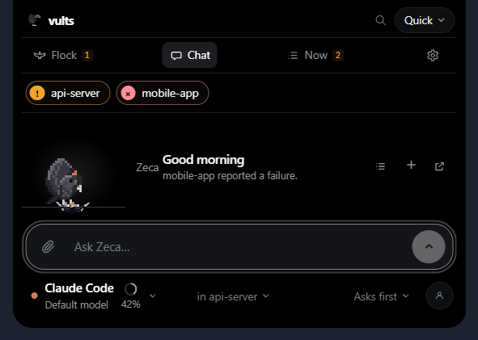
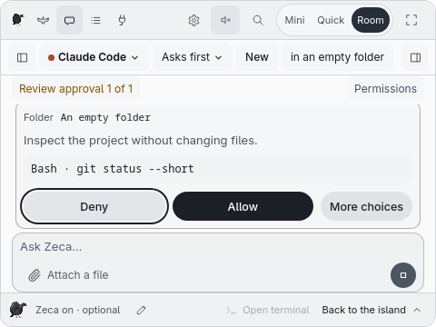
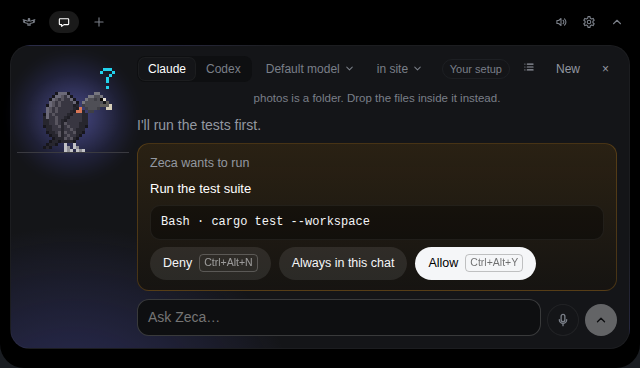
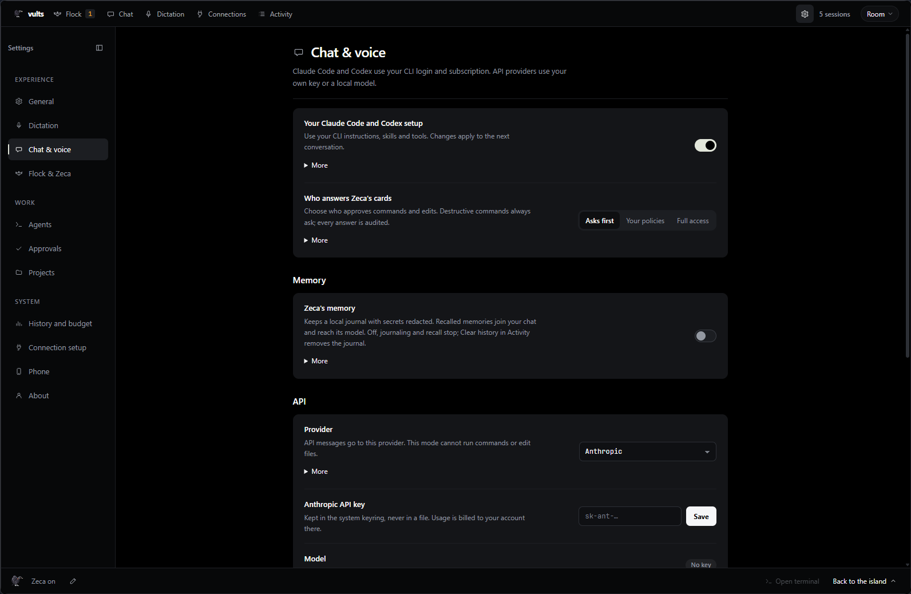

# Conversando com o Zeca
<!-- source: ba46991431e9 -->

Os painéis laterais redimensionáveis seguem o ponteiro que iniciou o arraste, ignoram toques adicionais e encerram o arraste quando a janela perde o foco. O cancelamento preserva a largura atual e mantém os rascunhos. Quando o espaço limita um painel, o arraste e o redimensionamento pelo teclado partem da largura visível; reduzir apenas o espaço disponível não sobrescreve a largura salva. Os controles de redimensionar e recolher usam a mesma cor de foco de teclado que o restante do tema selecionado.

Em janelas baixas do Nest, **Opções** reúne título, pasta, configuração, Nova e Memória, enquanto destinatário, executor e acesso continuam visíveis. A ajuda de configuração leva às configurações do Chat. As conversas recentes explicam quando uma ação em andamento impede a troca; busca e foco de teclado são preservados ao atualizar ou recuperar a lista, inclusive em Mostrar mais e Limpar filtros. Expandir a lista leva o foco à primeira conversa revelada; limpar os filtros devolve o foco à busca. Erros de destinatário mantêm o rascunho e oferecem uma nova tentativa explícita. A recuperação devolve o foco ao rascunho ou, se a leitura falhar novamente, ao botão de nova tentativa, desde que você não tenha movido o foco para outro controle. O Chat anuncia mudanças de estado da resposta e das permissões aos leitores de tela sem anunciar cada token. Falhas na Memória oferecem atualização sem repetir uma decisão; quando desativada, ela abre a seção Memória das Configurações. Os cartões de permissão do Flock mostram a ferramenta e o projeto exatos antes de confirmar **Sempre permitir**, e a cópia da pasta informa sucesso ou falha.

Abra a aba **Chat**, escolha **Chat…** no ícone da bandeja ou solte um arquivo na ilha. O Zeca tem um
poleiro ao lado do chat: ele pensa enquanto a resposta vem, inclina a cabeça quando pergunta algo a
você e engole os arquivos que você dá a ele. Escolha **Claude** ou **Codex** no seletor de motor (ou o provedor
de API que você configurou, veja abaixo); na ilha um controle compacto mostra o motor acima
do modelo, com fundo ao passar o mouse ou enquanto está aberto. Seu menu traz o motor, o modelo
e o esforço. No Quick, as ações da conversa ficam ao lado do Zeca, e o motor fica abaixo do rascunho.
Seu menu abre para cima usando a largura do rodapé, com uma única área de rolagem para listas
longas e opções de motor, modelo e esforço que quebram linha, também numa conversa já iniciada.
O Chat no Quick é um pouco mais largo que as outras abas (cerca de 561 pixels lógicos após o zoom).
O chat vazio no Quick fica baixo: o Zeca usa seu retrato original em 3x ao lado de
uma saudação, com o rascunho e os controles logo abaixo. O título some e o retrato
passa para 2x quando chegam mensagens. A superfície cresce com o conteúdo real da conversa
até atingir a altura disponível da ilha; então só a conversa rola. Começar uma conversa
vazia libera a altura anterior. Abrir, carregar e fechar o menu de motor não muda essa altura:
o menu fica sobre a conversa e rola dentro do espaço acima do rodapé. Uma área baixa mantém
o mesmo dimensionamento por conteúdo e controles menores.
A linha de uso e mídia não aparece nesse chat. Os chips de notificação só ocupam espaço quando
há itens reais: entram com expansão e somem completamente quando vazios, respeitando a redução
de movimento. Contêineres de alertas vazios não deixam espaçamento. A conversa usa a altura disponível,
sem limitar as respostas a 200 px. Os anexos rolam numa faixa horizontal, o rascunho tem altura
limitada e as mensagens mantêm sua própria área de rolagem. Uma área baixa esconde e pausa o retrato
para priorizar leitura e envio; voltar a uma área mais alta retoma a mesma cena.

Os motores vêm em dois grupos, **Your setup** (os
CLIs do Claude Code e do Codex, cada um *Signed in*, *Installed* ou *Not installed*: o Vults só olha
pergunta ao próprio CLI, `claude auth status` ou `codex login status`, e lê só se ele tem login,
usando como reserva se o arquivo de login existe; **Sign in** ao lado de um sem login abre um
terminal com o login do próprio CLI, que o Vults nunca vê; depois, cada agente que fala ACP e está
instalado aqui, como OpenCode, Qwen Code, Copilot CLI ou Kimi Code, que usa o próprio modelo e pede
um card antes de cada ferramenta que escreve ou roda) e **Vults harness** (a API, *Ready* com uma chave ou um modelo local),
com **Engines in Settings ›** embaixo. **New** (**+** na ilha) começa uma conversa nova; a anterior fica na lista (veja
[Conversas](#conversations)). Escolher outro motor num chat vazio começa com ele; numa conversa já
em andamento, o outro motor assume: as linhas ficam, uma nota diz quem continua, e o primeiro turno
dele começa com o que já foi dito (a sua primeira mensagem e as linhas mais recentes, no máximo
cerca de 12.000 tokens). **Esc** primeiro fecha um seletor aberto e depois fecha o chat; a conversa continua lá quando você volta.
Só um seletor fica aberto por vez. **↑/↓** no botão abre a lista e foca uma opção;
**↑/↓**, **Home** e **End** percorrem as opções sem aplicá-las. **Enter** ou um clique escolhe;
**Esc** devolve o foco ao botão. Clicar fora fecha a lista. O carregamento dos modelos mantém
na opção o foco, e as atualizações preservam um título de conversa ainda em edição.

O Chat vazio saúda você pelo horário local do desktop: bom dia a partir das 05:00, boa
tarde a partir das 12:00 e boa noite das 18:00 às 04:59. O texto de apoio prioriza uma sessão
esperando resposta, depois uma falha, depois trabalho ativo ou um bando tranquilo. No Room
e no Full, os cartões de perguntas seguem essas mesmas regras. Uma pergunta sobre sessão
inclui sua referência **@** exata; mantém seu texto, arquivos e pasta de execução.
Edite o rascunho antes de apertar **Enviar** ou **Enter**; clicar numa sugestão não a envia.

Sob a última resposta concluída, **Explique de forma mais simples** e **O que devo verificar
agora?** acrescentam uma pergunta ao rascunho editável. **Abrir Flock** aparece quando há
sessões e abre o Flock existente, salvando esse rascunho. Esses controles também aparecem
no Quick; somem durante um turno ou quando o último resultado falhou ou foi interrompido.
As saudações e sugestões usam regras locais, sem chamada ao modelo, fala, notificação ou
resposta a uma permissão. Com o Zeca desligado, elas não abrem o Chat.

O Zeca escuta brevemente enquanto você digita, pensa enquanto espera pelo modelo ou pela
transcrição de voz e busca enquanto uma ferramenta informada está em execução. Quando
chega texto novo na resposta, ele move o bico e se acomoda após uma pausa curta; se o fluxo
fica quieto, volta a pensar até o turno terminar. É uma reação visual, sem áudio de fala.
Abrir respostas salvas ou restaurar um rascunho não a reproduz. Toda permissão pendente
do Chat mantém a pose de pergunta, mesmo quando chegam arquivos ou outra ferramenta
informa progresso. O movimento reduzido mostra uma pose estática para o estado atual;
os companheiros escondidos param de desenhar.

No Quick, o compositor começa com uma linha de escrita e cresce conforme você digita, até o limite de altura.
O compositor usa uma linha arredondada: clipe à esquerda, rascunho no centro e microfone
opcional/Enviar à direita; o clipe mantém o nome acessível
e a dica **Anexar um arquivo**. Os cartões de arquivos ficam numa faixa própria acima dele. Suas mensagens ficam em balões à direita;
as respostas seguem na coluna da conversa.

O chat é do Zeca: com ele desligado (**Settings → Flock & Zeca → Zeca**) não há Chat nem
microfone do Chat, e arquivos soltos na ilha não são aceitos. O [ditado local independente](dictation.md#dictate-into-any-app)
continua funcionando, inclusive sua tecla de fala. Veja [Sem o Zeca](island.md#without-zeca).
Altere as teclas globais em Configurações do Sistema → Atalhos; Settings > General mostra os
vínculos informados pelo desktop.

## Onde ele trabalha

Antes da primeira mensagem, a pasta (*in vults ▾*, no topo no Nest, embaixo do campo na ilha) diz onde a conversa vai trabalhar: a
pasta da sessão em primeiro plano, a menos que você escolha outra das sessões no fio, ou uma pasta
vazia só dela. Depois que a conversa começa, ela fica lá até **New**.

## Modelo e esforço

Ao lado da pasta (na ilha, no botão abaixo do rascunho), *Default model ▾* escolhe o modelo e o quanto ele pensa, para o Claude e para o
Codex. O Claude oferece Opus, Sonnet e Haiku (os nomes do Claude Code para o mais recente de cada
um); o Codex lista os modelos que o seu próprio `codex` oferece, perguntados na primeira vez que você
abre o seletor com o Codex. O esforço vai de **Low** a **Max**, só com os que o modelo escolhido
aceita. **Default** deixa cada um para a CLI, como as suas configurações definem.

No Quick e no Nest, um anel e a porcentagem ao lado do modelo mostram a janela ativa mais
cheia do plano da CLI selecionada. **0%** é um zero informado; janelas ausentes ou expiradas
ficam sem indicador. **Atenção** começa em 70%, e **Perto do limite** em 90%. Passe o mouse no
controle para ver cada janela informada e seu horário de renovação, quando conhecido. O nome
acessível do controle inclui o uso e o estado. As janelas somem no horário de renovação sem
esperar outra leitura.

Isso reaproveita as leituras existentes da linha de status do Claude Code e as leituras
opcionais do plano do Codex nas configurações; abrir o Chat não adiciona consultas ao provedor.
O chat por API não tem indicador de assinatura. As atualizações de uso mantêm o rascunho,
os arquivos, a posição de leitura e o menu de modelo aberto.

Se uma CLI não conseguir listar os modelos, o seletor mostra uma explicação e
mantém seu rascunho e sua escolha de modelo. Feche e reabra o seletor para tentar
de novo; digitar ou atualizar o chat não repete continuamente a consulta que falhou.

A escolha é lembrada por pasta e por motor: uma conversa nova naquela pasta começa com ela. Ela
também pode mudar no meio da conversa: o próximo turno roda com o novo modelo e esforço, e a
conversa continua; uma resposta que já está chegando mantém o que começou usando. O modelo do chat por API é escolhido em **Settings → Chat & voice**.

## Mencionando o bando

Numa conversa com pasta, **@** e algumas letras também listam os arquivos e pastas dela
(`File: src/main.rs`, `Folder: src/auth`), primeiro. Escolher um coloca o caminho no rascunho como
texto, como `@src/main.rs`, para o agente abrir onde roda; controle de versão, dependências e
pastas de build ficam de fora. Uma pasta solta no chat entra do mesmo jeito, pelo caminho completo,
e nunca é copiada.

Digite **@** no rascunho para encontrar uma sessão ou projeto aberto. Busque pelo projeto,
agente, pasta ou ID da sessão. **↑/↓** percorrem as sugestões; **Enter**, **Tab** ou um clique
inserem a referência escolhida. O foco continua no rascunho, e escolher nunca envia uma
mensagem. **Esc** fecha as sugestões. Uma referência aparece como `@"Sessão: Codex · site"`
ou `@"Projeto: site"`; nomes repetidos mostram a pasta completa ou o ID da sessão. Você pode
selecionar até oito referências, incluindo várias sessões numa mensagem.

Uma referência de sessão seleciona aquele agente e ID exatos. Uma referência de projeto
seleciona as sessões do bando naquela pasta exata, incluindo seus diferentes agentes.
Ao enviar, o contexto do bando e as ferramentas que o consultam leem somente essas seleções
naquele turno. Isso funciona nos motores CLI e API. As referências não mudam a pasta de
trabalho da conversa nem respondem aos cards, e as mensagens anteriores continuam na
conversa. Sem referências, o contexto habitual do bando continua igual.

As referências acompanham o rascunho ainda não enviado entre Quick e Nest, junto com os
anexos. Remova a referência inteira entre aspas para deixar de incluí-la. Se editar, colar
ou recuperar uma referência sem sua seleção, escolha-a novamente nas sugestões de **@**.
Se uma sessão ou projeto mencionado tiver saído do bando, o Vults pede para remover a
referência e escolher novamente antes de iniciar um turno, mantendo o rascunho e os anexos
editáveis. Uma conversa salva mantém o texto legível da referência; selecione-a novamente se
trouxer esse texto para um novo rascunho.

## O Nest

O texto ainda não enviado, os anexos e a pasta escolhida acompanham você entre a ilha e o Nest.
Voltar do Chat do Nest abre o Chat no Quick. O rascunho fica em memória até você
enviar, começar ou abrir outra conversa, ou sair do Vults.

A seta no topo do chat da ilha abre o [Nest](nest.md), a janela do próprio Vults. A aba **Chat**
dele é a mesma conversa, larga, com respostas em Markdown completo; os cards dela são respondidos
ali também. **Memory**, ao lado, mostra o que o Zeca lembra.

O Chat vazio no Nest centraliza o retrato original do Zeca em 3x acima de **Perguntar ao Zeca**
e de uma lista vertical de sugestões. Quando chegam mensagens, a mesma cena usa um poleiro
menor em 2x acima do compositor. Seu espaço próprio mantém as mensagens livres da ave
durante toda a rolagem. O cabeçalho baixo, o espaçamento menor entre mensagens e o rascunho
inicial de uma linha deixam mais espaço para leitura; o campo cresce conforme você digita.
O compositor usa uma linha arredondada de cerca de 52-54 px de altura em repouso, com anexo à
esquerda e microfone/Enviar à direita. Janelas baixas mantêm os controles menores e textos
longos continuam rolando dentro do limite. Conversa e compositor compartilham uma coluna de
até 760 px de largura. Os anexos ficam numa
faixa horizontal com altura limitada, com nomes longos legíveis dentro de cada cartão.
Janelas baixas limitam o campo de escrita e omitem a dica de teclado; com até 560 px de altura,
também recolhem o retrato e usam controles menores no compositor.

O Zeca fica no poleiro enquanto a conversa rola. Passe o mouse nele para chamar sua atenção, ou
clique em **Cumprimentar o Zeca** para ele acenar enquanto está ocioso. Pensamento, voz, perguntas
e arquivos usam as mesmas animações da ilha; um cumprimento nunca responde a um card. Em janelas
baixas, o poleiro recolhe para manter o compositor e as ações acessíveis. A animação para de desenhar
quando o Chat está oculto, a janela está minimizada ou a tela está bloqueada.

## Continuando uma sessão

`/continue <palavras>` entrega as suas palavras a uma sessão do Claude Code ou do Codex na pasta da
conversa que parou nos últimos dez minutos, como o próximo turno dela: o Vults a retoma aqui, com
as configurações dela, no sandbox dela, e ela volta a aparecer no bando com os cards dela.
Só uma sessão cujo processo acabou: uma que ainda está aberta no terminal é recusada, então você
fala com ela lá. Uma por vez; `/continue stop` encerra. Não vai para nenhum modelo do Zeca. No
Windows, só sessões do Codex podem ser continuadas: o Claude Code não tem sandbox no Windows nativo,
e o Vults só executa uma sessão continuada dentro de um.

## Conversas

Toda conversa é salva neste computador enquanto acontece, e o botão de lista no topo do chat mostra
todas, a usada por último primeiro, com o motor e a pasta de cada uma. Clique numa para continuar de
onde parou, mesmo depois de reiniciar: ela mantém o motor, a pasta, o modelo e o esforço, e a CLI dela
retoma a própria sessão (a sessão do Claude Code, a thread do Codex; o chat por API reenvia o que foi
dito, com cada arquivo mandado guardado só como um rótulo: um arquivo de texto pelo nome, um documento pelo título, uma imagem como "uma imagem", nunca pelo conteúdo). O lápis renomeia; o xis apaga depois de um segundo clique, com tudo o que foi dito nela.

O que é salvo é o que o chat mostra: suas mensagens e os nomes dos arquivos que você mandou, as
respostas do Zeca, erros e paradas; nunca a resposta a um card (o log de auditoria guarda essas) e
nunca uma regra *Always in this chat*, então uma conversa aberta de novo pergunta como uma nova
perguntaria. As 200 mais recentes ficam guardadas, no mesmo `vults.sqlite` local do histórico de
atividade; **Settings → History and budget → Clear history** apaga todas. Uma conversa cuja pasta sumiu não pode
ser aberta de novo.

## O que o Zeca sabe

Cada mensagem leva, antes das suas palavras, um bloco `<today>` com a data e a hora deste computador
e um bloco `<flock>` com uma linha para cada sessão que a ilha mostra (até 12, depois "and N
more"): o agente, o projeto, o estado e o passo em que está (segredos redigidos), nunca o comando
sobre o qual um card pergunta. Isso vai para quem roda o chat, o provedor da CLI ou o da API, junto
com a mensagem.

Com a memória ligada, o que o Zeca lembra e o que ele recupera também entram: veja
[A memória do Zeca](memory.md).

## Escrevendo e lendo

- **Enter** envia, **Shift+Enter** começa uma nova linha. Enquanto uma resposta chega, **Enter** põe
  a mensagem numa fila acima do rascunho (**×** tira da fila); quando o turno termina bem, a fila
  sai, em ordem, um turno para cada uma. Depois de **Stop** ou de um erro nada sai sozinho: as
  palavras da fila voltam para o rascunho. **↑** com o campo vazio traz
  de volta a sua última mensagem, e cada **↑** seguinte uma anterior; **↓** volta para frente, até
  um rascunho vazio depois da mais nova. A sua última mensagem também oferece **Edit and send
  again** enquanto nenhum turno roda, e toda mensagem sua pode ser copiada. **/** no começo do rascunho
  lista os comandos do chat: `/remember`, `/forget`, `/continue` e `/new`, que começa uma conversa
  nova na hora.
- Quando o agente te pergunta algo (`AskUserQuestion` do Claude Code), o card mostra cada pergunta
  com as opções: um clique em cada volta como a sua resposta, ou escreva a sua e aperte **Enter**.
  O acesso total nunca responde uma pergunta por você. Enquanto um card de permissão espera,
  escrever e apertar **Enter** também responde: um não com as suas palavras, que o Claude Code lê (o
  Codex e os agentes ACP recebem um não simples).
- Enquanto o Zeca responde, o botão de enviar vira **Stop**: ele encerra o turno ali, e tudo o que o
  turno estava esperando vira um não.
- A resposta chega à medida que é escrita. Role para cima para ler e ela fica onde você está, com um
  botão *↓ new text* para voltar ao fim.
- **Copy** embaixo da última resposta copia ela inteira, no Markdown em que foi escrita; uma resposta
  mais antiga mostra o botão quando o ponteiro passa sobre ela. Um bloco de código tem o seu próprio
  **Copy**. Se a cópia falhar, o botão avisa e permite tentar de novo.
- Tanto Quick quanto Room mostram títulos, listas, citações, código e tabelas. Código e tabelas
  largas têm uma área de rolagem própria que aceita foco pelo teclado. Links continuam como
  texto, com o endereço ao lado do rótulo; um endereço solto aparece como um. `~~texto~~` risca o
  texto, e listas `- [ ]` / `- [x]` ganham as suas caixas.
- Um turno que falha diz por quê, com **Try again**: ele envia as mesmas palavras e arquivos mais uma
  vez.
- Enquanto um turno roda, a linha embaixo da conversa diz o que o agente está fazendo agora
  (*Executando cargo test…*, *Editando lib.rs…*), com quanto tempo o turno já rodou depois que ele
  passa de três segundos. Quando ele termina, a sua **Atividade** diz quanto tempo levou.
- Ao lado de **Send**, um pequeno anel diz o quanto o contexto do modelo está cheio assim que o
  motor informa (Claude Code e Codex): a fração da janela, ou só os tokens até a janela ser
  conhecida. Ele fica âmbar depois de 80%: hora de uma conversa nova, ou de deixar o motor compactá-la.
- **Ctrl+F** (**⌘F**) busca na conversa: conta as mensagens que batem, **Enter** e
  **Shift+Enter** passam por elas, **Escape** fecha.
- No Nest a conversa é lida em uma coluna da largura do campo de texto, por mais larga que seja a
  janela. Cada resposta vem assinada pelo Zeca e pelo motor que a escreveu, e um bloco de código diz
  a sua linguagem.

## Falando em vez de digitar

O ditado independente tem suas páginas de configuração em **Ditado**. **Ditado > Voz** reúne
o modelo e idioma falado compartilhados, com um link em Chat e voz. O ditado continua disponível
com o Zeca desligado.

Ligue uma vez em **Ditado > Voz**: baixe um modelo (*Base* tem 60 MB e é rápido; *Small*
e *Large v3 Turbo* entendem melhor sotaques e nomes). Um microfone aparece ao lado de Enviar, à direita do rascunho,
tanto no Nest quanto na ilha.

- Clique no microfone e fale. Ele para sozinho depois de cerca de 1,5 s de silêncio após as suas
  palavras, ou quando você clica de novo; as palavras caem no campo de entrada para você ler e
  corrigir, e aí **Enter** as envia. O silêncio antes de você começar nunca o interrompe; se uma
  pausa o interromper, clique de novo para continuar.
- **Ctrl+Alt+V** sempre usa o [ditado independente](dictation.md#dictate-into-any-app),
  mesmo com o Chat em foco. Nunca abre o Chat nem inicia este microfone. Use o botão de microfone
  para preencher diretamente este rascunho; o ditado independente segue seu caminho normal de
  cópia/inserção.
- Em Sala ou Tela cheia, as barras de volume e a prévia da fala do microfone ficam nessa janela.
  Sair do Chat, ocultar ou fechar a janela, ou bloquear a tela cancela sua gravação ativa.
- **Esc** enquanto ele escuta descarta a gravação. Uma gravação para sozinha depois de um minuto.
- **Language you speak** (idioma que você fala) segue o do seu sistema; escolha outro, ou *Detect
  it each time*. Um idioma fixo é muito mais confiável em frases curtas. O *Base* é fraco fora do
  inglês: em português use o *Small*, ou o *Large v3 Turbo* com uma GPU.

Só a sua fala vai para o whisper: um pequeno detector de fala (Silero VAD, menos de 1 MB) corta o
silêncio em volta dela, para o whisper não inventar palavras ali. Ele é baixado sozinho enquanto a
voz está ligada e ele falta; até lá, o microfone só para com um clique. Com uma GPU (Vulkan: AMD,
Intel ou NVIDIA) uma frase leva uma fração de segundo e uma prévia esmaecida das suas palavras
aparece enquanto você fala; no processador, escolha o *Base*.

Tudo acontece neste computador: o whisper.cpp transcreve o áudio na memória, e o áudio nunca é salvo
nem enviado para lugar nenhum. Os modelos e o detector são conferidos contra o SHA-256 conhecido
deles antes de serem usados.

## Lendo um turno

A resposta fica separada de uma seção **Atividade** recolhida. Abra para ver o pensamento
legível fornecido pelo motor e as ferramentas que ele informou. Cada ferramenta mostra seus
argumentos ou comando, a conclusão ou falha informada e, quando o motor informa (os resultados de
ferramenta do Claude Code, a saída de comando do Codex), os últimos 4.000 caracteres do que ela
imprimiu, com segredos ocultados. Uma edição mostra a sua mudança em linhas coloridas, com as
linhas que adicionou e removeu na sua linha (Edit, MultiEdit e Write do Claude Code; as mudanças de
arquivo do Codex). Resultados ausentes ficam como **Nenhum
resultado informado**; o Vults não inventa pensamento nem trata a duração do turno como tempo
medido de pensamento. O Codex mostra seus resumos públicos de raciocínio; motores que não fornecem
detalhes informam isso.

Somente uma aprovação pendente fica expandida por vez. **Revisar aprovação** volta àquela
solicitação exata; Anterior/Próxima seleciona outra sem responder. Cartões novos entram subindo
com uma transição curta, desativada com movimento reduzido. Cartões respondidos viram registros
recolhidos com o escopo disponível nos detalhes. O fim do turno expira os cartões sem resposta como
**Cancelado**. Ler mensagens anteriores preserva sua rolagem; o controle de revisão continua
acessível acima da conversa.

A atividade é salva localmente com a conversa, com segredos reconhecidos ocultados, tamanho de detalhes limitado e aviso explícito
quando reduzida. Reabrir mostra apenas o histórico: nunca repete um comando ou resposta de permissão.
Solicitações em andamento mantêm seus detalhes completos ao alternar entre Quick e Ninho.

**Permissões** ao lado da fila abre **Configurações → Chat e voz**. **Pergunta antes** pede
aprovação para cada comando ou edição. Para reduzir repetições, escolha suas políticas aceitas ali;
chamadas não cobertas e ações destrutivas continuam perguntando. **Sempre neste chat** cobre apenas
a mesma chamada exata elegível até a conversa acabar. O Zeca recebe a orientação de preferir ferramentas
de leitura e busca para inspeções simples e evitar chamadas desnecessárias em conversas comuns. Essa
orientação não muda as verificações de permissão. Recolher um cartão nunca concede acesso.

## O que ele pode fazer

- Ele lê arquivos daquela pasta livremente.
- Todo comando e toda edição aparecem na conversa como um card igual ao da própria ilha: o que o Zeca
  pretende fazer, o comando inteiro ou o arquivo com suas linhas **+/−**, e **Deny** e **Allow** lado
  a lado com suas teclas (**Ctrl+Alt+N** / **Ctrl+Alt+Y** respondem de qualquer lugar). Nada roda até você
  responder, e um card que ninguém responde é um não. O card informa sua pasta e o estado da permissão,
  com a operação completa em uma área rolável. **Deny** ganha destaque quando o backend não
  oferece uma regra para a chamada exata ou a conversa leu conteúdo de fora; a decisão e a
  disponibilidade de **Always in this chat** continuam com o responsável atual pelas permissões.
- Depois que a conversa lê conteúdo de fora (uma página ou busca na web, um comando que rodou
  `curl`, `git pull` ou `gh`, uma ferramenta MCP que não seja as do `vults-zeca`, o
  servidor que o Vults entrega ao Claude Code do chat), todo card seguinte avisa em vermelho: uma página pode trazer palavras
  escritas para conduzir o Zeca, então leia com cuidado o que o card pede. Só conta uma chamada que
  rodou (um fetch negado não leu nada), compilar e testar nunca contam, e o aviso vale pelo resto
  daquela conversa, também quando ela é aberta de novo pela lista. Uma conversa nova começa limpa.
- **Always in this chat** permite aquela chamada exata de novo (o comando e a entrada inteiros,
  não o texto do card) sem card, até a conversa acabar: **New**, outro motor, ou o Zeca desligado.
  Um card que não consegue nomear a chamada inteira não tem esse botão. Toda vez que a regra
  responde, o chat mostra *Allowed for this conversation* e o log de auditoria guarda. Comandos
  destrutivos sempre perguntam: nunca oferecem esse botão, e uma regra existente da conversa
  não pode respondê-los. As regras nunca são salvas.

### Quem responde os cards do Zeca

**Settings → Chat & voice → Who answers Zeca's cards** escolhe, para toda conversa, na hora:

- **Asks first** (o padrão): um card para cada chamada, como acima.
- **Your policies**: as [políticas](approvals.md#policies) que você aceitou respondem as chamadas do
  chat como respondem as do Claude Code na ilha. Um deny nega, um allow permite (chamadas do Claude
  Code, dentro da pasta da conversa), o resto pergunta.
- **Full access**: ao escolher, nas Configurações ou no menu do chat, você confirma antes; depois
  nada pergunta: todo comando e edição roda sem card, os destrutivos inclusive, e também depois de a
  conversa ler uma página web, a saída de rede de um comando ou uma ferramenta MCP. Só o que uma
  política sua nega é recusado: adicione linhas `deny` a uma política para o que nunca deve rodar. O
  próprio agente roda no modo dele que não pergunta nada (`bypassPermissions` do Claude Code, `never`
  sem sandbox do Codex), a partir do próximo turno, sem reiniciar a conversa; enquanto uma política
  sua negar algo, o Vults responde os pedidos no lugar dele, para que essa negação continue valendo.

O chat diz cada resposta dada assim (*Allowed by your policy*, *Denied by your policy*, *Ran with
full access*), e o log de auditoria guarda. O chip dele, ao lado do modelo (âmbar com um sinal de aviso
no acesso total), mostra a escolha; dali você só pode devolver acesso. Mais acesso é dado em Settings.

## Arquivos

Clique no clipe do chat para escolher arquivos, ou arraste um sobre a ilha e solte na área onde o
Zeca espera de bico aberto. Nos dois casos ele engole o arquivo, um urubu o leva até o outro lado
enquanto uma barra enche, e ele entra na sua próxima mensagem: um cartão dentro do compositor com o nome
e a extensão do arquivo (**×** o retira). Nomes longos quebram linha, e uma lista longa de arquivos rola
dentro do compositor. Clique no campo para escrever sobre ele. Você pode enviá-lo sem texto para perguntar o
que ele é. Imagens, PDFs, código e texto funcionam melhor. Os arquivos são copiados para
a caixa de entrada do app (até 20 MB cada) e apagados depois de uma semana; um arquivo com mais de
20 MB é recusado com uma linha dizendo por quê, e uma pasta entra no rascunho pelo caminho
([Mencionando o bando](#referencing-the-flock)). Uma imagem colada no rascunho é anexada do mesmo
jeito, e também um texto colado de 32 KB ou mais, como um arquivo próprio.

No Windows, arquivos arrastados do Explorer usam os objetos nativos de arquivo do WebView2 e
aceitam até 256 arquivos por vez. Se o WebView2 instalado não conseguir recebê-los, o cursor
continua indicando que o arraste está indisponível; use o clipe. Soltar um arquivo o anexa ao
rascunho; isso não envia a mensagem.

## Sua assinatura, seu login

O chat roda o comando `claude` ou `codex` em que você já fez login, então ele usa a sua própria
assinatura e o Vults nunca lê suas credenciais. Os dois transmitem a resposta à medida que ela é
escrita: o Claude por `claude -p`, o Codex por um único `codex app-server` de longa duração.

### Sua configuração

O chat lê a sua própria configuração do Claude Code e do Codex, como no seu terminal: seu
`CLAUDE.md`, skills, servidores MCP, hooks e regras de permissão (um ícone de pessoa junto aos controles do chat avisa).
As configurações e os servidores do `.mcp.json` de um projeto só entram numa pasta em que você já
confiou no Claude Code; o `CLAUDE.md` dele é lido de qualquer jeito. As suas regras de permissão
valem em qualquer pasta. Os cards continuam perguntando o que suas regras não liberam, seja qual for
o `defaultMode` das suas configurações, e os seus hooks nunca fazem o chat aparecer como uma sessão
de agente.

Escolha por conversa no ícone de pessoa junto aos controles do chat: **Your setup** ou **Clean**,
antes da primeira mensagem (a escolha também vira o padrão das próximas, como o interruptor em
**Settings → Chat & voice → Your Claude Code and Codex setup**). No limpo, o Claude não lê nada
disso, e o Codex começa numa pasta própria: nada do seu `config.toml`, servidores MCP, skills, hooks
ou `AGENTS.md`, com o seu login guardado só na memória. Bom saber:

- `claude -p` pula a pergunta de confiança, então um repositório que você acabou de clonar não
  consegue trazer regras ou hooks próprios.
- Uma regra de permissão como `Bash(npm test:*)` roda o script de teste de um projeto clonado sem
  card.
- Com o interruptor desligado, o Claude não recebe servidores MCP além do próprio Vults, e nenhuma
  regra salva pula um card.
- Uma conversa já em andamento mantém o que leu.

Veja [Segurança](../safety.md) para o resto.

## Sem uma CLI: uma chave de API, ou um modelo local

O chat também pode usar a API de um provedor com a sua própria chave, ou um modelo rodando na sua
máquina. Em **Settings → Chat & voice**, escolha o **Provider**, cole a chave dele e escolha um **Model**; o
nome do provedor então aparece no seletor de motor do chat, ao lado de Claude e Codex.

| Provedor | Chave | Observações |
|---|---|---|
| Anthropic | `sk-ant-…` | Claude Opus 5.5 até você escolher outro modelo |
| OpenAI | `sk-…` | |
| Google Gemini | `AIza…` (Google AI Studio) | |
| OpenRouter | `sk-or-…` | Uma chave para centenas de modelos |
| Groq, DeepSeek, Mistral, xAI | a de cada um | |
| Ollama | nenhuma | Precisa estar rodando em `127.0.0.1:11434` |
| LM Studio | nenhuma | O servidor dele precisa estar ligado, em `127.0.0.1:1234` |

- Os modelos são listados ao vivo pelo provedor. Cada provedor guarda o modelo que você escolheu
  para ele.
- Uma chave fica no [chaveiro do sistema](../reference/settings.md#where-things-live-linux), nunca
  é mostrada de novo, e só é enviada para o próprio provedor; **Remove** a apaga. O uso é cobrado na
  sua conta com aquele provedor.
- Este chat não pode rodar comandos, editar arquivos nem olhar seu projeto. Ele lê o que você digita
  e os arquivos que você solta (imagens, texto até 512 KB, e PDFs com a Anthropic), e chama
  ferramentas quando uma pergunta precisa: as do bando (suas sessões, os cards esperando, o uso dos
  seus planos, seu card do GitHub), `recall` e `memory_propose` com a memória ligada, e as da web com
  a web ligada. O que uma ferramenta devolve vai para o provedor (comandos com os segredos
  redigidos); ele nunca responde um card.
- Modelos de raciocínio que pensam em voz alta só mostram a resposta: a parte `<think>` fica oculta
  e nunca é enviada de volta.
- Uma conversa mantém o provedor e o modelo com que começou.
- Com a Anthropic, um pedido que o Claude recusa por motivos de segurança é tentado de novo com
  outro modelo Claude na mesma chamada; se esse também recusar, o balão avisa.

### A web

Com **Settings → Chat & voice → Web for Zeca** ligado, o chat por API pode buscar na web e ler páginas. As
buscas vão para o Brave Search ou o Tavily com a sua própria chave (guardada no chaveiro), ou para
um SearXNG que você roda. Desligado, o modelo nunca recebe nenhum dos dois.

Uma página não é confiável, então o modelo do chat nunca a vê: uma chamada separada ao seu provedor
de API, sem ferramentas e avisada de que a página é dado, a lê para a pergunta, e só essa resposta
volta. Os títulos e trechos de uma busca chegam ao modelo, marcados como não confiáveis. Páginas só
são lidas de endereços públicos. Cada busca e cada página é uma requisição em seu nome com um limite
diário ([Segurança](../safety.md#every-request-vults-makes)), e a conversa então conta como tendo
lido de fora.

## Perfis de agentes

Abra **Bando → Especialistas** para criar um agente, copiar um modelo ou editar um agente
personalizado. O urubu animado, as instruções e as skills fixadas com busca pertencem ao perfil.
Skills orientam o comportamento; nunca concedem ferramentas ou permissões. Salvar registra o
conteúdo e os padrões de execução localmente, sem iniciar um modelo. **Padrões da conversa** altera
as preferências de um modelo sem copiar suas instruções. Conversas existentes mantêm sua revisão
e seu modelo salvos.

Claude Code executa atualmente as conversas de especialista na aba Chat existente, isoladas da
memória do Zeca e do contexto do bando. Padrões de modelo/esforço do Claude valem para novas conversas.
Escolha um projeto opcional no controle de pasta antes de enviar; depois disso, o projeto fica fixado.
Conversas novas limpam o projeto anterior. Pastas ausentes ou inválidas são rejeitadas preservando o
rascunho. Essa escolha não habilita configurações do projeto, servidores MCP ou ferramentas do companheiro.

Agentes via API/local usam o provedor e modelo escolhidos nos padrões (ou o modelo salvo daquele
provedor). Recebem suas instruções fixadas, próprias mensagens e anexos selecionados explicitamente,
sem acesso ao terminal ou projeto. Configure chaves de nuvem nas Configurações; provedores locais usam os endpoints
locais existentes. Um papel via API nunca concede acesso ao terminal. GitHub exige a autorização
separada do perfil descrita abaixo. Provedor, modelo e mensagens ficam fixados ao reabrir, mesmo após
alterar os padrões futuros. Especialistas Codex usam a CLI instalada e o login existente da assinatura
ChatGPT, com diretório próprio do app por perfil e conta/workspace autenticados. Conversas existentes
recusam outro login; inicie uma nova conversa para usá-lo. A renovação do token mantém a mesma
identidade. Apenas metadados de propriedade em hash são salvos. Não herdam instruções, hooks, skills ou MCP externo
do usuário/projeto. Credenciais são passadas apenas em memória; a CLI existente renova os tokens.
Uma falha ao iniciar isoladamente nunca usa outro executor ou um caminho CLI sem qualificação. Escolha permissões diretamente no Chat; Ask, políticas ou acesso total de cada perfil
são independentes do Zeca. Cópias e agentes novos começam com Ask.

Antes da primeira mensagem, clique no controle de executor do especialista para abrir
**Configuração da conversa**. Mantenha **Usar padrões do agente** marcado ou desmarque para escolher
Claude Code, Codex ou um provedor API/local configurado, modelo e esforço da CLI para esta conversa.
**Aplicar nesta conversa** preserva o rascunho da mensagem e mantém iguais as instruções, skills,
permissões e padrões do perfil. Uma falha ao salvar mantém a escolha anterior ativa. Agentes por API
continuam sem acesso ao terminal ou projeto; escolha uma pasta vazia antes de mudar para um provedor API.

O clipe do especialista abre um seletor de arquivos para aquele perfil e conversa, inclusive com
Zeca desligado. Escolher arquivos nunca os envia automaticamente. Eles ficam acima do campo até
serem removidos ou enviados; uma mensagem só com arquivos é permitida. Uma conversa nova ou mudança
de fonte descarta o resultado de um seletor pendente. Trocar de destinatário não entrega os arquivos
ao Zeca ou a outro perfil. Os limites são 16 anexos e 20 MB no total por mensagem; cópias ausentes,
links e caminhos forjados são rejeitados preservando o rascunho editável. As cópias são privadas e
os arquivos originais existentes nunca são substituídos.

Valem os formatos de arquivo já suportados pela API: imagens/texto compatíveis e PDFs no protocolo
Anthropic. Arquivos incompatíveis ou textos maiores que 512 KB são apenas nomeados, sem conteúdo
embutido. O histórico salvo da API mantém nomes dos anexos, nunca seus bytes. Anexos são conteúdo
externo: com **Asks first** ou **Your policies** os cards avisam; o acesso total continua sem perguntar nada. Arquivos
não habilitam ferramentas da API, GitHub ou acesso ao projeto. Arrastar arquivos para especialistas
não é adicionado nesta etapa; use seu clipe.

A escolha ainda não enviada permanece no perfil enquanto o app está aberto e sobrevive ao fechamento
do Nest ou à troca de destinatário. Após o primeiro envio, executor/modelo/fonte salvos ficam fixados,
inclusive se o primeiro turno do modelo falhar. **Nova** limpa a escolha específica e volta aos
padrões do agente. Isso não inicia uma requisição ao modelo. Escolhas não enviadas, assim como
rascunhos não enviados, não são salvas entre reinícios do app.

**Arquivar agente** preserva suas revisões e conversas. Encontre-o em **Arquivados** e use
**Ver conversas** para ler o histórico ou **Restaurar agente** para voltar a enviar. Arquivar bloqueia
novos turnos e reinícios, enquanto um turno já admitido pode terminar. Parar e os cards de aprovação
pendentes continuam disponíveis. Restaurar preserva os padrões e as permissões escolhidas separadamente.

As ações do histórico ficam restritas ao destinatário: Zeca não pode renomear ou excluir uma
conversa de especialista, nem um especialista acessar o histórico de outro. Rename e Delete
preservam o rascunho e os anexos se houver falha ao salvar, com o erro visível para tentar novamente.
Excluir a conversa atual limpa rascunho, anexos, projeto e modelo específico somente após a exclusão
ter sucesso. Conversas de agentes arquivados podem ser excluídas sem restaurar o agente ou iniciar
um turno.

New e a abertura do histórico salvam o rascunho atual antes de trocar de conversa. Durante a troca,
os controles de conversa aguardam a conclusão. Se salvar ou trocar falhar, o rascunho e os anexos
permanecem para tentar novamente. Um pedido atrasado não pode substituir uma conversa selecionada
mais recentemente em outra janela, mudar a identidade do perfil ou encerrar os cards de aprovação
de um turno em andamento.

### GitHub para Desenvolvedor e Revisor

Em **Bando → Especialistas**, selecione **Desenvolvedor** ou **Revisor**, informe um repositório
exato como `owner/name` e clique em **Ativar GitHub**. A conexão GitHub já deve estar ligada e ter
saldo de requisições. A autorização salva mostra conta e host antes de iniciar um turno. Cada perfil
é independente, começa desligado e funciona com Zeca desligado. Cópias não herdam autorização.

O executor escolhido pode usar as leituras limitadas e ferramentas aprovadas de issues, pull requests,
revisões, Actions e merge desse repositório. Executores API de nuvem compatíveis rodam essas ferramentas no Vults; provedores locais mantêm apenas mensagens.
Claude e Codex usam um relay privado por turno. Nenhum snapshot global, busca de conta/repositórios,
ferramenta do bando ou memória entra no especialista. Leituras usam o saldo da conexão, incluindo
verificações da conta, e trazem conteúdo externo para a conversa. Toda escrita ainda mostra seu card
humano exato; acesso total nunca pula esse card nem uma negação das políticas.

Clique em **Desativar GitHub** para revogar a autorização, inclusive a autoridade de uma proposta
pendente. Desative antes de mudar o repositório. Reativar cria uma nova versão e nunca reativa escrita
antiga pendente. Mudanças de conta/host exigem revisar e ativar novamente. O aviso no Chat mostra o
repositório/conta/host esperados. Uma escrita já enviada ainda pode terminar: confira o resultado em
Atividade/auditoria antes de tentar novamente. Esses controles abrangem ferramentas da conexão Vults;
um comando de shell que você aprove separadamente mantém sua própria permissão de comando.
