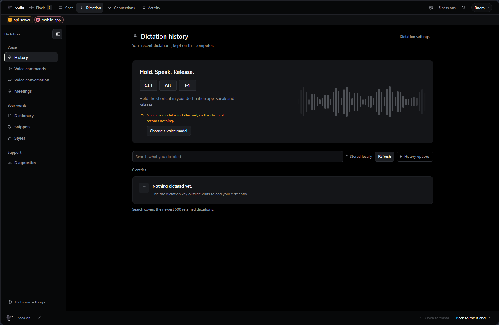
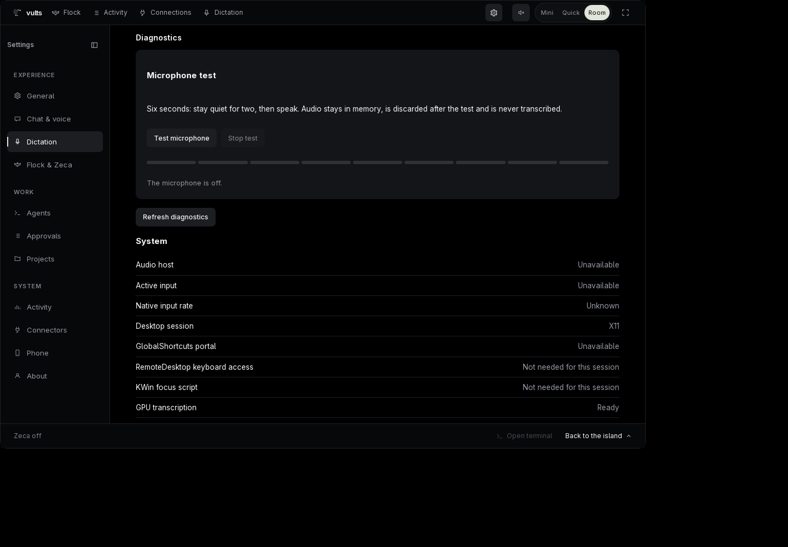

# Ditado
<!-- source: 46d302306e04 -->

Fale e suas palavras viram texto no aplicativo que você estava usando. Tudo roda neste computador:
o modelo de fala é local, o áudio fica na memória e nada é enviado com Enter. O ditado funciona com
o Zeca ligado ou desligado.

Comandos de voz e a conversa com o Zeca têm a página própria, [Voz](voice.md); gravar uma reunião
fica em [Reuniões](meetings.md).

## Primeiro ditado

1. Abra **Configurações > Ditado > Voz** e instale um modelo de fala. *Small* é um bom começo; num
   computador com GPU (Vulkan), *Turbo* é mais rápido e mais preciso.
2. Aceite o pedido do desktop para os atalhos globais. **Configurações > Ditado > Atalhos de
   teclado** mostra as teclas realmente vinculadas.
3. Clique no aplicativo onde quer o texto, **segure Ctrl+Alt+V**, fale e solte.
4. Espere **Copiado** e cole (Ctrl+V, ou Ctrl+Shift+V num terminal).

Uma cápsula pequena na parte de baixo da tela mostra o microfone, as faixas de som enquanto você
fala e o resultado. Ela nunca pega o foco nem cliques, e some sempre que aparece um card de permissão.

## Ditar em qualquer aplicativo

| Tecla | O que faz |
| --- | --- |
| **Ctrl+Alt+V** | Segure por pelo menos 300 ms, fale, solte. Dois toques curtos mantêm a gravação sem as mãos até o próximo toque |
| **Ctrl+Alt+X** | Cancela o ditado, mesmo durante a transcrição |
| **Ctrl+Alt+B** | Copia de novo o último ditado |

- **Só segurar** (em Atalhos de teclado) desliga o toque duplo.
- No X11, **Espaço** enquanto segura também trava a gravação sem as mãos, e **Esc** cancela. Os dois
  podem ser desligados. No Wayland, use o toque duplo e Ctrl+Alt+X.
- Dizer **cancela** ou **deixa pra lá** no final (*cancel*, *never mind*, *déjalo*) descarta o
  ditado. Desligue **Cancelar por voz** se precisar ditar essas palavras.
- A tecla sempre inicia o ditado, mesmo sobre uma janela do Vults. Para ditar no rascunho do Chat,
  use o botão de microfone do Chat.
- A gravação para em dez minutos. Áudio silencioso ou muito curto não gera texto.

## Para onde vai o texto

Por padrão o texto é **copiado**, e você cola. **Configurações > Ditado > Colagem > Inserir ditado
em editores e painéis tmux compatíveis** (desligado por padrão) deixa o Vults colar por você, só onde
ele consegue conferir o destino:

| Destino | X11 | Plasma Wayland |
| --- | --- | --- |
| KWrite, GNOME Text Editor, Mousepad, Leafpad | Colado | Colado, depois que você libera o acesso ao teclado |
| Uma sessão do bando no tmux, dentro do XTerm/UXTerm ou do Kitty | Digitado naquele painel exato | Igual, com acesso ao teclado |
| Todo o resto (Firefox, Kate, Konsole, IDEs, Vults) | Copiado | Copiado |

O resultado diz o que aconteceu: **Copiado** (a área de transferência tem o texto), **Colado** (o
Ctrl+V foi enviado ao aplicativo em que você estava) ou **Na sessão** (o tmux aceitou o texto).
Nenhum deles quer dizer que o aplicativo salvou, enviou ou executou algo.

O Vults nunca cola se o foco mudou, nunca envia Enter e nunca digita numa sessão que espera um card.
Um texto de várias linhas só vai para um terminal pela área de transferência.

**A colagem automática, em detalhe.** Colar empresta a área de transferência: o texto que você tinha
volta depois de cerca de 0,7 s, a não ser que você tenha copiado outra coisa nesse meio-tempo. Só
texto simples de até 64 KiB é restaurado, não imagens. No Wayland o desktop pede uma vez o acesso
ao teclado (portal RemoteDesktop, só teclado); o token fica no chaveiro do sistema, e desligar a
opção o remove. O ditado copiado pede aos gerenciadores de área de transferência que respeitam o
aviso (o Klipper respeita) que não o guardem no histórico.

## Suas palavras

- **Dicionário**: nomes e palavras para escrever do seu jeito (`Vults`, `kubectl`).
- **Substituições**: o que você diz → o que é escrito (`cloud code` → `Claude Code`). Maiúsculas e
  separadores são ignorados; só palavras inteiras.
- **Trechos**: um gatilho curto que vira um texto fixo, com quebras de linha (uma assinatura).
- **Testar uma frase** aplica suas regras a uma frase digitada, sem gravar nem copiar nada.

As regras valem nesta ordem: os trechos são protegidos, as substituições rodam na sua ordem, a
grafia do dicionário é corrigida, o código falado é convertido, os trechos se expandem. Edições
feitas durante uma gravação valem para a próxima.

**Ajudar o modelo com estas palavras** e **Vocabulário do projeto** (Configurações > Ditado >
Vocabulário, desligados por padrão) também passam suas palavras e os nomes dos seus projetos Git ao
modelo. Isso só ajuda com o *Turbo* em inglês; substituições e trechos funcionam com todo modelo.

## Código falado

Num terminal ou numa sessão do bando, `src barra main ponto rs` vira `src/main.rs`. As palavras para
`.` `/` `_` `-` `:` são *ponto, barra, underline, traço, dois pontos* (também em inglês e espanhol).
Os outros aplicativos mantêm as palavras. Desligue em **Configurações > Ditado > Colagem > Código falado**.

## Estilos e limpeza do texto

Se você quiser, um modelo pode arrumar o texto depois da transcrição. Em **Ditado > Estilos**,
**Limpar com um modelo** começa desligado; ele usa o provedor de API escolhido em **Configurações >
Chat e voz** (um Ollama ou LM Studio local também serve). Só texto é enviado, nunca áudio.

| Estilo | Resultado |
| --- | --- |
| Como falado | Suas palavras, com suas regras locais; sem modelo |
| Natural | Sem hesitações e repetições |
| Polido | Frases completas, pontuação escrita |
| Prompt | Uma instrução para um agente, organizada, nunca respondida |

Terminais e editores usam Como falado por padrão, e-mail usa Polido, aplicativos de chat usam
Natural; **Estilo por aplicativo** muda isso. **Escrever em** pode traduzir o resultado. Se o modelo
falhar ou demorar, você recebe o texto local. São no máximo 2.000 pedidos por dia.

## Música enquanto você fala

Enquanto você dita, a música tocando é baixada para 25 % (o padrão), pausada ou deixada como está
(**Configurações > Ditado > Voz > Música enquanto você fala**). Ela volta quando você para. No Windows
as opções são pausar ou deixar como está.

## Histórico

**Ditado** no Nest lista o que você ditou, por dia, com busca. **Detalhes** mostra o que foi ouvido
ao lado do que foi escrito. Cada item pode ser copiado, usado novamente (copiado como o último
ditado) ou excluído; **Opções do histórico** apaga tudo.

**Configurações > Ditado > Privacidade > Guardar histórico de ditado**: *Não guardar*, 7 dias,
**30 dias** (o padrão), 1 ano ou sempre. O histórico guarda só texto, nunca áudio nem o que estava na
sua área de transferência. Contagem de palavras e tempo economizado ficam em
[Atividade > Ditado](activity.md#dictation-statistics).

## Diagnóstico

**Ditado > Diagnóstico** confere a configuração sem gravar: o microfone e o formato dele, os atalhos,
o acesso ao teclado no Wayland, a GPU e o detector de fala.

**Testar microfone** grava seis segundos: dois em silêncio, quatro falando. Ele mostra o ruído de
fundo, sinal fraco ou ausente e saturação, e depois descarta o áudio. A tabela de tempos mostra
quanto demoram a transcrição, o processamento do texto, a limpeza e a entrega (p50 e p95 dos
ditados recentes).

## Se algo der errado

| Você vê | Faça isto |
| --- | --- |
| Nenhum texto | Confira o modelo em **Voz** e rode **Testar microfone** |
| **Copiado** quando esperava **Colado** | O aplicativo não está na tabela acima, o foco mudou ou falta o acesso ao teclado |
| Um erro em vez de Copiado no Wayland | Seu desktop não tem o protocolo de área de transferência (`ext-data-control`); o Plasma tem |
| O atalho não faz nada | **Atalhos de teclado** mostra *Não vinculado*: vincule nas configurações do desktop (**Alterar no KDE…**) |

Ao relatar um problema, informe o desktop, o modelo e o idioma, o resultado que viu e o passo que
falhou. O texto ditado não é necessário.
