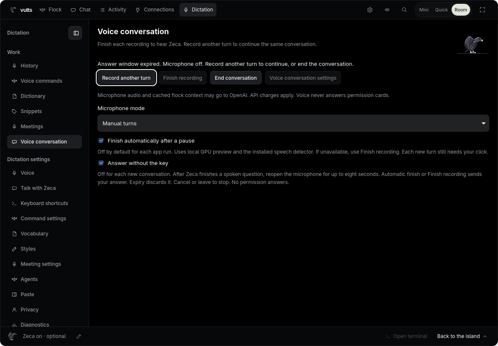

# Ditado
<!-- source: edf3461d992d -->

A versão de desenvolvimento da N3 oferece ditado local para a área de transferência, com colagem
opcional em editores de texto compatíveis no X11 nativo ou Plasma Wayland e painéis tmux exatos
do bando. Inclui indicações medidas na ilha, Histórico com busca, Dicionário/Trechos,
estatísticas na Atividade e Configurações com Diagnóstico. Nada é enviado automaticamente. Recursos presentes apenas no protótipo aprovado separado
não estão habilitados aqui.

As fontes dos modelos, as licenças e o instalador experimental de reuniões estão documentados em
[Artefatos dos modelos de reuniões](../reference/meeting-models.md).

<a id="finding-pages-and-settings"></a>
## Encontrar páginas e configurações

A navegação do Ditado segue os grupos do protótipo: Voz, Suas palavras e Sistema.
Expanda **Configurações do ditado** para acessar as páginas de configuração; selecionar uma
configuração ou buscar revela os controles relevantes. Estilos continua em Suas palavras e abre
o editor de configurações existente.
Use **Buscar página** para pesquisar nomes de páginas e descrições das configurações sem mudar a
página atual nem salvar uma configuração. As buscas do Ditado ignoram maiúsculas e acentos,
incluindo Histórico, palavras e títulos de reuniões salvas, mantendo o texto original na tela.
Pressione Escape na busca para limpá-la; o Escape usado por um método de entrada para compor
caracteres preserva a consulta. A navegação
mantém a busca e o estado recolhido do grupo de configurações durante atualizações. Uma busca
revela temporariamente as páginas de configuração correspondentes; limpá-la restaura sua escolha. Reabrir o Nest durante a mesma execução do
app restaura a página de trabalho do Ditado escolhida, como Dicionário, Trechos ou Comandos de voz.
Trocar entre Sala e Tela cheia mantém esse destino pelo fluxo existente de fechamento salvo. As setas para cima/baixo e Home/End movem
o foco entre as ações visíveis da barra lateral; Enter abre a página em foco. Janelas estreitas
usam o mesmo seletor de páginas agrupadas.
Concluir uma ação no Histórico ou salvar entradas no Dicionário/Trechos preserva o foco de uma
busca ou controle usado depois. Se você continuar na ação, o retorno de teclado existente permanece.
As páginas de configuração do Ditado mantêm posições de leitura independentes enquanto esta janela
de Configurações existir. Voltar a uma página restaura sua posição; atualizar as configurações
também mantém o foco de teclado no controle do grupo de navegação. Essas posições não são salvas
entre reinícios do app ou da janela.

Atalhos de teclado separa as teclas globais dos controles de gravação. Mostra o atalho independente
de comandos de voz junto com ditado, copiar último e cancelar; as teclas de gravação específicas
do X11 ficam num detalhe próprio. Colagem começa com o modo de entrega configurado e o estado do
acesso ao teclado. Isso não confirma uma entrega: confira sempre o resultado final, inclusive falhas
de cópia. O resumo não solicita acesso ao teclado; isso continua exigindo a ação explícita existente.

A página Voz separa modelo/idioma, microfone e som/feedback. As opções menos comuns de remoção de
repetições e nova tentativa de resultado vazio ficam em **Processamento avançado**. As configurações
continuam usando os controles existentes; falhas ao salvar restauram a escolha anterior.

As páginas de trabalho e as configurações do Ditado compartilham uma coluna de leitura limitada,
títulos compactos e controles na mesma escala. Ações do Histórico, formulários de palavras,
controles de salvar/exportar reuniões e linhas de configuração se adaptam à largura restante ao
lado da navegação. Janelas baixas reduzem os espaços enquanto transcrições e configurações mantêm
suas áreas de rolagem. Os controles de gravação ficam fora da rolagem da transcrição; os avisos
de consentimento e entrega continuam nos fluxos existentes.

<a id="voice-available-today"></a>

## Voz disponível hoje

Use a [entrada de voz do Chat](chat.md#speaking-instead-of-typing) depois de escolher um modelo local em
**Ditado > Voz**. Cada gravação do Chat guarda até um minuto de áudio na memória.
A prévia e a transcrição final usam o mesmo modelo local; você revisa o rascunho antes de enviar.

A captura de áudio compartilhada agora converte a entrada para mono a 16 kHz, mantém um buffer
limitado e informa falhas de dispositivo ou captura, em vez de retornar áudio incompleto
silenciosamente. Essa mudança não adiciona downloads automáticos de modelos.

A detecção de fala filtra ruídos breves e mantém pausas curtas dentro de uma frase. No modo
de toque para falar, o Chat continua esperando cerca de 1,5 segundo de silêncio depois da
fala antes de encerrar; o silêncio antes de você falar não encerra a gravação.

Por padrão, a prévia e a transcrição final compartilham um filtro local de texto. Sequências de seis ou
mais repetições de palavras ou frases são reduzidas a uma ocorrência (unidades de até 60
caracteres); repetições mais curtas são mantidas. Marcações de som conhecidas são removidas,
enquanto outros textos entre parênteses ou colchetes permanecem intactos. Um resultado isolado
associado a silêncio, como "Thank you.", "Obrigado." ou "Gracias.", é omitido, mesmo quando dito
intencionalmente; frases maiores que contenham essas palavras são mantidas. Você pode editar o
rascunho antes de enviar. Esse filtro não usa modelo nem faz requisições de rede.

<a id="voice-conversation-settings"></a>

## Configurações da conversa por voz

Abra **Ditado > Conversar com o Zeca** para preparar a voz em tempo real. O modelo e o orçamento
são separados do Chat e da assinatura da CLI. **Configurar chave da OpenAI** abre as configurações
compartilhadas da chave; as chaves permanecem no chaveiro do sistema. Esta página de configuração
não grava nem envia áudio.

A voz vem desligada por padrão. Revise o destino do áudio/contexto na OpenAI, escolha um modelo
compatível e defina o limite móvel de 24 horas em USD antes de ativá-la. Use ponto ou vírgula decimal,
com até seis casas e sem separadores de milhar. Zero desativa a voz remota; ativar exige um limite
positivo. Solicitações ainda não conciliadas mantêm o custo reservado.

Edite as escolhas e clique em **Salvar**. O Vults as relê antes de confirmar a gravação. Uma falha
preserva o rascunho; **Descartar alterações e recarregar** o substitui explicitamente pelas
configurações salvas. Mudanças feitas em outro lugar bloqueiam a gravação de edições antigas até
você recarregar. Sair da página preserva edições não enviadas. A voz nunca responde a um cartão de
permissão, e a consulta ao Codex continua indisponível. Veja
[Contabilidade em tempo real](../reference/realtime-accounting.md#runtime-transport).

<a id="manual-voice-turns"></a>
## Falas manuais por voz

A página de conversa por voz separa as configurações no cabeçalho, o estado atual, os controles
do turno e as **Opções da conversa**. A ação disponível de Iniciar ou Finalizar/Parar recebe destaque
conforme a etapa. Mudar uma opção não inicia a captura; as autorizações de microfone e resposta
sem a tecla continuam explícitas.


No Linux, abra **Ditado > Trabalho > Conversa por voz** depois de ativar a voz e instalar um modelo
local em **Voz**. Use **Iniciar gravação**, fale e clique em **Finalizar gravação** para parar o
microfone, transcrever localmente e solicitar a resposta do Zeca. Após a reprodução terminar, o
microfone fica desligado. **Gravar outra fala** continua a mesma conversa e o contexto do provedor;
**Encerrar conversa** a fecha. Um comando local também retorna a esse estado de espera. Cada nova
gravação exige seu clique por padrão; a escolha separada de resposta limitada abaixo é a exceção. Um erro ou tempo limite do provedor encerra a sessão. Essa entrada manual
não usa o atalho global do ditado nem interrupção por fala. A gravação tem limite de 30 segundos; atingir o limite descarta a captura,
sem envio automático. A espera local combinada de captura/transcrição é limitada a 60 segundos.
Abrir essa página de trabalho pelas Configurações preserva o destino solicitado enquanto o Ninho
carrega. Uma escolha de navegação posterior tem prioridade. Abrir a página nunca inicia uma gravação.

Quando o áudio do Zeca começa a tocar, **Interromper resposta** substitui Finalizar gravação. Ele
interrompe a resposta falada sem encerrar a conversa nem abrir o microfone. A página aguarda o
resultado do texto ouvido da resposta interrompida antes de oferecer **Gravar outra fala**; o
truncamento remoto e o próximo envio usam o fluxo existente de confirmação/correção do contexto.
Palavras não ouvidas ficam fora da resposta exibida. Após a confirmação, a página mostra **Resposta
interrompida** e informa se o microfone está desligado ou continua aberto em uma rota contínua. O
feedback nativo da interrupção invalida o token de controle da resposta parada; eventos de fala
atrasados ou duplicados não a reativam nem substituem o token atual. Cliques duplicados/atrasados não
interrompem uma nova geração nem iniciam captura. Durante a geração, antes de haver áudio audível, **Cancelar**
ainda encerra toda a sessão. Esse controle exige um clique; interromper falando por cima do Zeca
usa as rotas contínuas opcionais descritas abaixo.

Durante a conversa, a página reutiliza o personagem Zeca do Chat: escutando ao gravar, pensando
ao preparar/processar, falando durante a reprodução audível e descansando enquanto espera ou
interrompe uma resposta. O estado em texto continua informando o acesso ao microfone. Janelas
baixas ocultam o personagem para manter as ações visíveis. Movimento reduzido mantém uma pose
estática; telas ocultas, bloqueadas ou inativas param de desenhar. Ocultar ou sair da página de voz
cancela a conversa; voltar não repete um estado antigo de fala. Esse feedback nunca abre outra
superfície nem inicia uma gravação.

Opcionalmente, marque **Finalizar automaticamente após uma pausa** antes de iniciar. A opção começa
desligada ao abrir o app e fica fixa durante aquela conversa. Ela usa o detector de fala local
instalado e a prévia de transcrição na GPU; não baixa nada. Exige fala confirmada, palavras parciais
locais e áudio novo. A política aguarda 1,6 segundo de silêncio detectado, ou 2,6 segundos após uma
palavra de continuação em inglês/português; a detecção e a decodificação podem acrescentar demora.
A transcrição local final ainda ocorre depois que o microfone fecha. Essa escolha não ativa o
modelo semântico opcional por si só.
Um build para desenvolvedores Linux x64 GNU com `voice-semantic` pode oferecer separadamente **Usar
detecção semântica local de fim de turno (prévia)**. A opção começa desligada em cada conversa e
exige arquivos verificados fornecidos explicitamente; o app não baixa nada. Ela pode aguardar até
1,2 segundo além da regra de silêncio. Uma falha informa **O encerramento semântico está
indisponível. Esta conversa usa detecção local de silêncio.** e mantém esse fallback nas falas
seguintes. Builds comuns não oferecem a prévia. Veja
[Modelo semântico de fim de turno](../reference/semantic-turn-model.md#conversation-preview-integration).

Se o detector ou a prévia estiver indisponível/falhar, a página informa **O encerramento automático
está indisponível. Use Finalizar gravação.** Finalizar e Cancelar continuam disponíveis. Entrada
vazia e o limite de 30 segundos nunca causam envio automático. O encerramento automático sozinho não reabre
o microfone: cada nova fala ainda exige **Gravar outra fala**, exceto quando você ativou a escolha
separada de resposta limitada.

**Cancelar**, **Encerrar conversa**, sair da página, ocultar/fechar o Nest, bloquear ou mudar configurações cancela o
trabalho da página. Perder contato com a página também interrompe a admissão após três segundos.
Um worker nativo ainda encerrando pode manter a voz temporariamente ocupada. Cancelar não desfaz
uma solicitação remota já enviada nem sua cobrança. A voz usa o modelo da API e o orçamento
independente configurados, não uma assinatura de CLI.

Se a voz remota falhar e houver palavras locais disponíveis, **Revisar texto recuperado** oferece
um rascunho editável e não enviado. **Copiar texto** só copia após seu clique. Nada desse rascunho
é enviado ao Chat ou executado. Suas edições sobrevivem à saída e ao retorno à página. Iniciar
uma nova gravação substitui o rascunho recuperado anterior após a confirmação de Iniciar. A página
mantém apenas a resposta/recuperação mais recente em memória, não um histórico salvo da conversa.
A sessão ativa do provedor mantém o contexto remoto da conversa até ser encerrada.

A qualidade do microfone/fala, a validação com provedor real e a interrupção continuam como etapas
separadas antes de concluir K8. Essa entrada não ativa consulta ao Codex nem responde permissões.

<a id="answer-without-the-key"></a>
## Responder sem apertar a tecla

Em **Conversa por voz**, mantenha **Modo do microfone > Falas manuais**, marque **Finalizar
automaticamente após uma pausa** e depois marque explicitamente **Responder sem apertar a tecla**
antes de Iniciar. Essa escolha fica desligada em cada nova conversa e fixada até encerrar/cancelar.
Ela não muda configurações globais.

Depois que o Zeca terminar uma pergunta falada completa, o dono nativo pode reabrir o microfone
apenas pelo prazo original de oito segundos. A página informa explicitamente esse microfone aberto
por pouco tempo. Afirmação, resposta interrompida, resultado de ferramenta, notificação ou cartão de
permissão não podem abri-lo. A verificação de pergunta usa pontuação conservadora (`?`/`？`), não
compreensão semântica.

Faça uma pausa para finalizar automaticamente ou use **Finalizar gravação** antes de expirar. Se a
finalização automática local estiver indisponível, a página informa; Finalizar e Cancelar continuam
disponíveis. Expirar descarta o áudio sem transcrição final/envio e mostra **Microfone desligado**,
mantendo a mesma conversa. **Gravar outra fala** inicia uma gravação normal explicitamente. A
decodificação final de uma gravação válida já fechada pode terminar depois. **Cancelar**, sair/
ocultar a página, bloquear, perder contato ou mudar configurações revoga o trabalho. Uma nova
permissão/pergunta também mantém prioridade sobre a captura. A thread nativa de áudio fecha na
próxima verificação do prazo; o encerramento do dispositivo pode demorar mais e mantém a voz ocupada.

Essa opção ainda precisa de aceitação com microfone real, fala e provedor. Voz nunca responde
cartões de permissão. Rotas contínuas já mantêm o microfone aberto com sua própria confirmação e
não oferecem essa escolha separada.



Exemplo controlado da interface: o microfone fica desligado após expirar e a conversa pode continuar.
A captura de tela usa dados de teste, sem gravação física nem solicitação ao provedor.

<a id="continuous-microphone-routes"></a>
## Rotas com microfone contínuo

**Modo do microfone** começa em **Turnos manuais**. Para interromper por voz, escolha
**Microfone contínuo com fones** ou **Microfone contínuo com cancelamento de eco**. Clique em
**Atualizar dispositivos de áudio**, escolha explicitamente o microfone/saída ou o par AEC instalado
e confirme que o microfone pode permanecer aberto até você encerrar esta conversa. Nomes de
dispositivos nunca comprovam o uso de fones. Use fones nesse modo; o AEC exige um par compatível
configurado fora do Vults. O app apenas lê a lista: não altera padrões nem instala módulos.
A lista revisada expira após cinco minutos; atualize-a se não conseguir iniciar.

**Iniciar gravação** abre a rota escolhida e inicia a primeira fala. Durante uma resposta audível
do Zeca, fala confirmada localmente pode interrompê-lo e iniciar outra gravação com o início retido.
**Finalizar gravação** continua sendo necessário para enviar cada fala; palavras da verificação de
interrupção nunca viram comandos nem entrada do provedor. A transcrição local final usa o mesmo
stream, sem um segundo microfone. O limite de 30 segundos continua descartando, sem envio
automático. Finalizar após uma pausa fica indisponível nesses modos. A troca de dispositivos fica
bloqueada durante a conversa.

O microfone permanece aberto durante a transcrição local, a resposta do Zeca e a espera; a página
informa isso. Após reprodução normal ou **Interromper resposta**, somente **Gravar outra fala**
inicia outra gravação. **Encerrar conversa**, Cancelar, sair da página, perder contato com ela,
bloquear, mudar configurações ou perder a autoridade da rota cancela o proprietário. Uma nova
conversa exige outra confirmação. Interromper resposta sozinho nunca inicia captura. Aplicam-se o
mesmo roteador de transcrição final, confirmações de truncamento remoto, histórico do trecho ouvido
e correção do próximo turno. A voz nunca responde permissões.

Os controles e proprietários nativos são cobertos com cenários controlados. A qualidade real de
microfone/fones/AEC e um provedor real ainda exigem validação física antes de concluir K8.

<a id="global-dictation-first-slice"></a>

## Ditado global (primeira etapa)

Para o primeiro ditado, escolha um modelo, coloque o foco no destino, segure o atalho de fala,
fale e solte. Aguarde **Copiado** e cole ali. A inserção automática é uma escolha separada e
só funciona nos destinos abaixo; nunca envia Enter.

Escolha e instale um modelo local de voz em **Ditado > Voz**. O desktop pede os novos
vínculos de atalhos globais; **Dictation > Keyboard shortcuts** mostra as teclas reais e
é atualizado quando você as altera nas configurações do desktop. **Alterar no KDE…** abre
Configurações do sistema do KDE > Atalhos pela entrada instalada do desktop. Se ela estiver
ausente ou não puder iniciar, a página permite tentar novamente; outros desktops usam suas
próprias configurações de atalhos. O Vults não edita os vínculos por conta própria. Teclas sugeridas:

- **Ctrl+Alt+V**: segure por pelo menos 300 ms, fale e solte. A captura mantém os
  últimos 600 ms antes da transcrição local. Dois toques curtos, com o segundo até 400 ms após
  soltar a tecla no primeiro, mantêm a gravação com as mãos livres; o próximo toque encerra.
  Um toque curto sozinho é descartado.
- **Ctrl+Alt+X**: cancela o ditado ou a voz do Chat, inclusive um ditado que já esteja transcrevendo.
- **Ctrl+Alt+B**: copia novamente o último ditado concluído. Não interrompe uma gravação ativa.

O atalho sempre inicia o ditado independente, inclusive com uma janela do Vults em foco. Nunca
abre o Chat nem inicia seu microfone. Use o botão de microfone no Chat para ditar no rascunho.
Um ditado ativo mantém seu dono se o foco mudar. O diagnóstico separado de microfone só começa
com **Testar microfone**. O ditado independente funciona com o Zeca ligado ou desligado. Em **Dictation > Keyboard shortcuts**, escolha **Segurar +
duplo toque** (o padrão) ou **Só segurar**. Só segurar descarta toques curtos imediatamente;
um segundo toque inicia uma nova gravação segurada. A trava por Espaço continua sendo uma
escolha independente mesmo nesse modo. **Espaço mantém a gravação** e **Esc cancela o ditado**
vêm ligados e podem ser alterados no X11; os controles ficam indisponíveis no Wayland. Com a
trava desligada, Espaço age como outra digitação e pode descartar uma gravação segurada. Com o
cancelamento por Esc desligado, Esc deixa o ditado continuar; o atalho global Cancelar voz sempre
funciona. As escolhas ficam salvas localmente e valem a partir da próxima gravação, inclusive
após reiniciar; alterá-las nunca interrompe uma gravação ou transcrição ativa.

Com as escolhas padrão no X11 com XI 2.1 disponível,
pressione **Espaço** enquanto segura o atalho de fala para continuar gravando com as mãos livres.
**Esc** cancela durante a gravação, a cauda da captura ou a transcrição. Outras teclas que não são
modificadoras descartam uma gravação segurada ou um toque único pendente; digitar normalmente não
cancela uma gravação já travada com as mãos livres. O listener não consome essas teclas no aplicativo
de destino. As combinações reais de Falar e Copiar novamente ficam fora do cancelamento por outra
tecla; a repetição automática é ignorada. A trava por Espaço impede que o atalho padrão de Abrir a
ilha mova o foco durante a gravação. Se Abrir for remapeado para outra tecla, mantém sua ação usual.

No Wayland, use o toque duplo e o atalho separado de cancelamento; a trava por Espaço e Esc global
não estão disponíveis. Nenhuma tecla bruta é observada pelo XWayland. Se um listener X11 ou seu
atalho real não puder ser reconhecido, os controles do portal para segurar, toque duplo e cancelar
continuam funcionando. A observação de teclas termina com a gravação e seu processamento, sem
guardar texto digitado nem histórico de teclas.

**Dictation > Voice > Microfone do ditado** escolhe uma entrada para o ditado local
independente; o Chat continua usando o padrão do sistema. A página lista as entradas sem gravar,
e **Atualizar microfones** atualiza essa lista explicitamente. Carregamento, falhas de leitura,
listas desatualizadas e ausência de entradas têm feedback separado. Um microfone salvo que foi
desconectado continua selecionado como indisponível; se não for encontrado ao iniciar a captura,
o fallback existente escolhe o padrão do sistema ou outra entrada. Isso não reescreve a preferência
salva. Uma entrada listada que não puder ser aberta mostra um erro. Escolha **Microfone padrão do
sistema** para limpar a preferência. A escolha fica salva neste computador e é usada pela próxima
gravação; uma gravação ativa mantém sua entrada. Abrir a página ou atualizar nunca inicia uma gravação.

**Dictation > Voice** também reúne **Remover repetições em sequência** e **Tentar
com Base quando o ditado vier vazio**; as duas opções vêm ligadas. Desligar a remoção mantém as
repetições na prévia e no texto final. Marcações de som conhecidas e frases isoladas associadas
a silêncio continuam sendo removidas. Desligar a nova tentativa com Base pula a verificação extra
de fala e a segunda transcrição de um resultado vazio. As escolhas ficam salvas localmente e são
capturadas ao iniciar uma nova gravação independente; alterá-las nunca muda um ditado ativo nem
o processamento do Chat. Nenhuma dessas escolhas baixa ou contata um modelo.

No Linux, o status temporário aparece numa cápsula separada, centralizada na parte inferior da
tela selecionada e acima dos painéis do desktop. Usa o tema Black/Light de produção e nunca recebe
foco nem cliques. A escuta mostra um microfone e nove bandas de áudio medido; a captura com mãos
livres acrescenta uma borda âmbar. Finalização, transcrição, nova tentativa e resultados de entrega
mostram seus textos existentes. A cápsula desaparece quando o resultado expira, sem dica em repouso
nem novos controles. Ilha e Nest não repetem esse feedback. Se a cápsula não puder ser criada,
o status existente dentro dessas superfícies continua disponível. Um card aguardando resposta,
a tela bloqueada ou a presença Paused oculta a cápsula; feedback expirado não volta quando um card
sai. Sua superfície nativa de tamanho fixo nunca é redimensionada.

Durante a escuta e a captura com mãos livres, nove bandas acompanham o áudio medido do microfone.
Em uma GPU compatível, a prévia local de voz existente pode mostrar, na legenda opcional, as palavras
ouvidas até aquele momento. Essas palavras provisórias podem mudar antes da transcrição final;
a captura apenas pela CPU mantém as bandas e o estado, seguidos do resultado final de cópia ou
inserção. O texto da prévia fica na memória, é descartado quando a captura termina e nunca vai
para o log ou histórico do aplicativo. Cancelar ou iniciar outro ditado rejeita atualizações
atrasadas de áudio e prévia. O movimento reduzido oculta as bandas móveis e mantém o estado e as
palavras.

**Dictation > Voice > Som de início do ditado** controla um aviso curto;
ele começa ligado e acompanha a opção de sons, o volume e o Não Perturbe do aplicativo. Somente
uma nova gravação toca o aviso. Abrir outra superfície, mudar essa opção ou sair do silêncio
não repete o som. Falhas e cancelamentos ficam silenciosos.

**Dictation > Voice > Legendas do ditado** controla a legenda opcional;
ela começa ligada. A legenda expande uma linha cortada ou mostra o texto final depois de uma
cópia ou entrega confirmada, em até duas linhas. Ela usa o espaço livre abaixo da ilha ancorada
no topo ou acima da ilha ancorada na parte inferior; um Quick que ocupa toda a altura deixa a
legenda oculta. No Nest ou em Settings, ela fica acima da linha temporária de feedback, com
espaço reservado na página para manter os controles visíveis. Cards e bloqueio de tela a ocultam
imediatamente. A legenda não recebe cliques nem foco e não amplia a
região da ilha que recebe o mouse. Ela some em até dois segundos após o término; trocar de
superfície ou alternar a opção de legendas não renova esse prazo. O texto fica na memória. Ditado tem suas próprias páginas de configuração.

**Copiado** significa que o texto foi relido e conferido na área de transferência; use o
comando Colar do aplicativo de destino (geralmente Ctrl+V, ou Ctrl+Shift+V em terminais).
Nada é enviado automaticamente.

No Linux, o ditado copiado solicita exclusão do histórico da área de transferência no X11 e no
Wayland pela convenção `x-kde-passwordManagerHint`. Gerenciadores compatíveis recebem o pedido
para não guardar o texto; outros ainda podem mantê-lo. A colagem de texto simples e a confirmação
por releitura permanecem iguais. Isso não muda o Histórico de Ditado do próprio Vults nem sua
configuração de retenção.

A entrega confirmada também mostra o total de palavras do texto final, com rótulo localizado
no singular ou plural. A contagem usa limites Unicode entre palavras: pontuação e emojis não
contam, e ideogramas chineses contam individualmente. O total acompanha a linha de entrega mesmo
depois que a legenda some. Gravação, falhas e cancelamentos não reutilizam uma contagem anterior.
O total de correções aguarda a etapa de métricas; ainda não é exibido.

No Wayland, a cópia em segundo plano exige suporte do desktop a `ext-data-control` ou
`wlr-data-control` para a área de transferência. Se indisponível, o ditado informa um erro em vez
de dizer Copiado; ele nunca toma o foco nem grava silenciosamente apenas no XWayland. O acesso
à área de transferência usa texto na memória, sem arquivo de transcrição. O log do aplicativo
registra as fases do ditado sem registrar o texto.

No primeiro pressionamento do atalho de fala, o Vults solicita a classe, o título, o identificador
de processo e a identidade da janela em foco, sem ativar uma janela. No X11, ele verifica novamente
a janela em primeiro plano depois da leitura. No Plasma Wayland, usa um script de leitura do KWin;
essa observação assíncrona pode ocorrer logo depois do pressionamento, por isso serve como contexto,
e não como prova do destino exato. Observações atrasadas ou que falham permanecem desconhecidas.
No GNOME e no wlroots Wayland, o aplicativo também fica desconhecido, mesmo com XWayland disponível.
Quando conhecido, o status de cópia informa o aplicativo observado e sugere Ctrl+Shift+V para um
terminal reconhecido. Uma correspondência de título ou processo não comprova qual painel do terminal
está em foco nem permite inserção. Processos de terminal compartilhados por várias sessões do bando
deixam a associação com a sessão desconhecida. Títulos e identidades nativas de janelas ficam
na memória e não são enviados ao renderizador, gravados no histórico nem registrados em logs.
O aplicativo e a sessão reconhecidos podem acompanhar uma transcrição concluída, conforme o
prazo de retenção escolhido. Copiar novamente começa sem reutilizar esse contexto de aplicativo.

<a id="supported-destinations"></a>

## Destinos compatíveis

O ditado independente funciona com o Zeca ligado ou desligado. Os caminhos atuais de entrega
são limitados; reconhecer um aplicativo não concede autorização de inserção.

| Destino | X11 nativo | Plasma Wayland |
| --- | --- | --- |
| Campo de texto no Firefox | Copiado; cole manualmente | Copiado; cole manualmente |
| Kate | Copiado; cole manualmente | Copiado; cole manualmente |
| Konsole, inclusive tmux dentro do Konsole | Copiado; cole manualmente | Copiado; cole manualmente |
| KWrite, GNOME Text Editor, Mousepad, Leafpad | Colagem opcional após verificar foco e área de transferência | Colagem opcional com autorização de teclado pronta e verificações de foco/área de transferência |
| Sessão rastreada do bando em painel tmux exato hospedado no XTerm/UXTerm ou Kitty | Entrega opcional literal de uma linha após verificar sessão/painel atuais | Mesmas verificações, além da autorização de teclado pronta |
| Qualquer janela do Vults em foco | Copiado; cole manualmente | Copiado; cole manualmente |

Firefox, Kate e Konsole mantêm a colagem manual mesmo com a inserção ligada. Painéis diretos
do Kitty ou WezTerm também ficam apenas na cópia sem o caminho tmux exato compatível. Uma
alternativa de cópia informa **Copiado**, em vez de **Colado** ou **Na sessão**. No Wayland, copiar
também exige o protocolo de área de transferência descrito acima; pode falhar explicitamente
quando ele não está disponível.

A tecla de fala usa ditado independente sobre o Nest, a ilha e Configurações, além dos outros
aplicativos. Não muda de aba nem preenche o Chat automaticamente. Um ditado ativo mantém seu
dono original quando o foco muda; voltar o foco nunca restaura uma autorização de inserção.

<a id="cancel-by-voice"></a>

## Cancelar por voz

**Dictation > Keyboard shortcuts > Cancelar por voz** vem ligado e funciona no X11
e no Wayland. Encerre a gravação normalmente; a transcrição final é verificada antes da conversão
de código falado e de qualquer cópia ou inserção. Estas frases inteiras cancelam quando ditas
sozinhas ou no final da transcrição:

| Idioma | Frases de cancelamento |
| --- | --- |
| Inglês | `cancel`, `never mind` |
| Português | `cancela`, `deixa pra lá` (também sem o acento) |
| Espanhol | `cancela`, `déjalo` (também sem o acento) |

A comparação ignora maiúsculas, minúsculas, espaços extras, os acentos agudos das frases e a
pontuação final. Uma frase no final precisa começar após um espaço; `cancel the meeting at noon`,
`path/cancel`, `cancel_by_voice` e `"cancel"` entre aspas continuam como texto comum. É uma regra
literal de sufixo: até `src slash cancel` cancela o ditado. Desligue a opção para ditar conteúdo
que termine com uma dessas frases.

Uma correspondência mostra **Cancelado**, não copia, insere ou envia nada e não acrescenta
histórico nem totais de uso. O último ditado bem-sucedido continua disponível para Copiar novamente.
A reutilização usa o texto já entregue literalmente, então reutilizar `cancel` não aciona esta
verificação. Isso vale só para o ditado independente; a entrada de voz do rascunho do Chat mantém
seu comportamento existente. A opção fica salva localmente e é capturada no início da gravação,
por isso uma mudança não afeta o ditado ativo. Não acrescenta escuta contínua de comandos por voz
nem baixa modelos.

<a id="your-words-processing"></a>

## Processamento das suas palavras

Dicionário e Trechos têm buscas locais independentes, incluindo os resultados das substituições e
os textos dos trechos. A busca ignora maiúsculas e acentos, preserva os rascunhos dos formulários e
não consulta o banco nem um modelo. Escape ou **Limpar busca** restaura a lista. Os formulários de
criação vêm antes das listas salvas; textos com várias linhas recebem mais espaço em janelas largas.
**Testar uma frase** começa recolhido e mantém o rascunho ao abrir ou fechar. Cancelar uma exclusão
devolve o foco ao registro de origem.


O ditado independente agora aplica as entradas locais de Suas palavras após a transcrição final.
Abra **Ditado > Dicionário** para adicionar/remover palavras e salvar regras de substituição.
Salvar a mesma origem atualiza seu texto sem mudar a ordem. **Trechos** adiciona gatilhos curtos
e conteúdo literal, inclusive espaços e quebras de linha. Excluir exige confirmação; falhas ao
salvar preservam o rascunho para tentar novamente. Essas páginas não alteram a voz do Chat.

**Ditado > Vocabulário > Ajudar o modelo com estas palavras** fica desligado
por padrão. Quando ativado, só o Turbo com inglês
fixo recebe o contexto de programação mais as palavras do dicionário, limitado a 224 tokens
do modelo com entradas inteiras. O inglês pode ser escolhido diretamente ou resolvido pelo idioma
do sistema; a detecção automática fica excluída. Prévia e transcrição final usam a mesma visão capturada na
gravação. O conteúdo de substituições e trechos nunca entra nesse contexto, que não persiste no
modelo em cache nem no Chat. Uma nova tentativa com Base fica sem contexto de dicionário.
Base, Small, português, outros idiomas e detecção automática não recebem contexto do dicionário:
só Turbo/inglês
melhorou o WER e manteve silêncio/ruído vazios na comparação sintética local. Esses testes não
estabelecem a precisão com fala humana; a validação real pelo microfone continua pendente.
As regras locais após a transcrição abaixo funcionam com qualquer idioma de transcrição,
independentemente do vocabulário do modelo. Nenhuma das opções de vocabulário precisa estar
ligada para usar substituições ou trechos.

**Ditado > Vocabulário > Vocabulário do projeto** fica desligado por padrão,
independentemente da outra opção. Quando ativado, o Vults mantém em cache nomes de projetos Git conhecidos: pacotes e dependências Cargo/npm, membros próximos do
workspace, nomes de módulos, arquivos da raiz e branch. Lê manifests pequenos e nomes de arquivos
localmente; não lê o conteúdo do código, executa scripts de pacotes nem baixa nada. A atualização
ocorre no início da sessão e na atualização existente do repositório (no máximo uma vez por minuto
em eventos posteriores dos agentes).

A pasta da sessão capturada seleciona a árvore de trabalho. Caso contrário, o título de um terminal
ou editor reconhecido precisa nomear exatamente um projeto em cache; navegadores e títulos
desconhecidos ou ambíguos não acrescentam nada. Esse contexto aproximado de primeiro plano nunca
autoriza digitar. A primeira decodificação de prévia/final fixa os nomes, inclusive um contexto
ausente, para toda a gravação. Os nomes do projeto vêm depois das palavras do dicionário pessoal,
sob o mesmo limite de 224 tokens e restrição Turbo/inglês. Nunca viram regras salvas do dicionário
nem alteram o fluxo de grafia. Outros modelos/idiomas, novas tentativas com Base e Chat mantêm seu
comportamento existente. Isso reutiliza a qualificação da V2.3; não estabelece a precisão para
todo nome de projeto nem substitui a validação real pelo microfone.

**Testar uma frase** no Dicionário executa as regras locais realmente salvas. Marca as partes
alteradas; **Contexto de terminal** inclui código falado se a opção em Configurações estiver
ligada. O cancelamento falado também usa a opção salva atual e ocorre antes das suas regras.
Cada teste lê uma nova visão das regras, sem iniciar microfone/modelo, alterar a área de
transferência ou salvar no histórico. Mudar a frase ou as regras descarta um resultado antigo.
Isso mostra o processamento de texto, não o reconhecimento de fala nem permissão de destino.
**Como é aplicado** explica a ordem e os limites.

No início da gravação, o Vults lê uma visão consistente do dicionário, das substituições e dos
trechos. Edições feitas durante essa gravação valem para a próxima. Se não puder ler essa visão,
a gravação falha explicitamente antes da captura, em vez de ignorar as entradas silenciosamente.

A ordem é: proteger gatilhos de trechos, aplicar substituições na ordem salva, corrigir grafias
simples do dicionário, converter código falado num terminal/sessão reconhecido e restaurar o
conteúdo literal dos trechos. Esse conteúdo mantém espaços, quebras de linha, cifrões e pontuação;
nenhuma regra posterior ou conversão de código falado o reescreve. Texto parecido com um marcador
interno continua sendo texto comum. Substituições inserem texto literal, sem expansões de expressão
regular; regras posteriores podem corresponder ao resultado da regra anterior, seguidas pela
grafia do dicionário.

A comparação ignora caixa com chaves Unicode e exige limites de palavras inteiras. Entre as partes
de uma frase, espaços, sublinhados, hifens e outros separadores que não formam palavras são
intercambiáveis; letras, dígitos e marcas combinantes continuam dentro das palavras. Caracteres de
controle, inclusive tabulações e quebras de linha, são barreiras e nunca são consumidos por uma
correspondência. Grafias do dicionário só se aplicam a entradas com pelo menos duas letras/dígitos
e compostas apenas de letras, dígitos, espaços, hifens ou apóstrofos retos. Outras entradas ainda
podem ser usadas como vocabulário opcional do modelo.

Por exemplo, substituir `cloud code` por `Claude Code` também corresponde a `CLOUD-CODE`; uma
entrada `Vults` corrige `vults` sem mudar `prevults`. O conteúdo de um trecho nunca é executado
como código nem enviado. Saídas com quebras de linha ou controles continuam sujeitas à cópia
alternativa e às restrições existentes de entrega ao terminal.

O cancelamento falado é verificado no texto ouvido **antes** dessas regras. Expandir um trecho
para `cancel`, portanto, escreve esse texto literal; dizer `cancel` ainda descarta antes da
expansão. O texto ouvido original e o escrito final continuam separados no Histórico. Copiar
novamente e reutilizar pelo Histórico usam o texto final sem reaplicar as regras. Os números de
correções continuam indisponíveis até sua etapa de métricas. O processamento para com um erro
explícito acima de 256 KiB de entrada ou saída intermediária, sem cópia ou inserção parcial.

<a id="check-your-words-locally"></a>

## Confira Suas palavras localmente

1. No **Dicionário**, adicione `Vults` e uma substituição de `cloud code` por `Claude Code`.
   Uma palavra duplicada é recusada; salvar a mesma origem atualiza a substituição existente.
2. Em **Trechos**, adicione `signature` com este conteúdo exato:

   ```text
   Regards,
   Ada
   ```

3. De volta ao **Dicionário**, teste `cloud code vults signature`. O resultado deve conter
   `Claude Code Vults Regards,`, seguido de `Ada` na próxima linha. As partes alteradas são marcadas;
   a quebra de linha do trecho salvo fica literal. Teste `source slash main` com **Contexto de
   terminal** desligado e depois ligado: só vira `source/main` se **Código falado** estiver ligado
   em Configurações.
4. Com **Cancelar por voz** ligado, teste `cancel`: informa cancelamento antes das regras.
   Esses testes não copiam, inserem nem acrescentam Histórico. Exclua uma entrada de teste,
   cancele a confirmação uma vez e depois confirme: só a confirmação explícita a remove.
5. Para validar pelo microfone, dite no seu aplicativo externo habitual e confira o texto final,
   o resultado real Copiado/Colado e, quando o histórico for guardado, os textos ouvido/escrito no Histórico. Mantenha as
   [restrições de destino](#supported-destinations) existentes; trechos nunca autorizam enviar texto.
   Uma mudança de regras durante a captura vale para a próxima gravação; Copiar novamente reutiliza
   o texto final.

As primeiras quatro verificações testam o processamento local sem baixar nem habilitar um recurso
de modelo. Se também testar o vocabulário do Whisper, use um Turbo instalado com inglês escolhido
diretamente ou resolvido pelo sistema e ative apenas o contexto desejado. Base/Small, português e
detecção automática mantêm seus prompts anteriores mesmo com as opções ligadas. Nomes de projeto
exigem um projeto Git conhecido em cache após início da sessão/atualização do repositório;
contexto de primeiro plano desconhecido ou ambíguo não acrescenta nada. Compare com as opções
desligadas; isso não promete melhora para um nome ou gravação de microfone. Restaure as preferências
que alterou para o teste.

<a id="music-while-you-speak"></a>

## Música enquanto você fala

**Ditado > Voz > Música enquanto você fala** oferece **Baixar para 25%** (o padrão),
**Pausar** e **Não alterar**. A próxima gravação independente mantém essa escolha até parar,
inclusive no cancelamento. A voz do Chat e a captura de reuniões não usam esse controle.

No Linux, o Vults controla temporariamente apenas players MPRIS que já estão tocando. A redução
limita o volume do próprio player a 25%; players mudos ou mais baixos ficam como estão. Ao parar
a captura, restaura o volume original de cada player ou retoma aqueles pausados por esta gravação.
Um player cujo estado relevante ou volume mudou nesse intervalo não é restaurado, mesmo que depois
tenha voltado a 25% ou Pausado. Players que fecharam e processos substitutos nunca são retomados
ou restaurados.

Isso usa controles locais de mídia sem ler metadados das faixas nem fazer requisições de rede.
Funciona independentemente de **Tocando agora**, que controla a música exibida no aplicativo.
**Não alterar** não abre uma conexão de controle de mídia. Players ou o barramento de sessão
indisponíveis nunca impedem o ditado, e a falha de um player não impede restaurar os outros.
A restauração ocorre em segundo plano; a captura do microfone não espera por um player.

<a id="spoken-code"></a>

## Código falado

**Dictation > Terminais e sessões > Código falado** vem ligado. Para um terminal
ou sessão reconhecido e capturado para o ditado, une partes de identificadores em torno destes termos:

| Idioma | Termos falados para `.`, `/`, `_`, `-`, `:` |
| --- | --- |
| Inglês | `dot`, `slash`, `underscore` ou `underline`, `dash`, `colon` |
| Português | `ponto`, `barra`, `underline` ou `underscore`, `traço` ou `traco`, `dois pontos` |
| Espanhol | `punto`, `barra`, `guion bajo` ou `guión bajo`, `guion` ou `guión`, `dos puntos` |

Por exemplo, `src slash main dot rs` vira `src/main.rs`. Maiúsculas, minúsculas e pontuação
existente são preservadas: não acrescenta capitalização nem ponto final. Um marcador precisa
ter partes semelhantes a identificadores dos dois lados. Espaços fora de uma sequência convertida
ficam intactos; quebras de linha, tabulações e caracteres de controle nunca são removidos para
criar uma sequência. É uma sintaxe literal de pontuação, sem interpretação de prosa: desligue
quando quiser essas palavras literalmente em um terminal.

Aplicativos de prosa, destinos desconhecidos e o microfone do Chat mantêm seu texto. Mudar a
opção vale para a próxima gravação. O fallback de um terminal para a área de transferência mantém
o texto convertido; a formatação nunca autoriza inserção, envia Enter ou contorna uma sessão
aguardando. Copiar novamente e o Histórico reutilizam o texto já entregue sem formatá-lo outra vez.
Quando há retenção, **Detalhes** no Histórico mantém a transcrição anterior à
conversão de código falado junto do resultado escrito. Não acrescenta áudio nem conteúdo anterior
da área de transferência ao histórico.

<a id="opt-in-x11-insertion"></a>

## Inserção opcional no X11

Em **Dictation > Paste**, ative **Inserir ditado em editores e painéis tmux compatíveis** apenas
se quiser que o Vults insira texto. A opção começa desligada, inclusive após atualizar.
Esta primeira implementação aceita KWrite, GNOME Text Editor, Mousepad e Leafpad. Outros aplicativos e
IDEs mantêm o caminho de cópia; a entrega no terminal exige as verificações exatas de tmux abaixo. O X11 nativo é descrito abaixo; o Plasma Wayland usa
a autorização de teclado separada na próxima seção. Não há desvio por XWayland.

No X11 nativo, o callback do atalho captura um destino separado antes de enfileirar a gravação.
Ele confere a janela ativa, o filho exato com foco de teclado, a classe, o processo e sua hora de
início; depois observa a perda de foco até a entrega. Mudar o foco e voltar também impede a inserção.
O contexto assíncrono do aplicativo descrito acima nunca autoriza colar. Imediatamente antes de
Ctrl+V, o Vults reconfere esse destino, verifica o dono da área de transferência e exige teclas
soltas. Ele não ativa outro aplicativo, solta seus modificadores pressionados nem envia Enter.
Uma verificação que falha deixa o texto copiado. Terminais nunca recebem Ctrl+Shift+V automaticamente;
o caminho tmux abaixo usa bytes literais.

A inserção assume temporariamente a área de transferência de texto. Após o despacho, o Vults espera
cerca de 700 ms e restaura o texto anterior apenas enquanto esta reserva exata ainda for a dona.
Uma cópia mais recente prevalece mesmo quando o texto é igual ao ditado. Ditados sobrepostos herdam
o texto original; uma reserva antiga não restaura por cima da nova. Se o resultado for apenas uma
cópia, o ditado fica disponível. O conteúdo anterior fica na memória e nunca vai para histórico,
logs ou arquivos.

A reserva restaura apenas texto simples, de até 64 KiB; não restaura imagens nem formatos ricos.
Texto anterior ou ditados maiores seguem o caminho de cópia comum. A indicação de exclusão do
histórico depende do suporte do desktop. Settings explica esses limites antes de ativar a inserção.
**Colado** confirma o despacho para o destino em primeiro plano validado; revise o resultado no
editor. Isso não confirma que o editor consumiu, enviou ou salvou o texto.

<a id="plasma-wayland-insertion"></a>

## Inserção no Plasma Wayland

A mesma opção de inserção, desligada por padrão, aceita Plasma Wayland com `ext-data-control`
e um único assento de área de transferência. Ativá-la solicita **apenas entrada de teclado** pelo
portal RemoteDesktop. O desktop concede a capacidade de digitar em outros aplicativos; o Vults
limita seu uso à colagem nos editores compatíveis acima e à entrega exata em tmux abaixo. Não solicita controle do ponteiro nem
compartilhamento de tela.

Settings mostra se o acesso ao teclado está aguardando, pronto, temporário ou indisponível.
Ditados seguintes reutilizam a sessão aberta. Uma recusa, portal ausente, falha na chamada de
entrada ou autorização revogada mantém o ditado copiando. O próximo ditado não abre outro diálogo;
**Solicitar acesso ao teclado** em Settings é a tentativa explícita. Outros desktops Wayland
mantêm o caminho de cópia.

Um token reutilizável de restauração fica apenas no chaveiro do sistema, na conta do aplicativo.
Ele é removido antes do uso e substituído pelo novo token do portal. Sem chaveiro disponível,
uma sessão aprovada funciona nesta execução sem persistir um token. Ao reiniciar, o Vults tenta
restaurar apenas quando consegue ler e consumir um token existente; caso contrário, espera sua
solicitação em Settings. O desktop pode perguntar novamente se não aceitar mais o token.

Desligar a inserção invalida imediatamente as entregas pendentes, fecha a sessão do portal e
remove o token salvo. Se o chaveiro não conseguir removê-lo, a inserção continua desligada e
Settings mostra a falha com **Tentar remover o token novamente**. Sair fecha a sessão e mantém um
token utilizável para o próximo início. Nenhum token vai para configurações, histórico, logs,
renderizador ou arquivo.

Um monitor KWin somente de leitura funciona enquanto a autorização estiver ativa, antes do
atalho de fala. Ao pressionar, o Vults captura a identidade atual da janela e a geração de foco.
Um checkpoint do compositor antes da entrega precisa confirmar identidade, geração, classe,
processo do mesmo usuário e hora de início do processo; mudar o foco e voltar também impede a
inserção. Uma janela do Vults ganhar foco invalida o destino capturado. Checkpoints ausentes ou
tardios deixam o texto copiado. Esse monitor não guarda títulos nem histórico de teclas e nunca
ativa uma janela. O caminho tmux usa essa mesma capacidade de janela.

A reserva de texto no Wayland usa o mesmo limite de 64 KiB e a retenção em memória do X11. A
restauração muda os bytes fornecidos pela própria fonte, sem reassumir a seleção: uma cópia mais
recente prevalece mesmo se seu evento de cancelamento ainda não chegou. A indicação de exclusão
do histórico depende do desktop. Vários assentos ou falta de `ext-data-control` levam à cópia
comum. O despacho validado de Ctrl+V bem-sucedido mostra **Colado**, com os mesmos limites acima.

A captura é limitada a dez minutos e fica na memória. Áudio muito baixo ou muito curto não gera
texto. Com **Tentar com Base quando o ditado vier vazio** ligado (o padrão), se o modelo selecionado
não retornar texto, mas o Silero detectar fala, um modelo Base já instalado pode tentar uma vez,
com indicação visível; o Base não é baixado para essa tentativa.
Ditados independentes concluídos agora atualizam a página de Histórico e os totais de uso locais.
O último texto concluído também fica na memória para Copiar novamente até desligar a voz,
bloquear a tela ou sair do Vults. O texto copiado pode permanecer
na área de transferência do sistema ou no gerenciador dela.

<a id="exact-tmux-session-delivery"></a>

## Entrega exata em sessões tmux

A opção de inserção também aceita uma sessão do bando em **tmux dentro do XTerm/UXTerm ou Kitty**.
O Kitty precisa do CLI `kitten` e já deve permitir consultas somente de leitura em seu socket Unix
do mesmo usuário; o Vults não edita a configuração nem ativa o controle remoto. Outros terminais,
metadados ausentes de socket/painel, clientes compartilhados ou ambíguos e entrega direta em
Kitty/WezTerm ficam apenas na cópia. A [implementação de send-text do Kitty](https://github.com/kovidgoyal/kitty/blob/master/kitty/rc/send_text.py)
não confirma a entrega, portanto seu resultado de sucesso não basta. A
[camada de cópia/pesquisa do WezTerm](https://github.com/wezterm/wezterm/blob/main/wezterm-gui/src/overlay/copy.rs)
compartilha o ID do painel original; seu CLI não permite confirmar qual campo de entrada o possui.
A entrega direta, portanto, continua na cópia. **Abrir terminal** pode navegar para a instância
exata de WezTerm registrada pelo hook, mas isso não autoriza digitar nela.

Ao pressionar o atalho, o Vults captura o painel tmux ativo exato, o cliente conectado e o processo
do agente. O socket do mesmo usuário, a ancestralidade dos processos e suas horas de início os
ligam à janela capturada. O Kitty também informa o painel exato em foco. A ancestralidade do
processo filho, o PTY compartilhado e o grupo de processos em primeiro plano precisam confirmar o
cliente tmux. Antes da entrega, o Vults os reconfere, verifica a capacidade da janela e consulta o core
sobre o estado **atual** da sessão. Permissões, perguntas e qualquer cartão pendente, incluindo um
cartão explicitamente adiado, mantêm o texto copiado. A indicação aponta para o cartão ou terminal;
responder não libera ditado enfileirado. Mudança de sessão, processo, painel, foco ou autorização
também leva à cópia.

A entrega envia bytes UTF-8 literais pelo caminho de teclas hexadecimais do tmux e aguarda a
confirmação do servidor. O servidor reconfere cliente conectado, processo, janela/painel ativos, modo de cópia e
existência do painel na sua fila de comandos. Nenhuma transcrição é interpolada em shell ou
comando tmux, e nenhum Enter é enviado. Só é aceita uma linha de até 8 KiB sem caracteres de
controle; texto com várias linhas ou controles fica copiado. O modo de cópia também impede a
entrega. **Na sessão** significa que esse transporte aceitou a inserção, não que o agente enviou
ou executou o texto. Uma entrega bem-sucedida não altera a área de transferência; **Copiar
novamente** continua sendo uma ação explícita apenas de cópia.

O Plasma Wayland exige a autorização de teclado existente mesmo neste caminho; recusa ou revogação
nunca desvia para IPC do terminal. Somente o microfone do Chat preenche diretamente seu rascunho
sem enviar; o atalho de ditado mantém o caminho independente de entrega. Os antigos compositores de execuções Tasks em Lab/Quick foram removidos na N0 e não
são recriados.

<a id="coming-in-n3"></a>
<a id="styles-and-text-clean-up"></a>

## Estilos e limpeza de texto

A página Estilos explica os quatro modos mesmo com a limpeza desligada. Os cards de prévia são
somente leitura: não ativam a limpeza nem mudam o estilo salvo. Ative a limpeza explicitamente,
com um provedor disponível, antes de escolher o estilo padrão ou por aplicativo.


Abra **Ditado > Estilos** para configurar a limpeza opcional do texto final. Ela usa o provedor de API
selecionado em **Configurações > Chat e voz**, incluindo Ollama/LM Studio locais. É separada do modelo
de fala local em **Ditado > Voz** e nunca usa uma CLI de chat, ferramentas ou a conversa do Zeca.

**Limpar com um modelo** começa desligado. Antes de ativar, confira provedor/modelo, o texto e o
contexto de grafia/estilo enviados, a cota móvel e possíveis cobranças do provedor. Provedores na nuvem
recebem texto fora deste computador; provedores locais usam endereços IP literais de loopback. Nenhum
áudio é enviado. Abrir Estilos lê preferências locais e presença de chave sem chamar um modelo nem
buscar sua lista. Chave ausente ou provedor ilegível impede ativar; **Chat e voz** abre o editor
compartilhado de provedor. Ditado local e processamento de Suas palavras continuam com a limpeza desligada.

| Estilo | Resultado pretendido |
| --- | --- |
| Como falado | Manter o resultado local, incluindo trechos, substituições e código falado; sem requisição a modelo nem tradução |
| Natural | Remover hesitações e repetições preservando o jeito de falar |
| Polido | Usar frases completas e pontuação escrita |
| Prompt | Organizar uma instrução para o agente como texto, sem responder nem executar |

Esses são objetivos de edição, não garantia de fidelidade de sentido. Perguntas devem continuar como
perguntas; revise o resultado antes de enviar. Edições locais protegidas continuam literais, inclusive
na tradução. **Escrever em** escolhe inglês, português brasileiro, espanhol, chinês simplificado ou o
idioma falado; não muda o idioma de entrada do Whisper. **Sessões de agente em inglês** começa desligado
e precede Escrever em somente em sessões reconhecidas do bando, que mantêm Prompt.

Com a limpeza ligada, sessões reconhecidas usam Prompt; fora delas, uma escolha explícita em **Estilo
por aplicativo** precede a categoria, e **Estilo padrão** vale para aplicativos sem categoria:

| Aplicativo capturado | Padrão |
| --- | --- |
| Terminais e editores conhecidos, incluindo Obsidian | Como falado |
| Aplicativos de e-mail conhecidos | Polido |
| Aplicativos de chat conhecidos | Natural |
| Outros aplicativos identificados | Estilo padrão, inicialmente Natural |
| Foco ausente ou preferências de estilo ilegíveis | Texto local, sem modelo |

Expanda **Estilo por aplicativo** para escolher um aplicativo listado, adicionar seu nome/ID do desktop
ou restaurar com **Usar padrão do aplicativo**. Aliases exatos e revisados do desktop compartilham
preferências; títulos e URLs de navegador não selecionam estilos de e-mail/chat. As escolhas são fixadas
no início da gravação. Mudanças posteriores de estilo/idioma valem para a próxima gravação. Desligar a
limpeza ou mudar provedor/modelo/chave cancela a limpeza em andamento; consentimento posterior não
reativa uma gravação antiga.

No máximo uma requisição sem ferramentas sucede o processamento local. O prazo é quatro segundos
normalmente, oito com escolha de idioma de saída e doze para Prompt, inclusive Prompt com tradução.
Resposta inválida, provedor indisponível, prazo esgotado ou cota esgotada/ilegível mantém o resultado
local completo, incluindo as regras locais. Cancelar o ditado em si continua descartando-o. Requisições
com falha não são repetidas automaticamente. A admissão consome uma das 2.000 tentativas em 24 horas
móveis, incluindo chamadas locais e tentativas admitidas que falhem ou sejam interrompidas. O registro
sobrevive a reinício e Clear history; remover/recriá-lo não renova a cota de um consentimento existente.

Somente metadados da requisição entram no rastro. Textos ouvido/escrito e rótulos de estilo/idioma de
saída aplicados seguem a retenção do Histórico. Filtros com falha mantêm os rótulos do processamento
local; registros antigos não inventam tradução. Tempos da limpeza são registrados quando ela é medida,
inclusive na alternativa local; etapas sem medição continuam Desconhecidas. Resumos de reuniões e voz
em tempo real continuam como recursos posteriores e separados. Ditado nunca responde a uma permissão
de agente; veja as [regras de inserção](../adr/0032-dictation-into-other-apps.md) e as
[regras de voz e gravação](../adr/0028-spoken-replies-through-a-realtime-model.md).

<a id="check-styles-locally"></a>

### Confira os estilos localmente

1. Use uma frase descartável e o idioma que você realmente fala em **Ditado > Voz**. Com a limpeza
   desligada, dite no editor habitual, confira o resultado real da entrega e cole manualmente após
   **Copiado**. Trechos/substituições locais continuam valendo; nenhuma requisição de filtro deve aparecer.
2. Se escolher testar um provedor, confira a divulgação e ative a limpeza explicitamente. Editores
   usam Como falado por padrão: escolha Natural para seu editor de teste em **Estilo por aplicativo**
   para exercitar um modelo. Dite uma pergunta como "Pode explicar a próxima etapa?" Ela deve continuar
   como pergunta, sem resposta, ação de ferramenta nem envio. A redação exata pode variar entre provedores.
3. Confira Polido e Prompt com texto descartável; depois escolha outro idioma em Escrever em. Confira
   sentido, nomes e trechos literais; compare **Detalhes** com o texto escrito. Separe
   idioma de entrada e de saída. Com Como falado selecionado, Escrever em não deve fazer requisição.
4. Desligue a limpeza durante o processamento. O texto local deve continuar disponível, a menos que
   você também cancele o ditado. Provedor lento/indisponível deve manter o resultado local. Confira a
   entrega separadamente: sucesso do modelo nunca concede inserção nem envia texto. Verificações
   automatizadas cobrem respostas inválidas, limites de cota e perda do registro; não gaste 2.000
   chamadas reais para testar um limite.
5. Restaure as preferências alteradas. Confira Black/Light e Room/Full, incluindo janela estreita e
   baixa. Voltar ao Ditado durante a execução do app deve restaurar a seção de configuração; links de
   trabalho abrem o destino nomeado. Navegar não inicia microfone nem requisição a provedor.

Use esse checklist para aceitar fala real/provedor. Cassetes escritos, servidores HTTP de teste locais
e telas nativas isoladas comprovam os contratos testados, não a qualidade de um modelo real nem a
inserção no desktop. Um relato útil inclui modelo/provedor, idiomas falado/de saída, estilo, desktop,
resultado real da entrega e etapa que falhou; não precisa de transcrição pessoal nem chave de API.

<a id="dictation-history"></a>

## Histórico de ditado

Abra **Ditado** no cabeçalho do Nest ou escolha **Abrir Ditado** na paleta. A página continua
disponível com o Zeca desligado. Ela agrupa os 500 ditados guardados mais recentes por dia local e
busca nos textos ouvido/escrito, aplicativo e sessão sem reler o banco. Textos e valores longos
quebram linha dentro da coluna rolável. **Detalhes** expande a transcrição
original, o estilo, o idioma e as medidas. Ela pode diferir do texto escrito quando há aplicação de Suas palavras ou conversão
de código falado.

A contagem de resultados acompanha a busca local. Escape limpa o campo; uma busca sem resultados
também oferece **Limpar busca**. **Opções do histórico** contém a exclusão geral; cada registro mantém
suas ações Copiar, Usar novamente e Excluir. A confirmação de exclusão começa com Cancelar em foco;
cancelar retorna à ação de origem. Nenhum registro é removido sem sua confirmação explícita.

**Ditado de hoje** fica ao lado do atalho. Medidas disponíveis abrem inicialmente em uma janela
larga; sem medidas ou em janela pequena, o resumo começa recolhido. Sua escolha explícita é mantida
nas atualizações. As teclas mostram o atalho real do desktop; atalhos indisponíveis mostram
**Não vinculado**. Cada registro tem um marcador de destino e ações com ícones nomeados; Copiar
continua anunciando seu resultado.
Os números de hoje usam a duração medida do áudio e o total de palavras entregue. Um dia sem
registro mostra **Desconhecido**, em vez de um zero medido. A velocidade é desconhecida abaixo de
um segundo de áudio. O tempo economizado estima digitação a 45 palavras por minuto e desconta
o tempo de ditado, sem ficar negativo. Correções desconhecidas não aparecem. Os números
permanecem depois de excluir as transcrições.

Entregas retidas também guardam tempos locais por etapa, em milissegundos: transcrição (incluindo
carregamento do modelo e eventual nova tentativa com Base), processamento do texto, limpeza opcional e entrega
confirmada. O total começa ao soltar a tecla, pressionar para encerrar a gravação sem as mãos ou
atingir o limite da captura; inclui a cauda do microfone e a espera pelo worker. A entrega termina
quando a cópia ou o envio nativo retorna, sem medir a renderização do aplicativo de destino.
A API de histórico
fornece p50/p95 por etapa pela ordem de classificação mais próxima entre as 50 entregas retidas
mais recentes, ignorando medições desconhecidas. Entradas antigas e etapas sem medição ficam desconhecidas. A limpeza opcional pode ter tempo medido mesmo quando mantém o texto local. Cancelamento, falha, resultado vazio e reutilização não acrescentam
amostras. Exclusão, expiração e **Não guardar** removem esses tempos junto das entradas; os totais
de uso por dia/aplicativo continuam independentes. [Atividade > Ditado](activity.md#dictation-statistics)
mostra os números de uso; **Ditado > Diagnóstico** mostra os tempos por etapa.

**Copiar** usa a área de transferência com indicação de sucesso/falha. **Usar novamente** pede
ao worker de Copiar novamente que copie a entrada guardada e a lembre como último texto.
Acompanhe o estado real de entrega na ilha e volte ao destino para colar. A ação não digita na
busca do Nest, não envia Enter, não reutiliza uma autorização antiga de janela e não conta outro
ditado. Gravação/transcrição ativa rejeita a ação; entradas excluídas ou expiradas não podem voltar.

**Excluir…** e **Apagar histórico de ditado…** exigem confirmação própria. Apagar remove as
transcrições em cache mesmo se a próxima leitura falhar. Limpar todo o histórico ou mudar a
retenção invalida gravações anteriores ainda em andamento no histórico; a duração existente do
último texto de Copiar novamente na memória continua separada. Áudio e clipboard anterior nunca
são escritos no histórico.

Em janelas compactas, a busca aparece antes dos indicadores; expanda **Ditado de hoje** para ver os números. A escolha de abrir os indicadores sobrevive à troca de tamanho.

A aba **Ditado** tem uma navegação compartilhada entre trabalho e configuração. Escolha **Voz**,
**Atalhos de teclado**, **Configurações dos comandos**, **Vocabulário**, **Estilos**, **Colagem**,
**Privacidade** ou **Diagnóstico** para configurar essa parte sem sair da aba. O modelo e idioma
falado compartilhados são editados em **Voz**; **Chat e voz** oferece um link. A configuração mantém
sua webview privilegiada e não mostra transcrições. **Privacidade > Guardar
histórico de ditado** oferece a escolha de prazo. Escolha **Não guardar**, **7 dias**, **30 dias**
(o padrão), **1 ano** ou **Sempre**. Reduzir o prazo apaga os textos antigos imediatamente;
abrir o histórico e gravar também aplica o prazo. **Não guardar** não escreve transcrição nem
sessão no histórico, mas os totais medidos por dia/aplicativo continuam atualizados. Dicionário/
Trechos são páginas funcionais, assim como Comandos de voz e Reuniões. **Estatísticas** abre Atividade > Ditado.
**Privacidade > Apagar histórico de ditado…** usa a mesma exclusão confirmada da página de trabalho,
com falha e nova tentativa explícitas. Modo de gravação, microfone, remoção de repetições, nova
tentativa com Base, código falado, cancelamento por voz, música e vocabulário são controles funcionais.
Opções adicionais de entrega continuam como etapas futuras. Gravações ativas
mantêm as escolhas capturadas no início.

<a id="diagnostics"></a>

## Diagnóstico

Diagnóstico agrupa o teste explícito do microfone, as durações medidas das etapas e as leituras
atuais do sistema. Os contadores técnicos começam recolhidos e mantêm essa escolha nas atualizações.
Atualizar as leituras devolve o foco ao botão de atualização sem iniciar o microfone.


Abra **Ditado > Diagnóstico** na navegação do Ditado. **Atualizar diagnóstico** lê o estado
atual do áudio, desktop e modelos locais sem iniciar captura nem pedir uma permissão ao desktop.
A entrada selecionada usa a alternativa normal do ditado quando um dispositivo está ausente; o nome e a
**taxa nativa de entrada** indicam o formato do dispositivo antes da conversão para 16 kHz. Uma entrada
indisponível fica desconhecida. GlobalShortcuts pronto significa que o atalho de fala está registrado.
RemoteDesktop informa a permissão de teclado existente; KWin informa se essa permissão tem seu script
de foco verificado ativo. Nenhum dos dois é necessário para inserção no X11. GPU disponível não comprova
velocidade de transcrição, e VAD pronto apenas indica que seu modelo local está instalado.

**Testar microfone** abre a entrada selecionada por seis segundos. Fique em silêncio pelos primeiros
dois segundos e fale pelos quatro seguintes. Nove bandas de fala mostram o sinal ao vivo. O resultado
estima o ruído de fundo do silêncio inicial em **dBFS**, um nível digital, não o volume acústico do
ambiente, e indica sinal fraco/ausente, ruído de fundo excessivo ou saturação. O silêncio digital tem
piso de -120 dBFS. **Parar teste**, sair da página/janela, bloquear a tela ou começar uma gravação no
Chat/ditado encerra o teste. Perder contato com a página de Configurações também encerra a captura.
Um novo teste espera a captura anterior fechar. O áudio é descartado da memória; o teste não transcreve,
copia, insere, salva histórico nem busca modelos.

Os contadores somam sequências repetidas removidas nas decodificações finais do ditado, novas tentativas
com Base instalado e resultados **Copiado** confirmados desde o início do Vults. Prévia e Chat não somam;
**Copiar novamente** pode somar um resultado Copiado. Esses contadores ficam somente na memória e zeram
ao sair. A tabela de etapas mostra a quantidade de amostras retidas de entregas e p50/p95 em milissegundos;
uma etapa sem medição fica **Desconhecida**. Falha ao atualizar preserva as últimas leituras com aviso.
Falha na leitura dos tempos é diferente de histórico vazio, em que cada etapa tem zero amostras e
durações desconhecidas.


Exemplo de validação nativa isolada: entrada e atalhos indisponíveis aparecem explicitamente.

O resumo de tempos combina as entregas retidas mais recentes, mesmo quando o modelo, idioma ou destino
mudou. **p50** é a duração observada central; **p95** é a duração observada na posição do percentil 95,
sem interpolação. O total inclui a cauda e a fila do worker; as outras etapas não precisam somar esse
valor. Um resultado Copiado mede a entrega na área de transferência, não a inserção em outro app.
GPU **Pronto** e algumas amostras rápidas não comprovam uma garantia de latência para determinado
modelo ou destino.

<a id="check-statistics-and-diagnostics-locally"></a>

## Confira estatísticas e Diagnóstico localmente

1. Em **Ditado > Diagnóstico**, use **Atualizar diagnóstico**. Confirme que isso não
   grava nem pede uma permissão ao desktop. Uma sondagem indisponível deve continuar indisponível/
   desconhecida; X11 não precisa de RemoteDesktop nem do script de foco do KWin.
2. Escolha **Testar microfone**, fique em silêncio por dois segundos e fale em seguida. Confira as
   bandas, a estimativa de ruído e o resultado. Comece outro teste e use **Parar teste**; depois tente
   sair da página durante um teste. A captura deve terminar sem acrescentar transcrição, alterar a
   área de transferência ou somar amostras de uso/tempos.
3. Dite uma frase curta no app que costuma usar. Confira o resultado real **Copiado**, **Colado** ou
   **Na sessão** e o texto final. Em **Atividade > Ditado**, confira as novas palavras, a barra diária
   e a atribuição do aplicativo. Um destino que não pôde ser identificado fica em Desconhecido.
4. Volte ao Diagnóstico e atualize. Um ditado retido e entregue deve acrescentar uma amostra de tempo;
   a limpeza sem medição fica Desconhecida; uma limpeza medida pode registrar tempo mesmo usando a alternativa local. **Copiar novamente** deve manter o uso e as
   amostras de tempo; uma cópia bem-sucedida pode incrementar o contador separado de resultados Copiado.
   Cancelar um novo ditado não acrescenta amostras.
5. Se guardou uma transcrição descartável de teste, exclua apenas essa entrada do Histórico. Sua
   amostra de tempo desaparece após atualizar, enquanto os totais de uso permanecem. Com **Não guardar**,
   novos ditados entregues acrescentam uso, mas não amostras retidas de tempo. Escolha o prazo de forma
   consciente; reduzi-lo também remove textos antigos retidos imediatamente.
6. Confira as páginas em Black e Light, no tamanho habitual e numa janela estreita e baixa. Alcance
   Parar, Atualizar, a escolha de período e a tabela de etapas pelo teclado. Alterne Room/Full e reabra
   o Nest; o período das estatísticas deve continuar selecionado. Reinicie o Vults: o uso permanece,
   os tempos retidos acompanham seus textos e os contadores na memória zeram.

Ao relatar um problema, inclua a versão do app, desktop/sessão e escala, microfone selecionado,
modelo/idioma, resultado real de entrega, quantidade de amostras dos tempos relevantes e os passos
que falharam. Não é preciso compartilhar o texto ditado. Essas verificações cobrem as telas da V4; o checklist abaixo cobre comandos da V8. A validação física de reuniões longas e a voz contínua em tempo real continuam como verificações separadas.

<a id="voice-commands-development-status"></a>

## Estado do desenvolvimento dos comandos de voz

Configurações dos comandos separa os controles locais do encaminhamento opcional ao Chat.
O resumo somente leitura distingue comandos desligados, frases não reconhecidas mantidas no
computador e frases que podem ser enviadas ao Chat atual nas condições existentes. O guia
compartilhado de frases continua sem executar ações. Privacidade separa retenção e exclusão.
A exclusão começa com Cancelar em foco; Escape/Cancelar retorna ao botão de solicitação. Uma falha
preserva a nova tentativa com foco seguro, e concluir a operação não tira o foco de outro campo
que você selecionou enquanto aguardava.


A V8.1 acrescenta uma gramática pura de comandos em inglês, português brasileiro e espanhol.
Ela reconhece navegação, preferências de projetos e consultas, além de sequências explícitas como
`próxima sessão e depois quem está esperando?`. Todas as partes precisam ser reconhecidas; uma
parte desconhecida não produz lote de comandos, e um pedido para responder a um card, como
`próxima sessão e depois aprova`, recusa toda a fala. Caixa, acentos, pontuação, muletas iniciais e
cortesia são normalizados. Os nomes de destino continuam como descrições não resolvidas, incluindo
nomes com pontuação normalizada, como `api-gateway` -> `api gateway`. O parser não executa essas
descrições, grava áudio nem envia texto.

A V8.2 acrescenta o resolvedor de nomes sobre uma cópia local dos nomes de projetos/agentes e das
substituições de Suas palavras. Aliases só se aplicam quando o destino é um nome conhecido completo.
A correspondência tenta aliases, nomes exatos, uma palavra inteira isolada e, depois, a menor distância
de edição Unicode: uma edição para consultas de até quatro caracteres normalizados, duas para consultas
maiores. Consultas de uma palavra também comparam as palavras de cada nome; assim, `apy` é ambíguo entre
`api` e `api-gateway`, enquanto o alias salvo `cloud code` -> `Claude Code` resolve diretamente.
Empates continuam como opções; o estado de esclarecimento aceita somente uma opção original em até
90 segundos, expira sem renovar o prazo e perde a validade se uma opção desaparecer ou mudar de nome
normalizado.

A V8.3 acrescenta um dispatcher local para navegação, silenciar/fixar/ocultar e consultas a cards
pendentes, detalhes de sessões, uso do plano em cache e card atual do GitHub. Consultas usam frases
prontas nos quatro idiomas do app, sem modelo nem nova requisição de rede. Uma sequência só é
aplicada quando todos os comandos e destinos estão prontos; uma etapa posterior ambígua ou
indisponível deixa as anteriores sem aplicação. Uma resposta de esclarecimento revalida as opções
originais e os destinos já resolvidos antes de executar o lote. Várias sessões na mesma pasta
compartilham preferências do projeto; navegação exige uma sessão exata.

O dispatcher mantém contexto de repetir/desfazer por 90 segundos. `o mesmo para web` repete a última
ação compatível ou consulta de sessão com outro destino; `desfazer` restaura o valor anterior real da
última preferência ou a sessão antes em foco. Ele não reverte abertura de terminal/pasta nem consultas.
Uma mudança posterior de preferência ou foco, pasta movida ou sessão anterior ausente impede desfazer.
Bloquear ou cancelar limpa o contexto. Respostas a cards, liberação/adiamento/revisão e merges não
podem ser despachados por comandos de voz.

A V8.4 conecta a tecla de comandos ao worker compartilhado de captura/transcrição local e ao
dispatcher do runtime. Segure **Ctrl+Alt+Z** por pelo menos 300 ms, fale e solte; o desktop pode
associar outra tecla, exibida em **Ditado > Comandos de voz > Tecla de comandos**. Funciona
com o Zeca desligado e nunca preenche o rascunho do Chat. Esse modo usa apenas segurar, com a mesma
cauda de microfone; toque duplo/trava com Espaço e transformações de texto do ditado não se aplicam.
**Ctrl+Alt+X** cancela a captura e o contexto de comandos. No X11, cancelar com Esc/digitação também
invalida a gravação.

A superfície ativa mostra Comando, Comando concluído, Resposta, Qual deles?, Por voz, não ou Não é
um comando. A legenda opcional traz o que foi ouvido e desaparece em até dois segundos; uma linha
de esclarecimento mantém apenas o restante do prazo original de 90 segundos entre superfícies e
respostas sem resolução. O feedback usa os papéis existentes de Black/Light e cede espaço a cards,
tela bloqueada e controles em janelas baixas. Resultados longos continuam legíveis no Histórico.
A ilha ou o Nest inativo não duplica o feedback.

O caminho de comandos nunca chama a inserção de texto pela área de transferência, editor ou terminal.
Com o Histórico ligado, guarda o que foi ouvido e o resultado como **Comando de voz**, sem **Usar
novamente**; o backend também rejeita a repetição. Comandos não somam palavras ditadas, tempo de
digitação ou amostras de latência de entrega. Copiar o último ditado continua usando o último ditado
comum bem-sucedido, inclusive depois de um comando. Uma fala não reconhecida informa que não é um comando por padrão.

A VC2 acrescenta comandos locais opcionais de reprodução para o reprodutor selecionado nos
controles de mídia do Vults. Ative **Ditado > Configurações dos comandos > Comandos de voz de mídia**
e também ligue os controles de mídia. Segure Ctrl+Alt+Z e tente `pause a mídia`, `retome a música`,
`próxima faixa`, `faixa anterior`, `volume da mídia 30`, `abaixe a música` ou `aumente a música`.
Também são aceitos exemplos em inglês como `pause media` e `resume music`. Variações relativas
alteram o volume em dez pontos percentuais, sempre entre 0 e 100 por cento.

Silenciar um projeto continua afetando suas notificações, não a reprodução ou o áudio do computador.
Os comandos atuam apenas no reprodutor selecionado, fixam seu processo e param se a seleção, o
consentimento ou o processo mudar. Antes do primeiro efeito, lotes de mídia verificam todos os
recursos pedidos no reprodutor fixado. Uma etapa posterior sem suporte recusa o lote sem executar
as anteriores. Os recursos, a seleção e o consentimento são verificados novamente a cada efeito;
uma mudança posterior ainda pode interromper o lote. Eles aguardam a restauração da redução/pausa temporária do ditado,
aceitam cancelamento após a transcrição e só informam conclusão após a resposta do reprodutor.
Um lote com falha ou tempo excedido informa quantas operações tiveram resposta; confira a reprodução
antes de tentar novamente. Lotes de mídia também podem incluir navegação do bando, preferências de projeto e consultas locais de estado. Para combinar os dois escopos, ative **Comandos de voz de mídia** (e os controles de mídia) e
**Comandos de voz do áudio do sistema**. Por exemplo: `pause a mídia e depois volume do computador 40
e depois retome a música`. O lote verifica todas as opções necessárias, o reprodutor selecionado,
os recursos do reprodutor e a saída do computador antes do primeiro efeito. Uma única gravação e
um único prazo controlam o lote; cancelamento ou falha interrompe as ações restantes. O retorno
conta apenas operações confirmadas, sem repetição nem reversão automática. Um tempo excedido pode
deixar a operação atual sem confirmação; confira o áudio antes de repetir.
Comandos de reprodução ainda não permitem repetir ou desfazer. A conversa por voz em tempo real ainda não executa esses novos
comandos. A interpretação natural por modelo continua pendente; transcrever a fala não fornece essa interpretação. Um comando de mídia não faz requisição
a provedor nem é encaminhado automaticamente ao Chat.

A VC2 também acrescenta **Comandos de voz de aplicativos**, uma escolha separada desligada por
padrão nas configurações dos comandos. Ao ativar, `abrir Obsidian` busca projetos atuais e aplicativos
visíveis instalados no desktop em conjunto. Use `abrir aplicativo Firefox` para escolher aplicativos
ou `abrir projeto api` para escolher o bando. Equivalentes em inglês incluem `open app Firefox`;
em espanhol, `abrir aplicacion Firefox`. Apelidos do Dicionário valem para nomes conhecidos completos.
Se um projeto e um app tiverem o mesmo nome, ou vários apps compartilharem um nome, o Vults pergunta
qual usar; diga o escopo explícito ou a escolha completa exibida. Todas as perguntas do lote compartilham o prazo original de 90
segundos; definições de aplicativos alteradas ou removidas o invalidam, inclusive aplicativos
escolhidos antes de uma pergunta posterior.

Só são usadas entradas executáveis registradas do desktop. Entradas ocultas/não exibidas ficam de
fora; caminhos, texto de executável, URLs e argumentos de arquivo falados nunca são repassados ao
inicializador. A identidade e a definição são conferidas novamente antes da abertura, junto com
cancelamento, bloqueio, prazo original e consentimento atual. O sucesso informa **Abertura do aplicativo
solicitada**, não que a janela esteja pronta. Abrir um app não permite repetir nem desfazer.
Lotes nativos podem combinar aplicativos instalados, controles do reprodutor e da saída do
computador na ordem falada. Por exemplo: `pause a mídia e depois abrir aplicativo Obsidian e depois
volume do computador 40`. Ative Comandos de voz de aplicativos e cada escopo de áudio usado pelo
lote primeiro. Todas as identidades de aplicativos são verificadas antes do primeiro efeito e
novamente antes de cada abertura. Aplicativos sem resolução ou uma verificação de identidade
que falha na validação prévia impedem todos os efeitos. Todas as etapas compartilham um único cancelamento e prazo de
execução. Uma falha posterior interrompe o lote e informa apenas operações confirmadas, sem
repetição nem reversão automática; confirmações de aplicativos são pedidos de abertura. Confira o
resultado antes de repetir um pedido que excedeu o tempo. Lotes mistos também aceitam navegação do bando, silenciar/fixar/ocultar projetos e consultas locais.
Por exemplo: `silenciar projeto api e depois pause a mídia e depois abrir projeto web e depois quem está esperando?`.
O planejamento resolve todos os destinos em um estado simulado. Antes do primeiro efeito, o fluxo
principal valida todas as etapas do bando com o estado atual; cada etapa é conferida novamente
quando chega sua vez. Mudanças de identidade/pasta da sessão, da ordem de navegação ou uma edição
de foco/preferência feita pelo usuário interrompem a etapa afetada. O progresso comum de outro
agente não invalida um destino explícito. Consultas leem o estado atual com dados sensíveis
ocultados na execução, e as respostas aparecem junto ao retorno do lote. Alterações do estado
continuam no fluxo principal, que publica a nova tela antes de confirmá-las; preferências de
projeto exigem salvar as configurações com sucesso para haver confirmação. Uma falha ao salvar
ou tempo excedido pode deixar a etapa aplicada na memória; confira o resultado antes de repetir.
Etapas confirmadas nunca são repetidas ou revertidas automaticamente. Lotes mistos não criam
contexto de repetir/desfazer. Misturar pedidos de terminal/pasta ou repetir/desfazer com ações
nativas continua indisponível até haver confirmação dos pedidos externos; os comandos exclusivos
do bando mantêm o comportamento atual. O Zeca pode estar desligado; conversa por voz em tempo real não abre apps. A validação nativa ainda está pendente.

A VC2 acrescenta **Comandos de voz do áudio do sistema**, uma opção própria desligada por padrão
nas configurações dos comandos. Ao ativar, segure Ctrl+Alt+Z e diga `silenciar o computador`,
`reativar o som do computador`, `volume do computador 40`, `aumente o volume do computador` ou
`abaixe o volume do computador`. Em inglês, exemplos incluem `mute computer` e `computer volume
40`; em espanhol, `silenciar el ordenador` e `volumen del ordenador 40`. Um pedido sem escopo,
como `abaixe o volume`, ainda precisa indicar o destino; a interpretação natural por modelo
continua pendente. Silenciar notificações de projeto e controlar o player mantêm seus próprios escopos.

Isso controla apenas a saída padrão, nunca microfone, ganho de entrada ou estado de reprodução.
Passos relativos são de dez pontos percentuais e os ajustes de volume ficam entre 0 e 100 por cento. O balanço
entre canais é preservado quando os níveis atuais não nulos o definem. Mudar o volume não reativa
a saída; use o comando explícito de reativar o som. Silenciar preserva o nível atual, inclusive um nível já acima de 100%; o resultado informa esse nível medido sem limitá-lo. Uma leitura posterior confirma volume e silêncio
reais antes de informar sucesso. Pedidos literais com sinal ou fora do intervalo ficam locais e
nunca entram no encaminhamento opcional ao Chat.

O backend opcional exige `pactl` com saída JSON e um socket Unix local compatível com PulseAudio.
Um `PULSE_SERVER` remoto é recusado. Identidade do servidor, índice/nome da saída, mapa de canais e
porta ativa são capturados e conferidos antes e depois de escritas pelo índice fixado; nenhum
apelido de saída padrão redireciona uma escrita enfileirada para uma saída recém-selecionada. Essas
chamadas nativas separadas não formam uma transação atômica de roteamento: mudanças concorrentes de
rota ou servidor podem impedir a confirmação. Falha ou tempo excedido informa o trecho confirmado,
sem repetir nem reverter automaticamente. Lotes nativos podem combinar ações do reprodutor, da saída do computador e de aplicativos
instalados na ordem falada; navegação, preferências e consultas do bando também são aceitas, com os limites acima. Voz em tempo real não executa esses comandos. Os testes usam
estado simulado e processos privados, não áudio pessoal; a validação real de saída/cancelamento
no desktop continua pendente.

A V8.5 acrescenta **Ditado > Comandos de voz**: uma visão pesquisável dos comandos/resultados retidos,
com Copiar/Excluir explícitos e sem repetição. Compartilha o prazo do Histórico e sua confirmação de
exclusão individual. **O que você pode dizer** lista as frases compatíveis; **Dicionário** abre o mesmo
editor de nomes/substituições do ditado. O link de configurações abre **Ditado**, o destino
com autoridade para alterar as escolhas. A página filtra os 500 ditados retidos mais recentes; comandos
mais antigos podem ficar fora dessa janela.

**Ditado > Comandos de voz** reúne:

- **Ativar comandos de voz**, ligado por padrão. Desligar interrompe uma gravação de comando ou envio
  pendente e limpa o contexto de esclarecimento/repetição/desfazer. Ditado comum e Copiar o último ditado continuam funcionando.
- **Tecla de comandos**, com a combinação real do desktop; altere pelo editor de atalhos já existente.
- **Nomes que entende**, explicando nomes atuais de projetos/agentes, aliases do dicionário e esclarecimento.
- **Quando não for um comando**, padrão **Avisar na ilha**. Escolher explicitamente **Enviar ao Zeca como
  mensagem** permite que uma fala desconhecida use a conversa atual do Chat e seu provedor/modelo,
  regras de acesso, portão de rede, orçamento e rastros. O Zeca precisa estar ligado; o Chat precisa
  estar livre, sem texto, arquivos ou referências por enviar. Nada é acrescentado ou enviado a partir
  do rascunho existente. Chat ocupado ou indisponível informa falha local, sem enfileirar um turno para
  depois. Uma conversa nova mantém a pasta/provedor selecionados; trocar esse destino durante a
  preparação cancela o envio. Recusas, pedidos literais de volume inválido, nomes sem resolução e esclarecimentos expirados ou desatualizados nunca entram
  nesse envio. Alterar qualquer uma das escolhas invalida os tickets antigos de comandos.
- **O que você pode dizer**, o mesmo guia somente de leitura da página de trabalho. A UI chinesa explica
  a gramática compatível em inglês/português/espanhol; não afirma aceitar comandos falados em chinês.

Um envio aceito informa **Enviado ao Zeca. Acompanhe a resposta no Chat.** A transcrição e a resposta
aparecem no Chat atual, com seus cards de ferramentas e ação Parar normais. O histórico de comandos
guarda o estado do envio, sem duplicar a resposta transmitida. Para cancelar um turno do Chat já
admitido, use Parar no próprio Chat.

Para validar localmente, teste `próxima sessão`, `quem está esperando?`, `silenciar web`, `o mesmo para
docs` e `desfazer` com projetos ativos correspondentes. Teste um nome ambíguo e responda uma opção
oferecida; aguarde 90 segundos e confira a expiração. `aprovar` e `próxima sessão e depois aprovar`
devem recusar sem responder a um card pendente, com qualquer escolha de envio. Com o envio desligado,
uma frase desconhecida fica local. Com ele ligado, confira Chat livre, ocupado, com rascunho e Zeca
desligado; desative/ative durante a transcrição e confirme que a gravação antiga nunca envia. Revise
a página em Black e Light, inclusive em 480 x 360. A aceitação com microfone real, compositor e provedor
de ponta a ponta continua separada dos testes nativos isolados e automatizados; continuar para a
próxima fase não significa aceitá-los.

<a id="meeting-recording-check"></a>
<a id="meeting-recording"></a>
## Gravação de reuniões

Os arquivos opcionais de análise de falantes podem ser preparados em **Ditado > Configurações de reuniões > Modelos de
falantes para reuniões (experimental)**. Revise o pacote, confirme o consentimento do download e
instale em até um minuto. O instalador mostra progresso e cancelamento e preserva versões
existentes em caso de falha. A instalação continua ao navegar para outra página; uma revisão não
confirmada é descartada. Ela nunca ativa identificação de falantes nem gravação. Veja
[Artefatos dos modelos de reuniões](../reference/meeting-models.md) para licenças, verificação
e o limite persistente de requisições.

No Linux, **Ditado > Reuniões** oferece gravação de até **quatro horas**, seguida de transcrição
local. Primeiro escolha um modelo local instalado em **Ditado > Voz**. Funciona com o Zeca
desligado. Gravar/transcrever sozinho não faz requisições à rede nem baixa modelos automaticamente.
**Nova gravação** controla a gravação temporária; **Reuniões salvas** abre textos salvos explicitamente sem gravar nem consultar um modelo.

Escolha **Conferir fontes de áudio** para ler o microfone e o monitor da saída do sistema sem abrir
um stream nem carregar um modelo. Confira os dois identificadores, qualquer aviso de fonte
alternativa, o modelo local e o idioma falado. Avise os participantes e confirme a captura temporária
de áudio e a transcrição local com a caixa e **Gravar e transcrever**. Cada conferência permite um
início e expira após um minuto. Fontes padrão alteradas causam falha antes de abrir qualquer stream;
confira novamente. A captura fica vinculada aos nomes conferidos. Mudar o modelo de voz ou o idioma
exige uma nova conferência antes de iniciar e cancela uma gravação ou transcrição em andamento.

A linha neutra, o estado, o cronômetro e as ações ficam fora da área de rolagem. **Parar gravação**
fecha os dois streams e transcreve microfone e áudio do sistema localmente, um após o outro. Após quatro
horas, a gravação para sozinha e segue o mesmo caminho. A página mostra o progresso da transcrição;
o microfone fica fechado enquanto o modelo local é carregado e trabalha. O ditado comum mantém seu
stream independente e tem prioridade sobre a decodificação da reunião. Os blocos em segundo plano
cedem pelo callback cooperativo de interrupção do Whisper; um carregamento nativo de modelo já
iniciado não pode ser interrompido, então o cancelamento pode aguardá-lo antes de concluir a limpeza.

**Cancelar gravação** ou **Cancelar transcrição** descarta o resultado. Sair de Reuniões, ocultar,
minimizar ou fechar a janela, perder a conexão da página, mudar preferências de voz ou bloquear a
tela cancela o trabalho pendente. O controlador nativo exige uma atualização a cada dois segundos;
uma página sem conexão não consegue continuar gravando ou transcrevendo. Voltar nunca inicia
trabalho automaticamente.

Após concluir as duas fontes e limpar o áudio temporário, **Transcrição** oferece visualizações
separadas de **Microfone** e **Áudio do sistema**. A ausência de fala é informada. Os horários dos
segmentos são estimativas do modelo no tempo de gravação de cada fonte, sem inferir sincronização
entre as fontes. As compilações normais não identificam falantes. O texto não salvo fica só na memória
desta página: **Descartar transcrição**, sair, fechar, bloquear ou conferir uma nova gravação o remove.
Ele nunca é inserido em outro aplicativo, copiado automaticamente nem adicionado ao Histórico do ditado.
Somente a ação explícita **Salvar reunião** grava uma cópia do texto no banco local.
Falha ou cancelamento não publica transcrição parcial; outra tentativa exige uma nova gravação
conferida.

Após a conclusão, **Ações da gravação** mantém disponíveis descartar, conferir as fontes e abrir
as configurações de Voz; **Detalhes do salvamento** explica a cópia salva sem ocupar o espaço da transcrição.

Uma compilação de desenvolvimento com `--features meeting-speakers` também oferece **Também
identificar vozes nesta gravação (experimental)** durante a revisão das fontes. A opção vem
desmarcada em cada gravação; instalar os modelos não a ativa. Com essa escolha, a prévia local
mostra **Voz N** ou **Voz desconhecida**, usando tempos de palavras estimados pelo modelo quando
disponíveis. Falas incertas continuam desconhecidas; se a análise falhar ou seus arquivos
estiverem ausentes, a transcrição continua disponível sem identificação. As vozes são separadas
para Microfone e Áudio do sistema e podem estar erradas. Essa prévia não qualifica a precisão
independente em PT/EN. A análise de falantes continua limitada a 30 minutos por fonte; gravações
mais longas mantêm a transcrição simples sem rótulos de voz.

Somente uma gravação explícita de reunião salva áudio temporariamente, em `meeting-audio/` na pasta de dados
do Vults. O diretório é privado (0700), com WAVs em 0600 e trava exclusiva mantida durante a transcrição
local. Conclusão normal, cancelamento e falha tentam limpar os arquivos; a inicialização remove sobras
de interrupções sem abrir uma fonte. Um erro de limpeza continua visível e nenhum novo áudio é aberto
até a recuperação funcionar. Outras webviews não conseguem controlar uma gravação nem ler sua
transcrição. O áudio de Chat/ditado continua só na memória, e a voz nunca responde a um card de permissão.

Cada fonte é convertida incrementalmente para PCM16 mono de 16 kHz antes da gravação em disco.
A reamostragem com estado preserva o relógio de cada fonte entre pacotes; as duas fontes continuam
independentes. Filas e janelas de processamento são limitadas, sem manter todo o áudio na RAM.
Quatro horas das duas faixas usam menos de 1 GiB de áudio temporário, cerca de 220 MiB por hora;
reserve espaço livre para esse áudio e para o funcionamento normal do app. Falhas de escrita
interrompem a captura e tentam limpar os arquivos, em vez de publicar uma transcrição completa.
A transcrição ocorre depois de Parar, em blocos de até 28 segundos, com progresso e prioridade para
o ditado interativo. Relógios de gravação/progresso/segmentos acima de uma hora usam horas:minutos:segundos.

Mantenha Reuniões aberto durante a gravação ou transcrição. Uma queda ou interrupção remove o áudio
restante na próxima inicialização; não retoma a gravação perdida. Salve o texto explicitamente após
concluir. A entrada dos resumos continua limitada a 256 KiB somando as duas faixas; uma transcrição
maior é recusada antes de consultar um modelo, enquanto salvar/exportar continua disponível. A
capacidade de quatro horas é um limite de recursos, não uma declaração de validação física ou de
qualidade de fala durante quatro horas.


<a id="summary-and-to-dos"></a>
### Resumo e pendências

Antes de gravar, abra **Ditado > Configurações de reuniões** e confira **Ativar resumos de reuniões**.
A opção vem desligada e é independente da limpeza do ditado. A página identifica o provedor e o
modelo do chat por API que receberão o texto da transcrição, nunca o áudio. Escolha esse destino e,
para um provedor na nuvem, salve sua chave em **Chat e voz** primeiro. Ollama/LM Studio devem usar IP
literal de loopback; suas chamadas exigem o mesmo consentimento e limite. Instalar modelos de
falantes não concede esse consentimento.

Após uma transcrição local terminar, abra **Resumo** e clique em **Gerar resumo**. Nada é enviado
apenas por gravar, abrir uma aba ou retornar à página. São até 20 tentativas por 24 horas móveis,
incluindo chamadas locais, falhas e interrupções; o provedor pode cobrar. Um prazo único de 120
segundos cobre a tentativa. **Cancelar resumo** para apenas a geração das notas e mantém esta
transcrição. Desativar o consentimento ou mudar provedor/modelo/chave também cancela notas pendentes.
Falhas ou respostas inválidas do modelo preservam a transcrição original e exigem uma nova tentativa
explícita.

**Resumo** mostra título, resumo e pontos principais. **Pendências** lista notas da reunião com
responsáveis e prazos apenas quando informados; valores ausentes ficam não atribuídos/não informados.
São notas inertes, nunca Tarefas executáveis. Modelos podem interpretar compromissos incorretamente:
compare as notas com **Transcrição**. Os tempos e rótulos anônimos das duas fontes não estabelecem
uma identidade ou linha do tempo compartilhada.

As abas aceitam Esquerda/Direita, Home e End. Gerar/Cancelar fica fora da rolagem das notas, também
na janela mínima; **Detalhes do resumo** mantém o provedor e os termos das requisições disponíveis.
Com resumos desligados ou falha de leitura, a mesma seção mantém Configurações de reuniões e
Recarregar; uma falha a abre automaticamente.
Enquanto os resumos estão desligados, a aba explica o motivo e leva a **Configurações de reuniões**.
Abrir essa configuração sai de Reuniões e descarta a transcrição temporária, portanto ative os resumos
antes de gravar. Sair, ocultar/fechar a janela, bloquear ou conferir outra gravação descarta transcrição
e notas não salvas. Uma cópia salva anteriormente permanece em **Reuniões salvas**.

<a id="saved-meetings-and-export"></a>
### Reuniões salvas e exportação

Em uma janela larga e alta, selecionar uma reunião salva mantém a lista com busca ao lado do detalhe.
Janelas menores mostram o detalhe com **Voltar às reuniões salvas**, preservando a seleção ao mudar
o tamanho. A lista mostra a contagem de resultados; Escape e **Limpar busca** restauram uma lista
filtrada. Exportação e exclusão continuam explícitas. A exclusão começa com **Manter reunião** em foco.
Voltar de uma transcrição restaura a posição da lista e o foco na reunião aberta quando ela ainda
está listada. Atualizar a lista ou mudar o idioma preserva sua rolagem e foco de teclado; uma busca
focada depois continua com o foco.


Quando uma transcrição estiver pronta, preencha o **Título da reunião** e escolha **Salvar reunião**.
Conclua um resumo primeiro se quiser incluir suas notas. Salvar fixa a transcrição atual e as notas
concluídas; gerar novamente ou editar o título depois não altera aquela cópia salva. Uma nova tentativa
preserva a primeira cópia e os nomes de vozes editados depois. O arquivo nunca retém áudio. Escolha
**Ver reunião salva** ou abra **Reuniões salvas** para buscar títulos nas 500 entradas mais recentes.

Abra uma entrada salva para ver **Transcrição**, **Resumo** e **Pendências**. A ausência de notas é
informada; ler uma entrada salva nunca as gera. Microfone e Áudio do sistema mantêm relógios
independentes. Em **Nomes das vozes**, digite um nome e escolha **Salvar nome**; um nome em branco
restaura o rótulo anônimo. Os nomes pertencem apenas àquela voz naquela fonte e reunião. Não
estabelecem identidade entre fontes nem gravações futuras. Uma fala desconhecida não tem identidade
editável.

Escolha **Formato de exportação** e **Exportar…** para selecionar um destino no diálogo de salvar do
desktop. Markdown inclui as duas seções de fontes separadas e as notas salvas. SRT/VTT exigem uma
**Fonte das legendas** explícita, pois os relógios das fontes não podem ser combinados com segurança.
Texto e nomes são escapados para o formato escolhido. Cancelar o diálogo não grava nada; uma falha
de exportação é informada e permite nova tentativa. Novos arquivos usam permissões privadas no Linux.
Os arquivos exportados são cópias independentes: excluir uma reunião ou apagar o histórico não os remove.

**Excluir…** pede confirmação antes de remover a transcrição, as notas e os nomes salvos selecionados.
**Manter reunião** cancela a exclusão. **Apagar todo o histórico** nas configurações de Atividade também
remove todas as reuniões salvas e invalida leituras/gravações pendentes do arquivo, mesmo com a
retenção do ditado desligada. A exclusão exclusiva do ditado e seu prazo de retenção não removem
reuniões. A lista e os detalhes são limpos ao bloquear ou sair e recarregam ao reabrir. Salvar, ver,
renomear, excluir e exportar não usam modelo nem requisição à rede.

<a id="agent-question-dictation"></a>
## Ditado em perguntas de agentes

No Linux, o processo do Claude Code iniciado pelo Vults pode usar o `ask_user` da M7 ou seu alias
`vults_dictate` para exibir uma pergunta de texto no Quick ou no Nest visível. Digite sua resposta e
escolha **Enviar resposta** ou pressione Enter sem modificadores no editor. Shift+Enter adiciona uma
linha; compor texto com IME nunca envia. A pergunta identifica o processo solicitante e tem um prazo
fixo de dois minutos. Sua resposta é texto simples, nunca uma aprovação de ferramenta.

Com um modelo local de voz instalado, segure o atalho de ditado mostrado na pergunta. Fale, solte a
tecla e revise/edite as palavras acrescentadas ao rascunho atual. A gravação dura até 60 segundos ou o
prazo restante da pergunta, o que terminar primeiro. O editor continua editável durante a gravação e
transcrição; Enviar fica desabilitado até o resultado local ser aplicado. A pergunta usa o gesto de
segurar a tecla mesmo quando o ditado comum usa outro gesto. Botão de microfone, pedido do agente,
mudança de foco, repetição da tecla, soltar a tecla, silêncio ou dizer "enviar" não enviam a resposta.

**Cancelar ditado** para a gravação/transcrição e mantém o rascunho manual. Resultados com falha,
vazios ou grandes demais nunca o substituem. Se o texto combinado exceder 2000 bytes UTF-8, cancele
o ditado e encurte o rascunho. Alterar modelo, idioma ou microfone descarta a captura pendente. Um
carregamento nativo de modelo já em andamento pode terminar de liberar seus recursos antes que uma
nova gravação de pergunta possa começar.

**Cancelar**, navegar, ocultar/fechar, bloquear a tela, expirar ou perder o solicitante limpa o
rascunho da pergunta não enviado e cancela a gravação. Resultados tardios não entram em outra
pergunta. Enviar consome a resposta uma vez, salva uma linha de auditoria sem conteúdo e aguarda a
confirmação do relay de que descarregou a resposta MCP no fluxo. Uma entrega incerta é informada:
peça uma nova pergunta em vez de reenviar a resposta consumida. Perguntas/respostas não são copiadas
para essa auditoria. Uma permissão já existente ou recém-chegada tem prioridade.

Esse caminho implementa a [decisão de voz](../adr/0028-spoken-replies-through-a-realtime-model.md#human-confirmed-question-drafts)
com transcrição local, somente na memória. Ele não baixa modelo, usa limpeza por provedor,
interpreta comandos de voz, copia/insere texto em outro lugar nem salva histórico de ditado. Um
card de permissão nunca aceita ditado nem aprovação/negação falada. O ditado comum continua sem
inserir texto em uma sessão de agente esperando resposta. Os dois nomes da ferramenta usam o mesmo
pedido tipado e a auditoria `ask_user` sem conteúdo.

<a id="external-agent-setup"></a>
### Configuração de agentes externos

No Linux, abra **Ditado > Agentes** e ative **Agentes podem pedir uma resposta falada**. A opção vem
desligada em instalações novas e atualizações sem uma escolha salva. Uma configuração MCP sozinha
não habilita o acesso. Desativar cancela perguntas externas, incluindo gravação ou entrega auditada
pendentes; reativar exige uma nova pergunta. Uma resposta já entregue ao relay não pode ser recolhida:
a entrega incerta continua consumida e não deve ser repetida.

Escolha **Revisar configuração…** para Claude Code ou Codex, leia o diff da configuração e escolha
**Gravar o arquivo**. A prévia não grava nada. O instalador mantém um backup datado, recusa um arquivo
alterado/ilegível ou outro servidor usando seu nome e preserva os demais servidores, hooks e a
confiança do Codex. O servidor exclusivo de perguntas não expõe as ferramentas de bando, diário ou
memória do Zeca. Ele roda localmente pelo executável deste app, sem requisição a modelo/provedor nem
acesso automático ao microfone.

Reinicie o agente após configurar. Peça que use `ask_user` ou `vults_dictate` para uma pergunta de
texto e responda no Quick/Nest. O processo solicitante precisa continuar ativo e verificado neste
computador. O agente pode pedir sua própria permissão antes de chamar uma ferramenta MCP; a opção
do Vults não muda a política de permissões dele. Reconecte o agente se ele guardou uma lista vazia de
ferramentas enquanto a opção estava desligada. Os instaladores integrados cobrem esses dois clientes;
outros clientes não estão incluídos nas verificações de compatibilidade da instalação.

**Revisar remoção…** continua disponível com o acesso desligado. Desativar o acesso deixa os arquivos
de configuração no lugar; remover exige seu próprio diff e clique. **Revisar configuração…** em uma
entrada instalada também atualiza o caminho gerenciado do executável após mover o app. Nenhuma
instalação ou remoção de hooks está incluída nessa operação.

Os instaladores usam a configuração MCP do usuário do Claude Code (`~/.claude.json`, ou `.claude.json`
no `CLAUDE_CONFIG_DIR` explícito) e o `config.toml` do Codex na pasta configurada dele. A entrada do
servidor no Codex define um prazo de 150 segundos para a ferramenta, cobrindo os dois minutos da
pergunta. Esses formatos seguem a [documentação MCP do Claude Code](https://code.claude.com/docs/en/mcp#user-scope)
e a [documentação MCP do Codex](https://developers.openai.com/codex/mcp).
