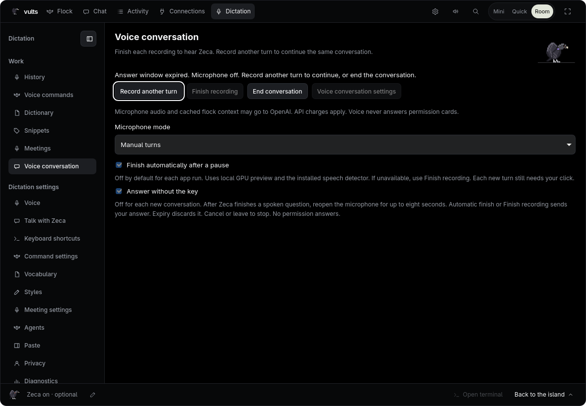

# Voz
<!-- source: ca1904c21195 -->

Três jeitos de usar a voz além do [ditado](dictation.md): comandos que controlam o bando e o
computador, uma conversa falada com o Zeca e respostas faladas à pergunta de um agente. A voz
**nunca responde a um card de permissão**, diga você o que disser.

## Comandos de voz

**Segure Ctrl+Alt+Z**, diga um comando e solte. Os comandos funcionam com o Zeca desligado e são
interpretados neste computador pelo mesmo modelo de fala do ditado; nenhum outro modelo e nenhuma
rede são usados. Português, inglês e espanhol são suportados.

| Para | Diga, por exemplo | Precisa de |
| --- | --- | --- |
| Andar pelo bando | `próxima sessão`, `abrir projeto api`, `quem está esperando?` | — |
| Silenciar um projeto | `silenciar notificações de web`, `fixar docs`, `ocultar api` | — |
| Perguntar sobre ele | `o que api está fazendo?`, `quanto resta do meu plano?` | — |
| Controlar a música | `pause a mídia`, `retome a música`, `próxima faixa`, `volume da mídia 30` | **Comandos de voz de mídia** e Tocando agora |
| Controlar o som do computador | `silenciar o computador`, `volume do computador 40`, `abaixe o volume do computador` | **Comandos de voz do áudio do sistema** |
| Abrir um aplicativo | `abrir Obsidian`, `abrir aplicativo Firefox` | **Comandos de voz de aplicativos** |
| Repetir ou desfazer | `o mesmo para docs`, `desfazer` (em até 90 segundos) | — |

As três opções ficam em **Configurações > Ditado > Configurações dos comandos**, todas desligadas
por padrão.

- **Encadeie** comandos com *e depois*: `pause a mídia e depois abrir aplicativo Obsidian`. Cada passo
  é conferido antes de o primeiro rodar; se um falhar, os outros param e o Vults diz o que foi feito.
- **Diga o alcance** do som: *mídia/música* é o player mostrado no Vults, *computador* é a saída
  padrão, e *silenciar notificações de …* é um projeto. `abaixa o volume` sozinho pergunta qual.
- **Nomes**: projetos, agentes e as substituições do seu dicionário são reconhecidos, inclusive com
  erros. Quando dois servem, o Vults pergunta qual; responda em até 90 segundos. `abrir aplicativo …`
  e `abrir projeto …` tiram a dúvida.
- **Não executados**: um comando negado (`não pause a música`) ou entre aspas, uma frase que ele não
  conhece, qualquer coisa sobre cards (`aprovar`), configurações, merges, fechar aplicativos ou apagar.
- Abrir um aplicativo ou um terminal confirma o pedido, não que a janela esteja pronta.

**Quando não for um comando** avisa na ilha por padrão. Você pode escolher **Enviar ao Zeca como
mensagem**: a frase vai para o Chat atual, quando o Chat está livre e sem rascunho.

**Ditado > Comandos de voz** guarda seus comandos recentes e os resultados, e **O que você pode dizer**
lista cada frase. **Verificar um comando** explica como uma frase digitada seria entendida, sem executá-la.

No Windows, os aplicativos vêm do Menu Iniciar e da Microsoft Store, e o volume de um player exige
escolher uma vez o aplicativo dele em **Configurações dos comandos > Aplicativo de áudio do player**.

## Conversar com o Zeca

Uma conversa falada: você fala, o Zeca responde em voz alta. Sua fala é transcrita localmente; a voz
do Zeca vem de um modelo realtime da OpenAI, então esta parte **envia áudio e contexto à OpenAI** e
custa dinheiro na sua chave de API, separado da assinatura da sua CLI.

1. **Configurações > Ditado > Conversar com o Zeca**: adicione a chave da OpenAI (ela fica no
   chaveiro), escolha o modelo, defina o limite diário em USD, ative e **Salvar**.
2. Abra **Ditado > Conversa por voz**, escolha **Iniciar gravação**, fale e **Finalizar gravação**.
3. O Zeca responde. **Interromper resposta** corta a fala dele; **Gravar outra fala** continua;
   **Encerrar conversa** fecha.

Opções, todas desligadas a cada conversa nova:

- **Finalizar automaticamente após uma pausa**: a fala termina depois de cerca de 1,6 s de silêncio.
- **Responder sem apertar a tecla**: depois que o Zeca te faz uma pergunta, o microfone reabre por oito segundos.
- **Microfone contínuo** (com fones, ou com cancelamento de eco): você pode interromper o Zeca
  falando. O microfone fica aberto até você encerrar a conversa, e a página avisa.

Uma fala tem no máximo 30 segundos; ao chegar no limite, ela é descartada, não enviada. Sair da
página, esconder o Nest ou bloquear a tela encerra a conversa. Se o provedor falhar, **Revisar texto
recuperado** te dá o que você disse como um rascunho editável que não é enviado a lugar nenhum.

## Responder à pergunta de um agente

Um agente pode te fazer uma pergunta em texto e esperar a resposta no Quick ou no Nest. Digite, ou
segure a tecla de ditado mostrada na pergunta e fale; as palavras entram no rascunho para você
revisar. Só **Enviar resposta** (ou Enter no editor) envia. A pergunta expira em dois minutos, e um
card de permissão sempre vem primeiro.

O Claude Code que o Vults inicia pode perguntar sozinho. Para o seu próprio Claude Code ou Codex:

1. **Configurações > Ditado > Agentes**, ligue **Agentes podem pedir uma resposta falada**.
2. **Revisar configuração…**, leia o diff e **Gravar o arquivo** (um backup datado é mantido).
3. Reinicie o agente e peça que ele use `ask_user`.

**Revisar remoção…** tira do mesmo jeito.
